# Agent Office

สำนักงาน AI สไตล์เกม RPG สำหรับจัดทีม Agent มอบหมายงาน ตรวจผลงาน และเก็บความรู้ร่วมกัน พัฒนาด้วย **Rust + React + TypeScript** และรันผ่าน **Docker Compose**

> รุ่นสำหรับใช้งานบนเครื่องหรือ Docker host ที่คุณควบคุม เว็บเปิดเฉพาะ `localhost` โดยค่าเริ่มต้น การติดตั้งใหม่ไม่มีข้อมูลตัวอย่างและไม่เชื่อมบัญชี AI ให้อัตโนมัติ

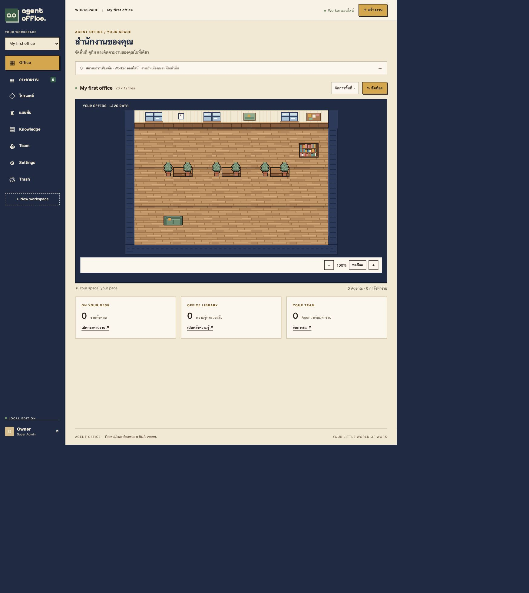

## ทำอะไรได้บ้าง

| ส่วนงาน | ความสามารถ |
| --- | --- |
| **Office** | สร้าง Workspace จัดห้อง วาง/ย้าย/หมุน/ทำสำเนาเฟอร์นิเจอร์ ย้อนกลับ/ทำซ้ำ ซูม และดูตัวละครตามสถานะงาน |
| **กระดานงาน** | กรองสถานะ เครื่องมือ และ Agent เรียงงานตามวันที่หรือความสำคัญ สลับกระดาน/รายการ และติดตามงานที่มีปัญหา |
| **โปรเจกต์** | จัดกลุ่มงาน ระบุความสำคัญและเกณฑ์ตรวจรับ |
| **แผนทีม** | ให้ Manager เสนอแผน หรือจัดขั้นตอนเอง ตรวจแผนก่อนอนุมัติ และส่งต่อผลงานหลังตรวจรับ |
| **Knowledge** | เก็บความรู้พร้อมแหล่งที่มา ตรวจสอบก่อนให้ AI ใช้ และค้นหาด้วยความหมายข้ามภาษาหรือ full-text |
| **Skills** | สร้าง/แก้ไข/เก็บถาวร/กู้คืน Skill พร้อมประวัติเวอร์ชัน และมอบหมายแบบติดตามล่าสุดหรือตรึงเวอร์ชัน |
| **โครงสร้างทีม** | Org Chart ตามสายรายงาน ฝ่าย หน้าที่ ขอบเขตตัดสินใจ และ Skill ของแต่ละ Agent |
| **Workflow** | แม่แบบ 1–8 ขั้น งานคู่ขนาน/รวมผล Skill ที่จำเป็น ไฟล์บังคับ และผู้ตรวจรับ สร้างร่างแผนก่อนอนุมัติ |
| **Team** | เพิ่ม Agent กำหนดบทบาท คำสั่ง ผู้ให้บริการ ตำแหน่ง และตัวละคร 12 แบบ |
| **Monitoring** | CPU/RAM/พื้นที่คงเหลือ ตั้งเกณฑ์แจ้งเตือน และกระดิ่งขวาบนสำหรับ Super Admin |
| **Settings** | เชื่อมบัญชี AI ผ่านเว็บ จัดการโปรไฟล์ สมาชิก สิทธิ์ และ Worker ส่วนตัว |
| **Trash** | กู้คืน Workspace งาน Agent และความรู้ที่ย้ายไปถังขยะ |

ข้อมูลอยู่ใน PostgreSQL ส่วนไฟล์ผลงานอยู่ใน Docker volume จึงต้องสำรองทั้งสองส่วนเมื่อย้ายเครื่อง Redis ใช้สำหรับข้อมูลชั่วคราว ไม่ใช่แหล่งเก็บความรู้หลัก

## เริ่มติดตั้ง

### สิ่งที่ต้องมี

- Git และ Docker พร้อม Docker Compose v2 ที่รองรับ `!reset` / `!override`
- Python 3 สำหรับสร้างค่าเริ่มต้นและใช้สคริปต์สำรอง/กู้คืน
- `shasum` สำหรับตรวจ checksum ของ backup
- บัญชี AI ของคุณเองที่ใช้งาน CLI ของผู้ให้บริการได้ หากต้องการรันงานจริง

ไม่ต้องติดตั้ง Rust, Node.js หรือ CLI ของ AI ลงบนเครื่องเพื่อรันแอป ทุกบริการหลัก build และทำงานใน Docker

```sh
git clone https://github.com/Sin1apachai/gangagent.git
cd gangagent
./setup.sh
docker compose up --build -d
```

เปิด **http://localhost:8088** แล้วเข้าสู่ระบบด้วย `OWNER_EMAIL` และ `OWNER_PASSWORD` ที่สร้างไว้ใน `.env` บัญชีแรกเป็น Super Admin

- `setup.sh` สุ่มรหัสผ่านให้ ไม่เขียนทับ `.env` เดิม
- เก็บ `.env` เป็นความลับ อย่า commit หรือส่งให้ผู้อื่น
- การแก้ `OWNER_PASSWORD` ใน `.env` หลังติดตั้งแล้วไม่เปลี่ยนรหัสผ่านของบัญชีเดิม ให้เปลี่ยนจาก **Settings → โปรไฟล์**
- เปลี่ยนพอร์ตได้ด้วย `OFFICE_PORT` ใน `.env`

ตรวจหรือหยุดบริการ:

```sh
docker compose ps
docker compose logs --tail=100 app worker
docker compose down
```

`docker compose down` เก็บ volumes ไว้ ส่วน `down --volumes` ลบข้อมูลถาวร จึงไม่ควรใช้กับระบบที่ต้องการเก็บข้อมูล

## คู่มือใช้งานครั้งแรก

### 1. สร้างพื้นที่และจัดห้อง

กด **New workspace** ตั้งชื่อ แล้วเปิด **Office → จัดห้อง** เลือกเฟอร์นิเจอร์และคลิกวาง ลากเพื่อย้าย หมุนหรือทำสำเนาได้ จากนั้นกด **บันทึกห้อง**

- ปุ่ม **พอดีจอ** คืนแผนที่ให้พอดีกับพื้นที่แสดงผล
- ใช้ลูกศรและ Enter เพื่อวางด้วยคีย์บอร์ด, R หมุน, Ctrl/⌘ Z ย้อนกลับ
- **จัดการพื้นที่** ใช้แก้ชื่อหรือย้าย Workspace ไปถังขยะ
- ตัวละครแสดงจาก Agent ที่คุณเพิ่มเอง ไม่มีตัวละครหรือผลงานที่สร้างแทรกให้ในการติดตั้งใหม่

### 2. เชื่อมบัญชี AI

เปิด **Settings → การเชื่อมต่อ AI** แล้วกดปุ่มเชื่อมบัญชีของผู้ให้บริการ ทำขั้นตอนบนหน้าทางการที่เปิดให้

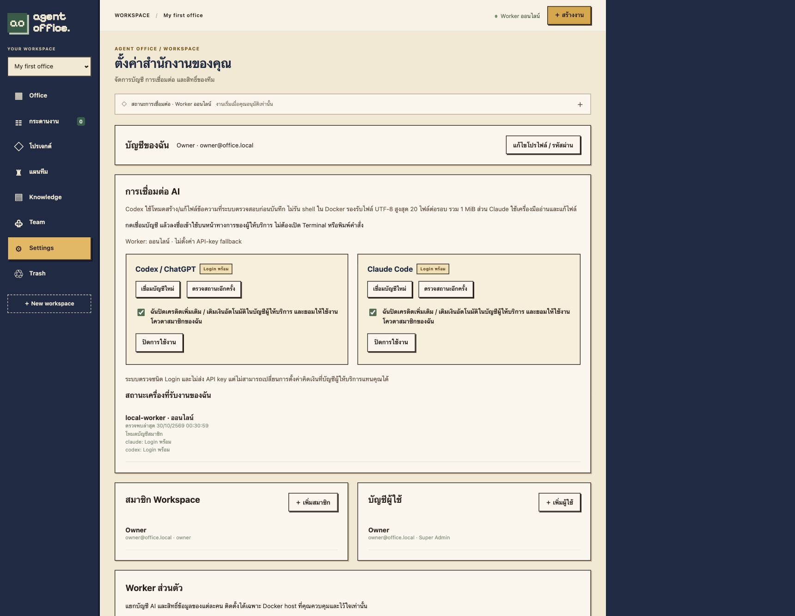

- **Codex:** เปิดหน้ายืนยันทางการและใส่รหัสอุปกรณ์ หากบัญชีแจ้งว่าปิด device-code login ให้เปิดตามคำแนะนำของผู้ให้บริการก่อน
- **Claude:** ยืนยันบนหน้าทางการ แล้วนำรหัสยืนยันครั้งเดียวกลับมาใส่ในฟอร์มที่ระบบแสดง ไม่ใช้รหัสผ่านหรือ API key
- รอจนสถานะ **Login พร้อม** แล้วตรวจการตั้งค่าเครดิตเพิ่มเติมของบัญชี ติ๊กยืนยันและเปิดใช้งานผู้ให้บริการที่ต้องการ
- หาก token ถูกเพิกถอนหรือหมดอายุ ใช้ **เชื่อมบัญชีใหม่**

การ Login ไม่ได้เริ่มงาน และ Worker อาจรอให้งานปัจจุบันจบก่อนดำเนินการ Login ข้อมูลบัญชี AI อยู่ใน credential volume ของ Worker แยกจากเว็บ ไม่ดึงบัญชีที่ Login บนเครื่องมาให้อัตโนมัติ

ระบบไม่มี API-key fallback หรือการซื้อเครดิตให้อัตโนมัติ แต่ไม่สามารถเปลี่ยนการตั้งค่า paid overage ของผู้ให้บริการแทนคุณได้ จึงไม่รับประกันค่าใช้จ่ายเป็นศูนย์หากบัญชีเปิดเครดิตเพิ่มเติมอยู่

### 3. เพิ่ม Agent และสร้างงาน

1. เปิด **Team → เพิ่ม Agent** ตั้งชื่อ บทบาท คำสั่ง และเลือก Codex หรือ Claude
2. กด **สร้างงาน** ใส่รายละเอียด เลือก Agent ที่ใช้เครื่องมือตรงกัน และระบุเกณฑ์ตรวจรับ
3. บันทึกงานก่อน ตรวจข้อมูล แล้วกด **เริ่มงาน** เมื่อต้องการใช้โควตา AI
4. เปิดงานเพื่อติดตามผล ประวัติ และไฟล์ผลงาน
5. ตรวจรับเป็นเสร็จ หรือส่งกลับพร้อม feedback แล้วกดเริ่มรอบแก้ไข

แนบไฟล์อ้างอิงได้สูงสุด **5 ไฟล์ ไฟล์ละ 1 MiB** รอบแก้ไขจะได้รับผลงานเดิมที่ลงทะเบียนไว้ โดยประวัติรอบก่อนยังอยู่

### 4. ใช้กระดานติดตามงาน

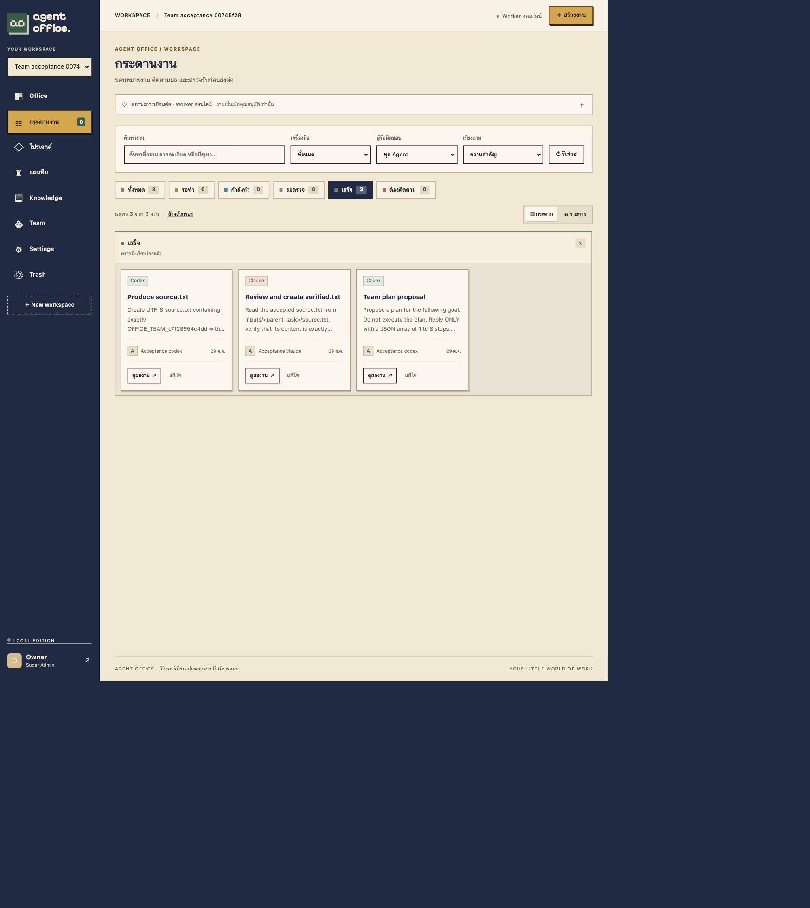

- เลือก **ทั้งหมด / รอทำ / กำลังทำ / รอตรวจ / เสร็จ / ต้องติดตาม** เพื่อจำกัดงานที่แสดง
- กรอง **เครื่องมือ** และ **ผู้รับผิดชอบ** หรือค้นหาจากชื่องาน รายละเอียด และปัญหา
- เรียงตามงานใหม่ งานเก่า หรือความสำคัญ
- สลับ **กระดาน / รายการ** ตามวิธีอ่านที่ถนัด
- กดชื่อการ์ดหรือปุ่ม **เปิดงาน / ตรวจผลงาน / ดูผลงาน** เพื่ออ่านรายละเอียดเต็ม
- ใช้ **ล้างตัวกรอง** หากต้องการกลับมาดูงานทั้งหมด

| สถานะ | สิ่งที่ควรทำ |
| --- | --- |
| รอทำ | ตรวจรายละเอียดแล้วกดเริ่มงาน งานที่ส่งคำขอแล้วอาจรอ Worker หรืองานก่อนหน้า |
| กำลังทำ | ติดตามงานหรือขอยกเลิกก่อนแก้ไข |
| รอตรวจ | อ่านผลงาน ดาวน์โหลดไฟล์ แล้วตรวจรับหรือส่งแก้ |
| เสร็จ | งานที่ผ่านการตรวจรับแล้ว |
| ต้องติดตาม | เปิดดูสาเหตุ เช่น รอ Login รอโควตา งานล้มเหลว สะดุด หรือถูกยกเลิก |

<details>
<summary>ดูหน้ากระดานบนจอแคบ</summary>

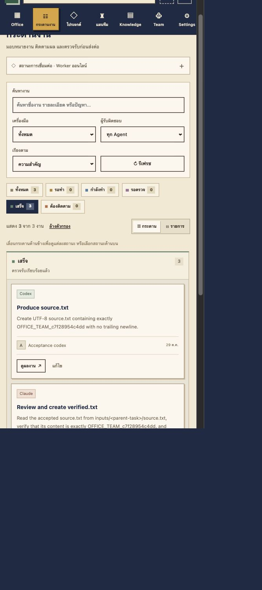

เลื่อนเฉพาะกระดานด้านข้าง หรือเลือกสถานะเดียวเพื่อให้การ์ดอ่านได้เต็มพื้นที่ มุมมองรายการใช้การเลื่อนแนวตั้ง

</details>

### 5. จัดแผนทำงานร่วมกัน

เปิด **แผนทีม** ใส่เป้าหมาย แล้วเลือก Manager ให้เสนอแผน หรือจัดแผนเองได้สูงสุด **8 ขั้นตอน**

1. หากเลือก Manager ระบบสร้างงานเสนอแผนที่ยังไม่เริ่ม ให้กดเริ่มงานนั้นเอง
2. ตรวจผลงานของ Manager แล้วนำข้อเสนอเข้าร่างแผน
3. แก้ผู้รับผิดชอบ รายละเอียด และความสัมพันธ์ของขั้นตอนก่อนอนุมัติ
4. ยืนยันการใช้โควตาแล้วกด **อนุมัติและเริ่มทีม**
5. ตรวจรับแต่ละงาน งานที่พึ่งพากันจะรอให้งานก่อนหน้าผ่านการตรวจรับ แล้วจึงรับข้อความและไฟล์ผลงานไปทำต่อ

### 6. เก็บและค้นหาความรู้

เพิ่มข้อมูลใน **Knowledge** พร้อมแหล่งที่มา และทำเครื่องหมายตรวจสอบเมื่อพร้อมให้ AI ใช้ ค้นหาเฉพาะข้อมูลที่ตรวจสอบแล้วได้จากฟอร์มค้นหาพร้อมแหล่งอ้างอิง

หากต้องการค้นตามความหมายข้ามภาษา ให้เปิดบริการในเครื่องเพิ่มเติม:

```sh
docker compose --profile semantic up --build -d
```

โมเดลดาวน์โหลดในขั้น build และรันบน CPU ภายใน Docker หลัง build แล้วทำงานแบบ offline หากบริการนี้ไม่พร้อม ระบบใช้ PostgreSQL full-text และแจ้งวิธีค้นหาที่ใช้

Super Admin ให้หรือเพิกถอนสิทธิ์ **Super Intelligence** แก่สมาชิกจาก Settings ได้ สิทธิ์นี้ค้นหาความรู้ที่ตรวจสอบแล้วข้าม Workspace พร้อมแสดงแหล่งที่มาและบันทึกประวัติ ไม่ได้มอบรหัสฐานข้อมูลหรืออนุญาต SQL อิสระให้โมเดล

## ผู้ใช้หลายคนและ Worker ส่วนตัว

Super Admin เพิ่มบัญชีผู้ใช้ใน **Settings → บัญชีผู้ใช้** จากนั้นเจ้าของ Workspace เชิญสมาชิกและกำหนด Owner / Member / Viewer ได้ สมาชิกใช้บัญชีเว็บและบัญชี AI ของตนเอง ไม่แชร์ subscription ของเจ้าของโดยอัตโนมัติ

สำหรับผู้ที่ต้องรันงานด้วยบัญชี AI แยก:

1. Login ด้วยบัญชีของผู้ใช้นั้น เปิด **Settings → Worker ส่วนตัว**
2. ตั้งชื่อและดาวน์โหลดไฟล์ติดตั้ง เก็บไฟล์เป็นความลับ เพราะมี credential ส่วนตัว
3. ให้ผู้ดูแล Docker host ที่ไว้ใจติดตั้งไฟล์บน host เดียวกับระบบหลัก:

   ```sh
   docker compose -f office-worker-<id>.compose.json up -d
   ```

4. กลับมาเชื่อมบัญชี AI จากเว็บของผู้ใช้นั้น
5. ใช้ **เพิกถอนสิทธิ์** เพื่อยกเลิกการเชื่อมต่อของ Worker

Worker แยก PostgreSQL role/RLS, Redis ACL, credential volumes และ UID ของโมเดล ขอบเขตนี้ยังถือว่าผู้ดูแล Docker และตัว coordinator เป็นผู้ที่ไว้ใจ ไม่ใช่ระบบสำหรับให้ผู้ใช้ที่ไม่ไว้ใจควบคุม container เอง

## ความสามารถและข้อจำกัดของ AI

| ผู้ให้บริการ | โหมดในระบบนี้ |
| --- | --- |
| Codex | ส่งผลลัพธ์ตาม JSON schema แล้วระบบตรวจ path/ขนาดก่อนบันทึกไฟล์ UTF-8 ไม่รัน shell หรือทดสอบโปรแกรมที่สร้าง |
| Claude | เครื่องมืออ่าน/เขียน/แก้ไฟล์ภายในขอบเขตที่กำหนด ไม่มี shell หรือ MCP ภายนอก |

Codex รองรับสูงสุด **20 ไฟล์ต่อรอบ, 256 KiB ต่อไฟล์, รวม 1 MiB** ไฟล์ข้อความอ้างอิงใช้บริบทที่จำกัด ไฟล์ binary หรือไฟล์ใหญ่จะไม่ถูกแนบเป็นข้อความ โค้ดที่โมเดลสร้างยังต้องนำไปตรวจและทดสอบก่อนใช้งาน

งานมีเวลาทำงานสูงสุด 15 นาทีและจำกัดการเริ่มทำจริง 3 ครั้ง เมื่อพบ quota หรือ lease ขาด ระบบไม่ลองทำซ้ำเอง ต้องตรวจสาเหตุก่อนสั่งใหม่ ไม่มีการเปิด privileged container หรือข้าม sandbox ให้อัตโนมัติ

## สำรองและย้ายเครื่อง

วิธีใช้งานปกติสำหรับ **Super Admin**: ไปที่ **Settings → สำรองข้อมูล** ยืนยันว่าไฟล์รวมข้อมูลทุก Workspace แล้วกด **สำรองข้อมูลตอนนี้** ดูสถานะและกด **ดาวน์โหลดไฟล์สำรอง** เมื่อพร้อมได้ทันที ไม่ต้องใช้คำสั่ง มีประวัติ ยกเลิกระหว่างทำ และลบไฟล์เก่าโดยยืนยันก่อนลบ

ระบบพักการเริ่มงาน AI ใหม่ชั่วคราวและรอให้งานเดิมจบ ใช้ snapshot เดียวกันสำหรับฐานข้อมูลและรายการไฟล์ เก็บ ACL ของไฟล์ผลงาน พร้อม SHA-256 ไม่รวม session, รหัสเชื่อมบัญชี AI, credential volumes, binding ของ Worker เดิม หรือ Redis cache ไฟล์มีข้อมูลบัญชีผู้ใช้และทุก Workspace จึงต้องเก็บเป็นความลับ

ไฟล์จากหน้าเว็บเป็น `.tar` รวม `office.dump`, `artifacts.tar.gz`, `manifest.json`, `SHA256SUMS` และ `post-restore.sql` เก็บได้สูงสุด 20 ชุด ชุดละไม่เกิน 2 GB เก็บใน volume `backup-data` แยกจากผลงาน เว็บอ่านได้อย่างเดียว บริการสำรองไม่มี Docker socket และไม่มี volume บัญชี AI หากบริการขัดข้อง หน้าเว็บมีปุ่มกู้สถานะพักงานเมื่อบริการไม่ทำงานแล้ว

Settings แยกเป็นแท็บ **เชื่อมต่อ AI / บัญชีของฉัน / สมาชิก Workspace / สำรองข้อมูล / ผู้ใช้ระบบ** ตามสิทธิ์ เพื่อลดความยาวหน้าจอ

[ผลทดสอบสำรองและกู้คืนผ่านเว็บ](docs/web-backup-report.md)

สำหรับผู้ดูแลที่ต้องการใช้วิธีเดิมเพิ่มเติม:

```sh
./backup.sh
```

ผลลัพธ์จากสคริปต์เดิมอยู่ใน `backups/office-<เวลา>/` ประกอบด้วย PostgreSQL dump ไฟล์ผลงานที่ลงทะเบียนพร้อม ACL และ checksum สคริปต์พักการรับงานใหม่และรอให้งานที่กำลังทำจบก่อนสำรอง

Backup เป็นข้อมูลส่วนตัว ไม่รวม `.env` หรือ credential volumes ของ AI ให้คัดลอก backup ไปที่เก็บปลอดภัยอีกแห่งด้วยตนเอง

สำหรับไฟล์เว็บ ให้แตก `.tar` ในโฟลเดอร์ส่วนตัวก่อนใช้เครื่องมือกู้คืนด้านล่าง (การสำรองและดาวน์โหลดผ่านหน้าเว็บไม่ต้องใช้คำสั่ง)

ตัวอย่างทดสอบกู้คืนเข้า project แยก โดยใช้ไฟล์ `.env` ที่เตรียมไว้บนเครื่องปลายทาง:

```sh
docker compose build app worker backup
OFFICE_PORT=8089 docker compose -p office-restore up -d postgres redis
OFFICE_PORT=8089 RESTORE_PROJECT=office-restore CONFIRM_RESTORE=office-restore \
  ./restore.sh backups/office-<เวลา>
```

เปิด http://localhost:8089 ตรวจฐานข้อมูลและดาวน์โหลดผลงานก่อนสลับมาใช้งานจริง สคริปต์ไม่ยอมกู้ทับ project หลัก `agent-office` และจะเพิกถอน binding ของ Worker ส่วนตัวเดิม ต้องสร้าง Worker และเชื่อมบัญชี AI ใหม่หลังย้าย

หากเปลี่ยนชื่อ Compose project ต้องกำหนด `OFFICE_DOCKER_NETWORK` และ `OFFICE_RUNS_VOLUME` ใน environment ของบริการ `app` ให้ตรงกับ network/volume จริง ก่อนออกไฟล์ Worker ส่วนตัว ดูรายละเอียดใน [สถาปัตยกรรม](docs/architecture.md)

## เลือกตัวละครและใช้ฟอร์มแบบแท็บ

เปิด **Team → เพิ่ม Agent / แก้ไข → ตัวละคร** เลือกรูปลักษณ์พื้นฐาน 3 แบบและเครื่องประดับ 4 แบบ รวม 12 ตัวเลือก แล้วกดบันทึก รูปลักษณ์เดียวกันจะแสดงใน Office, Team และ Org Chart และคงเดิมเมื่อโหลดใหม่

ฟอร์ม Agent แบ่งเป็น **ข้อมูลทั่วไป / ตัวละคร / คำสั่งและตำแหน่ง**; Skill แบ่ง **ข้อมูลทั่วไป / วิธีทำงาน / การส่งมอบ**; Workflow แบ่ง **ข้อมูลทั่วไป / ขั้นตอน** แล้วเลือกแก้ทีละขั้นผ่านแท็บย่อย ข้อมูลที่กรอกคงอยู่เมื่อสลับแท็บ ใช้ลูกศรซ้าย/ขวา, Home/End สลับแท็บด้วยคีย์บอร์ดได้ รายละเอียดงานแยก **โจทย์และ Skill / ผลงานและตรวจรับ / ประวัติ**

ปุ่มหลักเปลี่ยนเป็นสีเขียวเข้มเมื่อ hover พร้อมตัวอักษรสีอ่อน และมีเส้น focus สำหรับคีย์บอร์ด

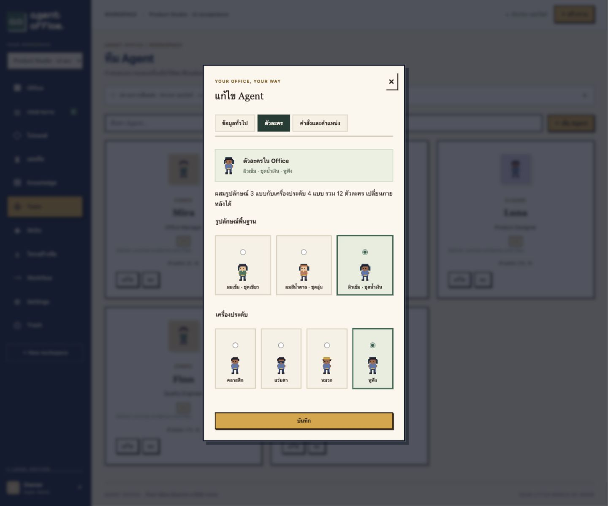

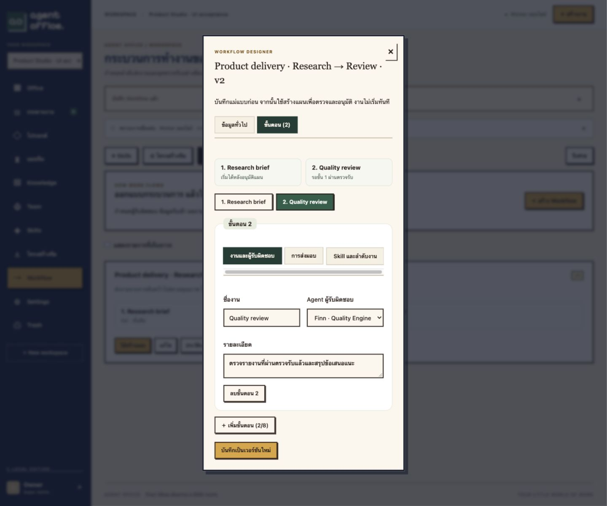

## Skills, โครงสร้างทีม และ Workflow

1. เปิด **Skills → สร้าง Skill** ระบุวิธีทำงาน ข้อมูลรับเข้า ผลลัพธ์ และเกณฑ์ตรวจรับ การแก้ไขบันทึกเป็นเวอร์ชันใหม่ ส่วนประวัติเดิมแก้ทับไม่ได้
2. เพิ่ม Agent ใน **Team** แล้วเปิด **โครงสร้างทีม** คลิกสมาชิก ระบุฝ่าย หัวหน้า หน้าที่ และขอบเขตตัดสินใจ เจ้าของ Workspace หรือ Super Admin เป็นผู้จัดโครงสร้างและมอบหมาย Skill
3. เลือก **ติดตามล่าสุด** เพื่อให้งานใหม่ใช้ Skill ล่าสุด หรือ **ตรึงเวอร์ชัน** เพื่อใช้เวอร์ชันที่เลือก ระบบปฏิเสธสายรายงานวนลูปและการเชื่อมข้อมูลข้าม Workspace
4. เปิด **Workflow → สร้าง Workflow** เพิ่ม 1–8 ขั้น เลือก Agent, Skill ที่จำเป็น, ข้อมูลรับเข้า, ผลงาน, เกณฑ์ตรวจรับ, ชื่อไฟล์บังคับ และผู้ตรวจรับ เลือกงานก่อนหน้าที่ต้องรอได้หลายขั้น จึงแยกงานคู่ขนานและรวมผลกลับมาได้
5. กด **ใช้สร้างแผน** ระบุเป้าหมาย แล้วตรวจแผนใน **แผนทีม** การสร้างแม่แบบหรือร่างไม่เรียก AI ต้องอนุมัติแผนก่อน ระบบจึงสร้างงานให้ Worker
6. ตรวจผลงานและไฟล์ในรายละเอียดงาน งานถัดไปเริ่มเมื่อทุกงานที่ต้องรอผ่านตรวจรับ หากส่งกลับแก้ไขต้องกดเริ่มอีกครั้ง หากไม่มีไฟล์บังคับ งานจะล้มเหลวและไม่ปล่อยงานถัดไป

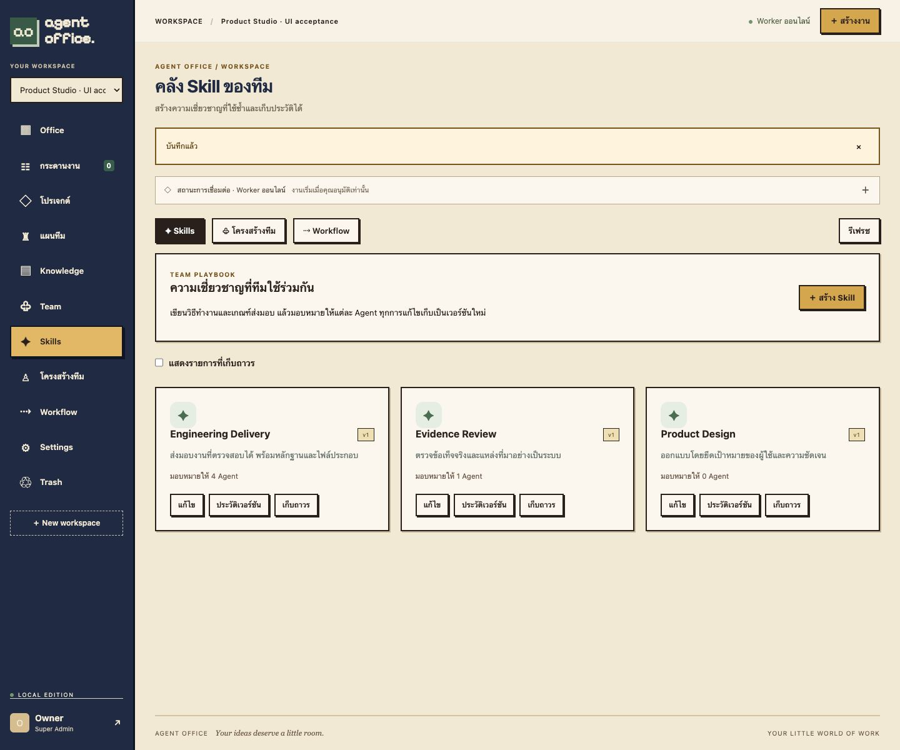

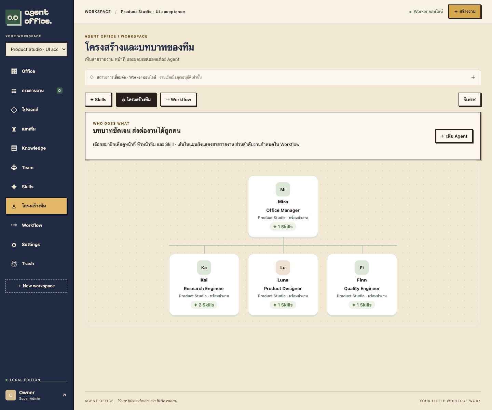

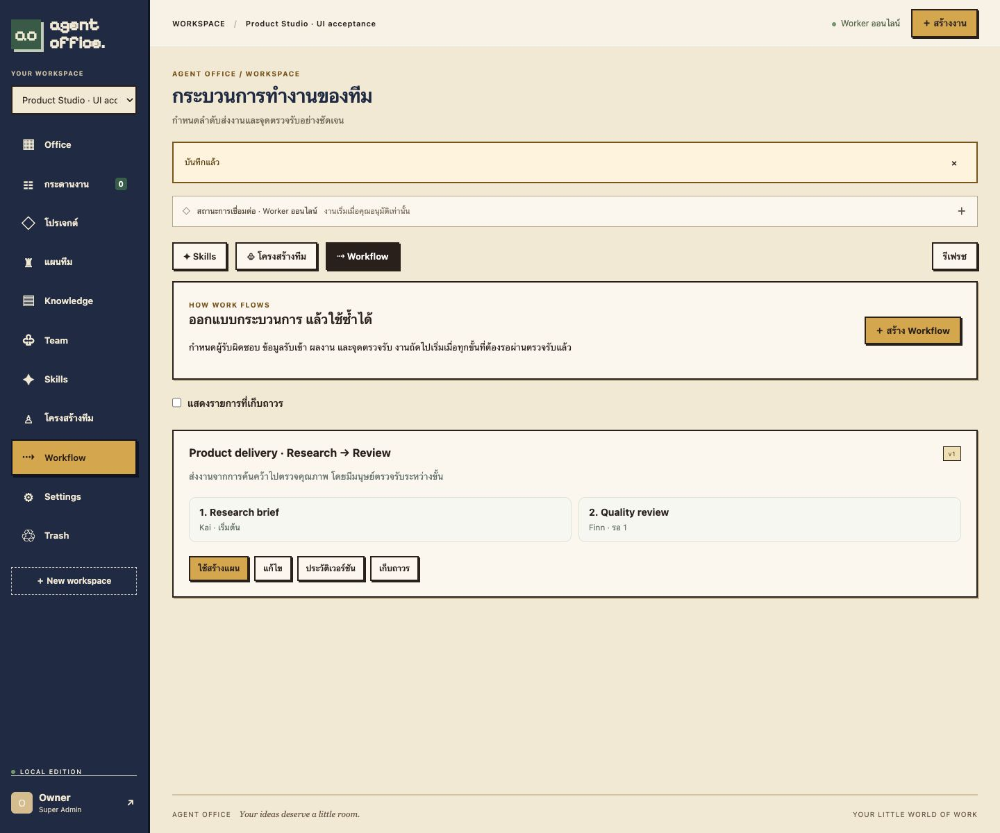

**การเก็บเวอร์ชัน:** งานทั่วไปเก็บสำเนาบทบาทและ Skill เมื่อกดเริ่มครั้งแรก งานจากแผนเก็บสำเนาเมื่ออนุมัติแผน การส่งกลับแก้ไขใช้สำเนาเดิม การแก้ Skill/Agent/แม่แบบภายหลังไม่เปลี่ยนคำสั่งของงานนั้น Skill ที่เก็บถาวรจะใช้เริ่มงานใหม่ไม่ได้จนกู้คืนหรือยกเลิกการมอบหมาย ส่วนงานที่มีสำเนาแล้วทำต่อได้

**สิทธิ์ตรวจรับ:** Workflow เลือกผู้ตรวจรับเป็นสมาชิกที่เขียนงานได้ หากไม่เลือกจะใช้ผู้อนุมัติแผน เจ้าของ Workspace และ Super Admin ตรวจรับแทนหรือเปลี่ยนผู้ตรวจรับได้และมี audit งานทั่วไปที่ไม่กำหนดผู้ตรวจรับใช้สิทธิ์เขียนตามปกติ การเป็นหัวหน้าใน Org Chart หรือมี Skill ไม่เพิ่มสิทธิ์ฐานข้อมูล เครื่องมือ หรือสิทธิ์ตรวจรับ

แม่แบบและ Skill เก็บถาวร/กู้คืนได้จากหน้าเมนูของตัวเอง ประวัติเวอร์ชันเก็บใน PostgreSQL และรวมอยู่ใน backup การทำงานยังอยู่ภายใต้โควตาสมาชิกและข้อจำกัดเครื่องมือเดิม ไม่ได้เพิ่ม API เสียเงิน

## โครงสร้างโค้ด

```text
server/
  migrations/           # ฐานข้อมูลและสิทธิ์
  src/
    main.rs             # จุดเริ่มต้น
    lib.rs              # ประกอบแอปและ routes
    domain/             # กฎแผนงาน
    application/        # use cases
    infrastructure/     # persistence และ semantic retrieval
    presentation/http/  # HTTP handlers แยกตาม feature
    organization/       # Skill revisions, roles, workflow templates, execution snapshots
    worker.rs           # วงจรงานและการเรียก CLI
    codex_files.rs      # ตรวจและบันทึก structured files
web/src/
  application/          # controller และ state
  features/             # office, tasks, knowledge, team, settings ฯลฯ
  shared/               # types, API client, fields
semantic/               # บริการ embedding ภายในเครื่อง
compose.yaml            # บริการใช้งานจริง
compose.test.yaml       # ระบบทดสอบแยก
```

Rust ใช้ structs, `impl` และ composition เพื่อห่อกฎและบริการ React ใช้ function components ร่วมกับ service/engine classes เช่น `OfficeApi` และ `LayoutEngine` ไม่บังคับใช้ inheritance กับทุกส่วน

## การทดสอบ

```sh
./test.sh
```

รัน build และทดสอบใน Compose project แยก ใช้ฐานข้อมูล `office_test`, Worker จำลองสองตัว และ volumes ชั่วคราว ไม่ใช้ credential volumes ของระบบจริง ผลตรวจล่าสุด: **52 HTTP integration tests, 14 Rust unit tests และ 3 character rendering tests ผ่าน**

Docker build รัน TypeScript build และ `npm test` สำหรับตัวละครให้อัตโนมัติ

Fixture tests ไม่เรียก AI จริง ส่วน live acceptance เคยทดสอบแยกด้วยบัญชีที่เชื่อมและอนุญาตแล้ว ครอบคลุมการสร้างไฟล์ ส่งแก้ ดาวน์โหลด ตรวจรับ และส่งต่อไฟล์ Codex → Claude รอบล่าสุดยังทดสอบ Skill จริงและ Workflow ส่งต่อไฟล์ Codex → Claude สำเร็จ ดู [รายงาน Skill/Workflow](docs/skills-workflow-test-report.md), [รายงานทดสอบ](docs/phase2-test-report.md) และ [ผลตรวจ UI กระดาน](docs/task-board-check.md)

สคริปต์ `tests/probe_live.py` และ `tests/probe_live_team.py` ต้อง opt in ชัดเจนและใช้โควตาบัญชีจริง ไม่รวมอยู่ในชุดทดสอบปกติ

## เอกสารเพิ่มเติม

- [สถาปัตยกรรม สิทธิ์ และขอบเขตความปลอดภัย](docs/architecture.md)
- [รายงานการทดสอบระบบ](docs/phase2-test-report.md)
- [ผลตรวจการจัดระเบียบ UI](docs/ui-refinement-check.md)
- [ผลตรวจหน้ากระดานงาน](docs/task-board-check.md)
- [ที่มาของภาพและฟอนต์](docs/design/README.md)

ภาพในคู่มือนี้เป็นภาพจากระบบที่ใช้งาน/ทดสอบแล้ว งานใน Workspace ชื่อ Acceptance เป็นงานตรวจระบบ ไม่ใช่ข้อมูลที่จะถูกสร้างให้เมื่อติดตั้งใหม่ ภาพ Settings ไม่แสดงรหัสผ่าน token หรือรหัสยืนยัน

### Run usage and the first context optimization

Open a task → **การใช้ Token**. Each run records provider-reported input/output,
cache counters (when available), provider elapsed time, and UTF-8 prompt bytes.
Missing counters stay unavailable; fixture workers never invent token usage.
Historical runs have no retroactive statistics. Codex cached input is included in
its input count; Claude uncached input and cache read/write are separate. Do not
add Codex cache reads to its input again, compare providers as if their counters
had identical meanings, or convert these counters into a Pro quota percentage.
Prompt bytes cover the application's submitted text, not hidden provider prompts,
subsequent tool reads, or the whole provider context.

The initial optimization serializes frozen role/Skill JSON compactly, preserving
all values including whitespace inside instruction strings. This removes formatting
only; selective knowledge retrieval and generated handoff summaries are future
work. `POST /api/workspaces/{wid}/tasks` accepts `context_format: "pretty"` for an
explicit baseline or `"compact"` (default). The choice is fixed at creation.

For an opt-in live pilot, run `tests/probe_usage.py` with `BASE_URL`, owner login
variables, and `OFFICE_TEST_TARGET=live_owner` in a trusted environment. It makes
four subscription CLI calls, one baseline and one compact run per provider, checks
downloaded `answer.json` by exact JSON equality, and archives its temporary
workspace. Never print or commit login variables. The report is written to
`/private/tmp/office-usage-pilot.json`. This small pilot is descriptive, not evidence
of a general percentage saving. Compare input/output, cache and quality separately;
repeat with representative multi-step work before broad conclusions.

Measured live results and limitations: [Context usage pilot](docs/context-usage-report.md).

### Focused Knowledge and accepted handoffs (opt-in)

New task → **ข้อมูลประกอบงาน → เลือก Knowledge ตามงาน (ทดลอง)**, or enable the
focused option when approving a draft team plan. The default stays full bounded
context. Focused mode chooses whole verified records by lexical relevance and
preserves every role/Skill/safety instruction and acceptance contract. Critical
records can be pinned with `[[knowledge:UUID]]` (copy from the Knowledge card).
Missing/unauthorized or oversized required references fail before calling a model.

Producing tasks can write `handoff.json` with `summary`, `decisions` array,
`open_questions` array and `artifacts` paths. Accepted dependency briefs are used
only after validating source run and registered artifact references; invalid
briefs fall back to the normal result. Review summaries for missing facts.

Task → **การใช้ Token** shows retrieval sources and counters. Team plan →
**การใช้ Token ทั้งแผน** aggregates every recorded attempt/revision/planner run
with provider-specific cache semantics and missing-data coverage. To use full
context after insufficient evidence, send the task back, switch mode on its Token
tab while it is not scheduled, and explicitly start again.

[Live workflow results and limitations](docs/focused-context-report.md): this
controlled noisy-library pilot observed **66.86% less reported input**, with six
exact artifact checks passing, but **28.53% longer summed provider time**. This is
one paired workflow, not a general saving guarantee or Pro quota measurement.
No paid embeddings/API service was added. Lexical retrieval has limited synonym
and Thai segmentation support; pin essential sources and retain human review.

## ดูทรัพยากรและตั้งการแจ้งเตือน

เข้าสู่ระบบด้วย Super Admin แล้วเปิด **Settings → ทรัพยากร** เพื่อดูค่าปัจจุบันและทรัพยากรที่ใช้ได้อีก อัปเดตทุก 5 วินาที เลือกเปิดเกณฑ์แต่ละรายการ ระบุเปอร์เซ็นต์ที่ใช้ไป ระยะเวลาที่ต้องเกินต่อเนื่อง และระยะเผื่อกลับปกติ แล้วกด **บันทึกเกณฑ์แจ้งเตือน**

กระดิ่งขวาบนแสดงรายการยังไม่อ่านและสถานะเตือน พร้อมข้อความเมื่อเกิดเหตุหรือกลับปกติ กดอ่านแล้วไม่ได้ทำให้ปัญหาทรัพยากรหายไป เกณฑ์และประวัติอยู่ใน PostgreSQL จึงยังอยู่หลังรีสตาร์ต หากข้อมูลขาดหายระบบจะไม่แสดงว่ากลับปกติโดยไม่มีหลักฐาน

ค่าที่แสดงเป็นของ **Docker Linux VM และคอนเทนเนอร์** ซึ่งอาจใช้ร่วมกับแอปอื่น ไม่ใช่ทรัพยากรทั้งเครื่อง macOS ระบบนี้ไม่เรียก AI ไม่ใช้ Docker socket และไม่ต้องสมัครบริการเพิ่ม ค่าเริ่มต้นเตือน CPU/RAM VM และ Redis ที่ 85%, พื้นที่ผลงาน/Worker RAM ที่ 90%, เกินต่อเนื่อง 15 วินาที และเผื่อกลับปกติ 5 จุดเปอร์เซ็นต์

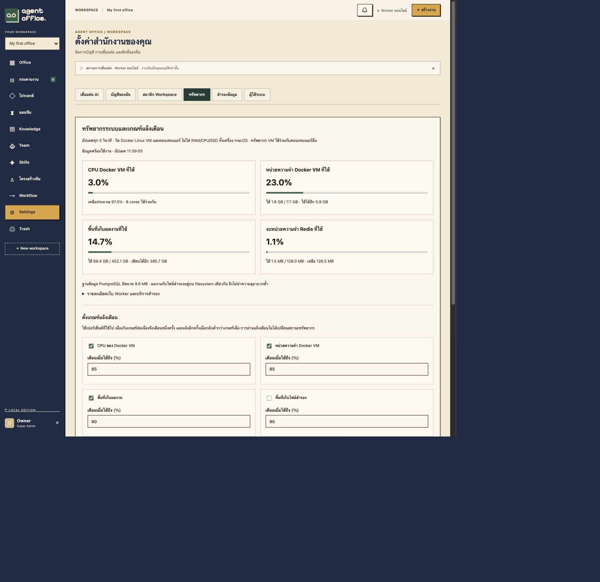

ดู [รายงานการทดสอบและข้อจำกัด](docs/resource-monitoring-report.md) และ [ตัวอย่างรายการแจ้งเตือน](docs/images/resource-notifications.jpg)

## แบ่งออฟฟิศเป็นหลายห้อง

เปิด **Office → จัดห้อง → ห้องและฝ่าย → เพิ่มห้อง** ระบุชื่อ หน้าที่ ฝ่าย ขนาด ตำแหน่ง และประตู กด **ใช้การแบ่งห้อง** เพื่อดูผัง แล้วกด **บันทึกออฟฟิศ** เพื่อบันทึกถาวร สลับแท็บเฟอร์นิเจอร์เพื่อจัดโต๊ะและของใช้ได้ ยกเลิกเพื่อกลับไปใช้ผังที่บันทึกไว้

- แผนที่เดิม 20 × 12 ช่อง รองรับห้องสี่เหลี่ยมขั้นต่ำ 3 × 3 ช่อง เว้นทางเดินระหว่างห้องอย่างน้อยหนึ่งช่อง พิกัดในฟอร์มเริ่มจาก 1
- แต่ละห้องมีหนึ่งประตู ต้องเปิดเข้าทางเดินภายในแผนที่ ห้ามวางเฟอร์นิเจอร์คร่อมผนังหรือปิดช่องประตูทั้งด้านในและนอก
- กำหนดฝ่ายของ Agent ใน **โครงสร้างทีม** ให้ตรงกับฝ่ายประจำห้อง ระบบจับคู่ชื่อโดยไม่สนตัวพิมพ์ใหญ่เล็กและช่องว่างหัวท้าย แต่ละฝ่ายมีห้องประจำหนึ่งห้อง เว้นฝ่ายว่างสำหรับห้องประชุมหรือส่วนกลาง
- ตัวละครประจำฝ่ายใช้ห้องนั้นเป็นพื้นที่ทำงานและเดินเล่น Agent ที่ไม่มีห้องประจำใช้พื้นที่ส่วนกลาง เส้นทางระหว่างห้องต้องผ่านประตู
- แก้ไขและลบห้องได้ การลบห้องไม่ลบ Agent หรือเฟอร์นิเจอร์ ห้องเป็นการจัดพื้นที่ ไม่ใช่ขอบเขตสิทธิ์ข้อมูล และไม่เปลี่ยน Workflow
- สมาชิกที่แก้ไข Workspace ได้จัดห้องได้ Viewer ดูได้เท่านั้น ระบบตรวจเวอร์ชันก่อนบันทึกเพื่อป้องกันการเขียนทับผังของผู้อื่น

ข้อมูลห้องเก็บร่วมกับ layout ใน PostgreSQL และรวมใน backup อัตโนมัติ Workspace เก่ายังคงเปิดได้โดยไม่มีห้องเพิ่มเอง

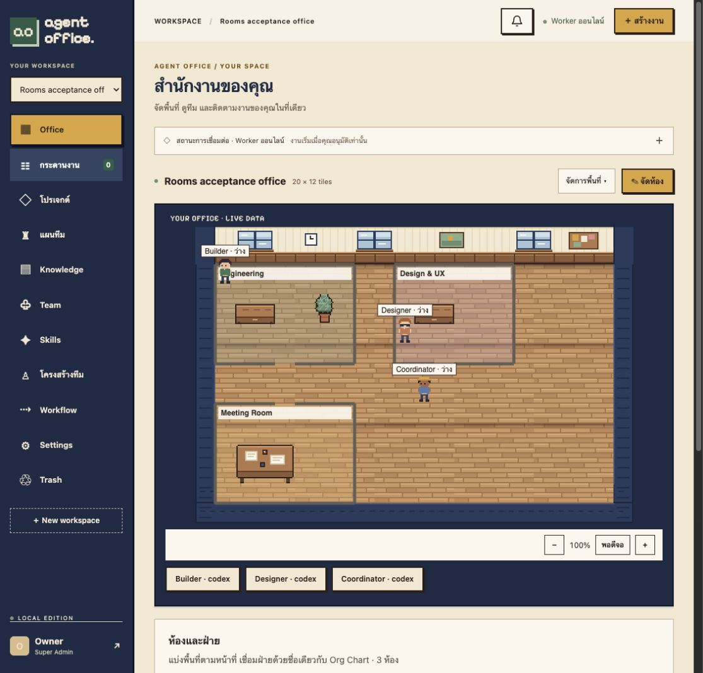

[ผลการทดสอบระบบแบ่งห้อง](docs/office-rooms-report.md)

ล้างประวัติแจ้งเตือนได้จาก **กระดิ่งขวาบน → ล้างประวัติ → ยืนยันล้างประวัติ** ล้างเฉพาะรายการที่สิ้นสุดแล้วจากบัญชีของคุณ ไม่กระทบประวัติของผู้ดูแลคนอื่น คำเตือนที่ยังเกิดอยู่จะคงแสดงจนกว่าปัญหาจะสิ้นสุด ปุ่มจะปิดเมื่อไม่มีประวัติที่ล้างได้

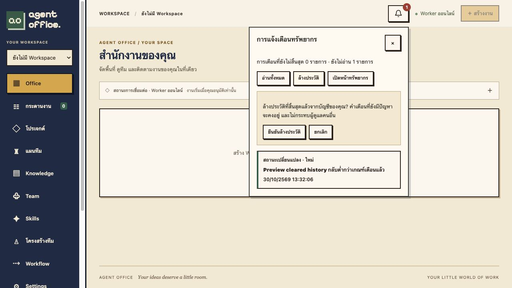

การทดสอบปุ่มล้าง: ผ่าน 4 HTTP tests ของ monitoring, 29 Rust tests และ 7 frontend domain/rendering tests พร้อมตรวจแยกประวัติผู้ดูแลสองบัญชี ([หลักฐาน](docs/measurements/clear-notifications-proof.json)) และทดสอบกดยกเลิก/ยืนยันจากหน้าจอจริง
