# Agent Office

สำนักงาน AI สไตล์เกม RPG สำหรับจัดทีม Agent มอบหมายงาน ตรวจผลงาน และเก็บความรู้ร่วมกัน พัฒนาด้วย **Rust + React + TypeScript** และรันผ่าน **Docker Compose**

> รุ่นสำหรับใช้งานบนเครื่องหรือ Docker host ที่คุณควบคุม เว็บเปิดเฉพาะ `localhost` โดยค่าเริ่มต้น การติดตั้งใหม่ไม่มีข้อมูลตัวอย่างและไม่เชื่อมบัญชี AI ให้อัตโนมัติ

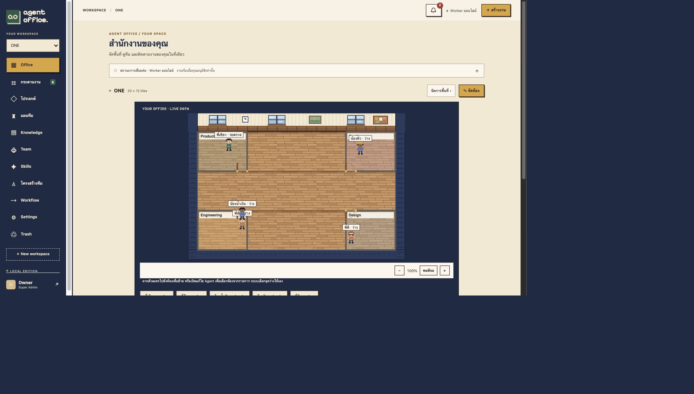

ภาพหน้าจอหลักอัปเดตจาก UI วันที่ 2 พฤศจิกายน 2026 โดยใช้ Workspace ตัวอย่าง ONE สถานะงานและจำนวนรายการอาจเปลี่ยนตามการใช้งาน ภาพสาธิตจากระบบทดสอบหรือภาพก่อนอนุมัติแผนมีคำกำกับแยกไว้

## ทำอะไรได้บ้าง

| ส่วนงาน | ความสามารถ |
| --- | --- |
| **Office** | สร้าง Workspace จัดห้อง วาง/ย้าย/หมุน/ทำสำเนาเฟอร์นิเจอร์ ย้อนกลับ/ทำซ้ำ ซูม และดูตัวละครตามสถานะงาน |
| **กระดานงาน** | กรองสถานะ เครื่องมือ และ Agent เรียงงานตามวันที่หรือความสำคัญ สลับกระดาน/รายการ และติดตามงานที่มีปัญหา |
| **โปรเจกต์** | จัดกลุ่มงาน ระบุความสำคัญและเกณฑ์ตรวจรับ |
| **แผนทีม** | ให้ Manager เสนอแผน หรือจัดขั้นตอนเอง ตรวจแผนก่อนอนุมัติ และส่งต่อผลงานหลังตรวจรับ |
| **Knowledge** | เก็บความรู้พร้อมแหล่งที่มา ตรวจสอบก่อนให้ AI ใช้ และค้นหาด้วยความหมายข้ามภาษาหรือ full-text |
| **Skills** | สร้าง/แก้ไข/เก็บถาวร/กู้คืน Skill พร้อมประวัติเวอร์ชัน และมอบหมายแบบติดตามล่าสุดหรือตรึงเวอร์ชัน |
| **โครงสร้างทีม** | Org Chart ตามสายรายงาน ฝ่าย หน้าที่ ขอบเขตตัดสินใจ และ Skill ของแต่ละ Agent |
| **Workflow** | แม่แบบ 1–8 ขั้น งานคู่ขนาน/รวมผล Skill ที่จำเป็น ไฟล์บังคับ และผู้ตรวจรับ สร้างร่างแผนก่อนอนุมัติ |
| **Team** | เพิ่ม Agent กำหนดบทบาท คำสั่ง ผู้ให้บริการ ตำแหน่ง และตัวละคร 12 แบบ |
| **Monitoring** | CPU/RAM/พื้นที่คงเหลือ ตั้งเกณฑ์แจ้งเตือน และกระดิ่งขวาบนสำหรับ Super Admin |
| **Settings** | เชื่อมบัญชี AI ผ่านเว็บ จัดการโปรไฟล์ สมาชิก สิทธิ์ และ Worker ส่วนตัว |
| **Trash** | กู้คืน Workspace งาน Agent และความรู้ที่ย้ายไปถังขยะ |

ข้อมูลอยู่ใน PostgreSQL ส่วนไฟล์ผลงานอยู่ใน Docker volume จึงต้องสำรองทั้งสองส่วนเมื่อย้ายเครื่อง Redis ใช้สำหรับข้อมูลชั่วคราว ไม่ใช่แหล่งเก็บความรู้หลัก

## เริ่มติดตั้ง

### สิ่งที่ต้องมี

- Git และ Docker พร้อม Docker Compose v2 ที่รองรับ `!reset` / `!override`
- Python 3 สำหรับสร้างค่าเริ่มต้นและใช้สคริปต์สำรอง/กู้คืน
- `shasum` สำหรับตรวจ checksum ของ backup
- บัญชี AI ของคุณเองที่ใช้งาน CLI ของผู้ให้บริการได้ หากต้องการรันงานจริง

ไม่ต้องติดตั้ง Rust, Node.js หรือ CLI ของ AI ลงบนเครื่องเพื่อรันแอป ทุกบริการหลัก build และทำงานใน Docker

```sh
git clone https://github.com/Sin1apachai/gangagent.git
cd gangagent
./setup.sh
docker compose up --build -d
```

เปิด **http://localhost:8088** แล้วเข้าสู่ระบบด้วย `OWNER_EMAIL` และ `OWNER_PASSWORD` ที่สร้างไว้ใน `.env` บัญชีแรกเป็น Super Admin

- `setup.sh` สุ่มรหัสผ่านให้ ไม่เขียนทับ `.env` เดิม
- เก็บ `.env` เป็นความลับ อย่า commit หรือส่งให้ผู้อื่น
- การแก้ `OWNER_PASSWORD` ใน `.env` หลังติดตั้งแล้วไม่เปลี่ยนรหัสผ่านของบัญชีเดิม ให้เปลี่ยนจาก **Settings → โปรไฟล์**
- เปลี่ยนพอร์ตได้ด้วย `OFFICE_PORT` ใน `.env`

ตรวจหรือหยุดบริการ:

```sh
docker compose ps
docker compose logs --tail=100 app worker
docker compose down
```

`docker compose down` เก็บ volumes ไว้ ส่วน `down --volumes` ลบข้อมูลถาวร จึงไม่ควรใช้กับระบบที่ต้องการเก็บข้อมูล

## คู่มือใช้งานครั้งแรก

### 1. สร้างพื้นที่และจัดห้อง

กด **New workspace** ตั้งชื่อ แล้วเปิด **Office → จัดห้อง** โหมดเริ่มต้นคือ **เลือกของที่วางแล้ว** คลิกสิ่งของเพื่อเลือก แล้วลากย้ายหรือกด **นำสิ่งของที่เลือกออก** ได้ คลิกพื้นว่างเพื่อยกเลิกเลือก หากต้องการเพิ่มของใหม่ให้เลือกจากรายการเฟอร์นิเจอร์ ระบบจะสลับไปโหมดวางให้ จากนั้นกด **บันทึกออฟฟิศ** (ย้อนกลับ/ทำซ้ำได้ก่อนบันทึก)

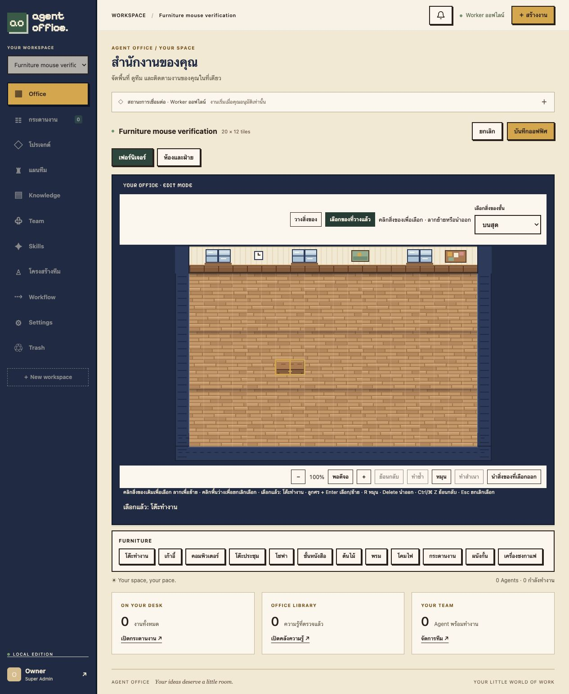

- ปุ่ม **พอดีจอ** คืนแผนที่ให้พอดีกับพื้นที่แสดงผล
- ใช้ลูกศรและ Enter เพื่อวางด้วยคีย์บอร์ด, R หมุน, Ctrl/⌘ Z ย้อนกลับ
- **จัดการพื้นที่** ใช้แก้ชื่อหรือย้าย Workspace ไปถังขยะ
- ตัวละครแสดงจาก Agent ที่คุณเพิ่มเอง ไม่มีตัวละครหรือผลงานที่สร้างแทรกให้ในการติดตั้งใหม่

### 2. เชื่อมบัญชี AI

เปิด **Settings → การเชื่อมต่อ AI** แล้วกดปุ่มเชื่อมบัญชีของผู้ให้บริการ ทำขั้นตอนบนหน้าทางการที่เปิดให้

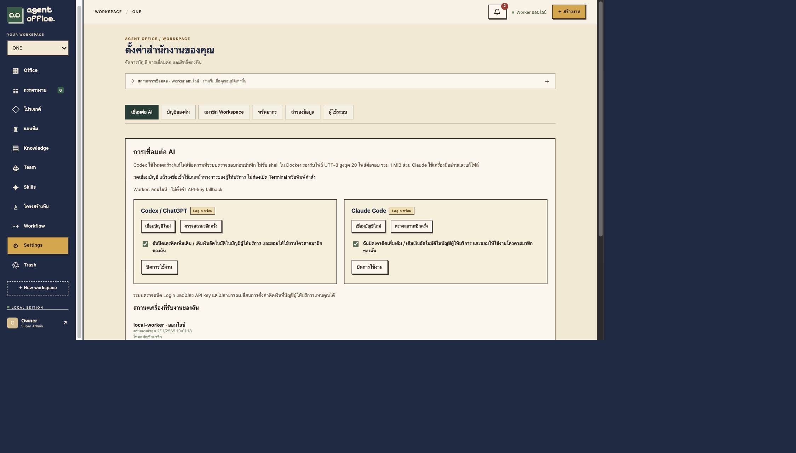

- **Codex:** เปิดหน้ายืนยันทางการและใส่รหัสอุปกรณ์ หากบัญชีแจ้งว่าปิด device-code login ให้เปิดตามคำแนะนำของผู้ให้บริการก่อน
- **Claude:** ยืนยันบนหน้าทางการ แล้วนำรหัสยืนยันครั้งเดียวกลับมาใส่ในฟอร์มที่ระบบแสดง ไม่ใช้รหัสผ่านหรือ API key
- รอจนสถานะ **Login พร้อม** แล้วตรวจการตั้งค่าเครดิตเพิ่มเติมของบัญชี ติ๊กยืนยันและเปิดใช้งานผู้ให้บริการที่ต้องการ
- หาก token ถูกเพิกถอนหรือหมดอายุ ใช้ **เชื่อมบัญชีใหม่**

การ Login ไม่ได้เริ่มงาน และ Worker อาจรอให้งานปัจจุบันจบก่อนดำเนินการ Login ข้อมูลบัญชี AI อยู่ใน credential volume ของ Worker แยกจากเว็บ ไม่ดึงบัญชีที่ Login บนเครื่องมาให้อัตโนมัติ

ระบบไม่มี API-key fallback หรือการซื้อเครดิตให้อัตโนมัติ แต่ไม่สามารถเปลี่ยนการตั้งค่า paid overage ของผู้ให้บริการแทนคุณได้ จึงไม่รับประกันค่าใช้จ่ายเป็นศูนย์หากบัญชีเปิดเครดิตเพิ่มเติมอยู่

### 3. เพิ่ม Agent และสร้างงาน

1. เปิด **Team → เพิ่ม Agent** ตั้งชื่อ บทบาท คำสั่ง และเลือก Codex หรือ Claude
2. กด **สร้างงาน** ใส่รายละเอียด เลือก Agent ที่ใช้เครื่องมือตรงกัน และระบุเกณฑ์ตรวจรับ
3. บันทึกงานก่อน ตรวจข้อมูล แล้วกด **เริ่มงาน** เมื่อต้องการใช้โควตา AI
4. เปิดงานเพื่อติดตามผล ประวัติ และไฟล์ผลงาน
5. ตรวจรับเป็นเสร็จ หรือส่งกลับพร้อม feedback แล้วกดเริ่มรอบแก้ไข

แนบไฟล์อ้างอิงได้สูงสุด **5 ไฟล์ ไฟล์ละ 1 MiB** รอบแก้ไขจะได้รับผลงานเดิมที่ลงทะเบียนไว้ โดยประวัติรอบก่อนยังอยู่

### 4. ใช้กระดานติดตามงาน

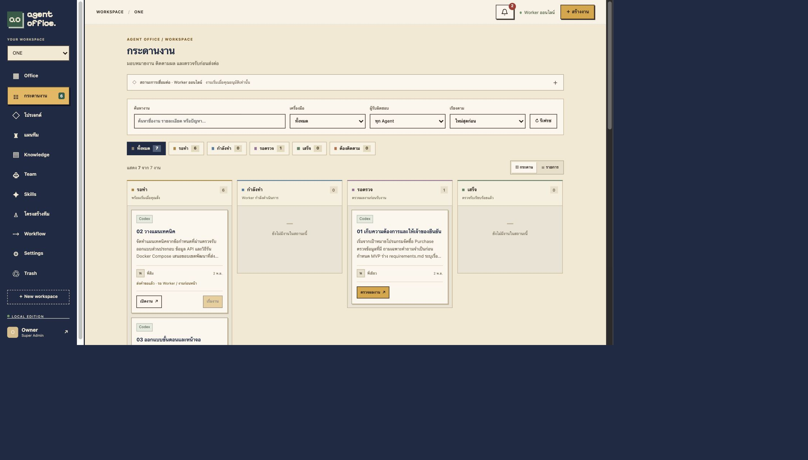

- เลือก **ทั้งหมด / รอทำ / กำลังทำ / รอตรวจ / เสร็จ / ต้องติดตาม** เพื่อจำกัดงานที่แสดง
- กรอง **เครื่องมือ** และ **ผู้รับผิดชอบ** หรือค้นหาจากชื่องาน รายละเอียด และปัญหา
- เรียงตามงานใหม่ งานเก่า หรือความสำคัญ
- สลับ **กระดาน / รายการ** ตามวิธีอ่านที่ถนัด
- กดชื่อการ์ดหรือปุ่ม **เปิดงาน / ตรวจผลงาน / ดูผลงาน** เพื่ออ่านรายละเอียดเต็ม
- ใช้ **ล้างตัวกรอง** หากต้องการกลับมาดูงานทั้งหมด

| สถานะ | สิ่งที่ควรทำ |
| --- | --- |
| รอทำ | ตรวจรายละเอียดแล้วกดเริ่มงาน งานที่ส่งคำขอแล้วอาจรอ Worker หรืองานก่อนหน้า |
| กำลังทำ | ติดตามงานหรือขอยกเลิกก่อนแก้ไข |
| รอตรวจ | อ่านผลงาน ดาวน์โหลดไฟล์ แล้วตรวจรับหรือส่งแก้ |
| เสร็จ | งานที่ผ่านการตรวจรับแล้ว |
| ต้องติดตาม | เปิดดูสาเหตุ เช่น รอ Login รอโควตา งานล้มเหลว สะดุด หรือถูกยกเลิก |

<details>
<summary>ดูหน้ากระดานบนจอแคบ</summary>

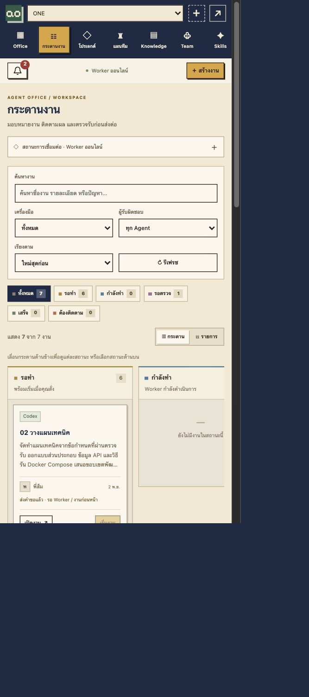

เลื่อนเฉพาะกระดานด้านข้าง หรือเลือกสถานะเดียวเพื่อให้การ์ดอ่านได้เต็มพื้นที่ มุมมองรายการใช้การเลื่อนแนวตั้ง

</details>

### 5. จัดแผนทำงานร่วมกัน

เริ่มได้สองทาง โดยการสร้างร่างยังไม่เรียก AI:

- **มี Workflow อยู่แล้ว:** ไปที่ **Workflow → ใช้สร้างแผน** กรอกเป้าหมาย แล้วกลับมาที่ **แผนทีม** เพื่อตรวจร่าง
- **จัดแผนใหม่:** ไปที่ **แผนทีม → สร้างร่างเอง** กรอกเป้าหมาย เลือกจัดแผนเองหรือเลือก Agent ให้เสนอแผน แล้วกด **สร้างร่างแผน** หากเลือก Agent ระบบจะสร้างงานเสนอแผนให้กดเริ่มเอง ตรวจผลงานแล้วกด **นำข้อเสนอ AI มาให้ตรวจ** ในสรุปแผน

1. เปิดแท็บ **ขั้นตอน** ตรวจชื่อ ผู้รับผิดชอบ Skill และงานที่ต้องรอ รองรับสูงสุด **8 ขั้นตอน**
2. หากแก้ไข ให้กด **บันทึกการแก้ไข** ก่อน
3. เปิด **ตรวจและเริ่ม** ตรวจเช็กลิสต์ แล้วทำเครื่องหมายยืนยันการใช้โควตา
4. กด **อนุมัติและเริ่มทีม** ขั้นที่ไม่มี dependency จะเริ่มได้ ส่วนขั้นถัดไปรอการตรวจรับงานที่เกี่ยวข้อง
5. ใน **ขั้นตอน → วิธีตรวจงาน** เลือกหัวหน้าใน Org Chart, Agent ผู้ตรวจเฉพาะทาง หรือผู้ใช้ตรวจ งานภายในที่เลือก Agent จะส่งตรวจและส่งแก้อัตโนมัติภายในขีดจำกัด ส่วนงานปลายทางให้เจ้าของตรวจเสมอ
6. ตรวจรับเมื่อผลงานครบตามเกณฑ์ งานถัดไปจึงรับผลและไฟล์ที่ผ่านตรวจไปทำต่อได้

การอนุมัติเริ่มทีมทำให้ระบบเรียก AI และใช้โควตาของบัญชีที่เชื่อมไว้ ไม่ใช่เพียงบันทึกร่าง ดู [รายละเอียดหน้าแผนทีม](#หน้าแผนทีม) ด้านล่าง

### หัวหน้าตรวจงานและการรับช่วงของเจ้าของ

หัวหน้าจะได้รับโจทย์ เกณฑ์ตรวจรับ และสำเนาไฟล์จากรอบที่ส่งตรวจ ใช้บทบาท Skill และโมเดลของผู้ตรวจที่เลือกไว้ ผลตรวจมี **ผ่าน / ส่งแก้ / ต้องให้เจ้าของตัดสินใจ** ผ่านแล้วจึงบันทึก Knowledge และปล่อยงานถัดไป ส่งแก้แล้วเริ่มรอบใหม่ได้จนผู้ทำงานใช้ครบ 3 ครั้ง หากรายงานไม่ถูกต้อง ผู้ตรวจไม่พร้อม หรือครบขีดจำกัด จะคงงานไว้รอตรวจและแสดง **งานรอคุณตรวจ** ด้านบน

ถ้าไม่มีหัวหน้า ระบบส่งให้เจ้าของรับช่วง ไม่ให้ Agent ตรวจตัวเอง งานตรวจใช้บัญชี AI ของผู้เริ่มแผนและมีการใช้โควตาเพิ่ม จึงต้องยืนยันทั้งงานผลิต งานตรวจ และการส่งแก้ก่อนเริ่มแผน หากหัวหน้ารอ quota งานต้นทางยังไม่ผ่านและรอผู้ตรวจกลับมาตามการตั้งค่ารีเซ็ต ผลตรวจจากรอบเก่าหรือผู้ตรวจที่ถูกปิดใช้งานจะไม่นำมาปรับสถานะงาน

แผนและงานเดิมไม่ถูกเปลี่ยนให้ตรวจอัตโนมัติย้อนหลัง สำหรับ Workflow ใหม่ควรระบุผู้ตรวจในงานภายใน และเก็บจุดที่ต้องตัดสินใจเรื่องธุรกิจกับงานส่งมอบสุดท้ายให้เจ้าของตรวจ

### เปิด Task โดยไม่ต้องอ่าน Log ทุกไฟล์

- **ผลงานและตรวจรับ:** แสดงช่วงต้นไม่เกิน 2 ย่อหน้า/600 ตัวอักษร พร้อมปุ่มเปิดข้อความทั้งหมดในบันทึก ไม่ใช่การสรุปใหม่ด้วย AI
- **ไฟล์ผลงาน:** เลือกรอบล่าสุดหรือรอบเก่า ค้นชื่อไฟล์ แสดงครั้งละ 12 รายการ แยกผลงานที่สร้างใหม่ออกจาก `inputs/`, `references/` และ `result.md` เปิด Preview ทีละไฟล์ได้ตามเดิม
- **ประวัติและบันทึก:** โหลดเมื่อกดดู แสดงเหตุการณ์ครั้งละ 20 รายการและข้อความบันทึกครั้งละประมาณ 20 KB พร้อมย้อนช่วงก่อนหน้าและค้นเฉพาะช่วงที่เปิดอยู่

ส่วนหัว Task modal แยกจากเนื้อหา ชื่อ Task แท็บ และปุ่ม **×** อยู่กับที่เสมอ เลื่อนเฉพาะเนื้อหาด้านในได้ โดยเปลี่ยนแท็บแล้วเริ่มที่ด้านบนของเนื้อหา ส่วนท้าย **Footer** แยกไว้สำหรับปุ่มเริ่ม แก้ไข ยกเลิก ตรวจรับ และส่งแก้ตามสถานะงาน ปุ่มจึงยังมองเห็นได้ขณะเลื่อนเนื้อหาหรือเปลี่ยนแท็บ

หน้าเว็บใช้ข้อมูลแบบย่อระหว่างรีเฟรช จึงไม่ส่งผลลัพธ์ของทุกงานและทุก run ซ้ำมาในรายการเบื้องหลัง ข้อความเต็มยังอยู่ในฐานข้อมูลและอ่านได้จากหน้าบันทึก

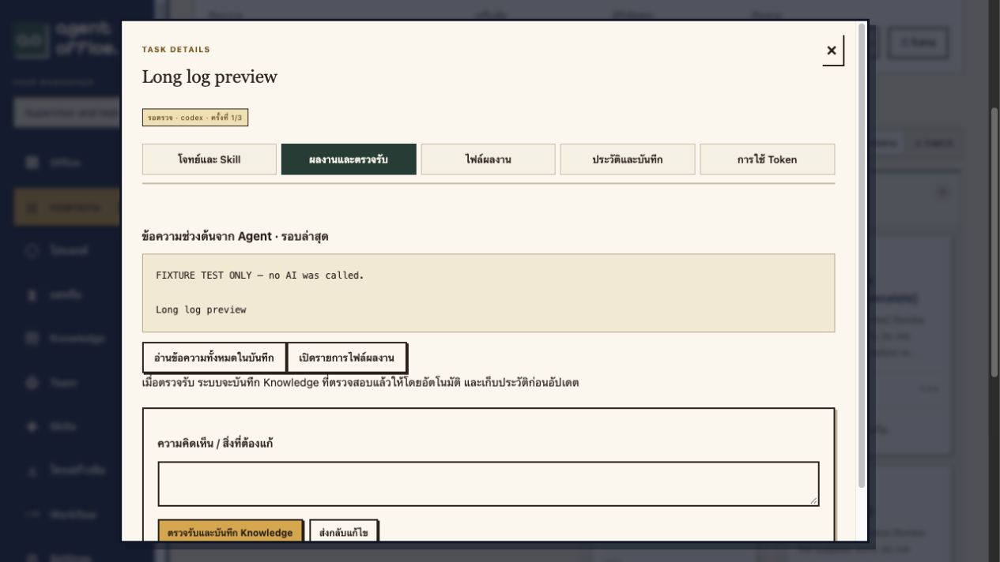

**ตรวจรับครบไม่เท่ากับโปรแกรมรันได้:** เปิด **แผนทีม → ตรวจหลักฐานส่งมอบ** เพื่อดูจำนวนไฟล์โค้ดและ Compose ที่ยังไม่มีบริการ การตรวจนี้อ่านรายการไฟล์เท่านั้น ไม่ได้รันโปรแกรมหรือยืนยันผลทดสอบแทนเจ้าของ

รายละเอียดและผลทดสอบ: [Supervisor review and focused Task modal](docs/supervisor-review-and-task-modal.md)

### การ์ดที่อ่านเนื้อหาได้โดยปุ่มไม่หลุด

การ์ด Knowledge, Team, Skill, Workflow, กระดานงาน โปรเจกต์ และรายการการ์ดอื่น ๆ แยก **Header / Body / Footer** โดยจำกัดความสูงตามประเภท ข้อความยาวเลื่อนเฉพาะ Body ส่วนชื่อและปุ่มท้ายการ์ดยังอยู่ในกรอบ เนื้อหาเดิมไม่ได้ถูกลบหรือตัดออก ดู [ขนาดและผลทดสอบการ์ด](docs/bounded-card-layout-check.md)

### 6. เก็บและค้นหาความรู้

**Skill คือวิธีทำงาน ส่วน Knowledge คือข้อมูลที่ทีมใช้อ้างอิง** เช่น Skill อธิบายวิธีเขียนข้อกำหนด ส่วน Knowledge เก็บกฎและขอบเขตที่เจ้าของยืนยันแล้ว

เปิดงานที่ **ผลงานและตรวจรับ → ตรวจรับและบันทึก Knowledge** ระบบจะตรวจรับและบันทึกความรู้ที่ตรวจสอบแล้วในขั้นตอนเดียวกัน ไม่เรียก AI เพิ่ม และไม่บันทึกเมื่อส่งกลับแก้ไข หากบันทึก Knowledge ไม่สำเร็จ งานจะยังไม่ถูกตรวจรับเพื่อให้ลองใหม่ได้

ระบบเลือกเอกสาร Markdown หลักหนึ่งไฟล์จากผลงานรอบที่ตรวจรับ โดยให้ไฟล์ที่ Workflow ระบุไว้ก่อน ข้าม `result.md`, `inputs/` และ `references/` หากไม่มีเอกสารที่ใช้ได้ จะเก็บข้อความผลลัพธ์ช่วงต้นไม่เกิน 3 ย่อหน้า/4,000 ไบต์ พร้อมอ้างอิงกลับไปยังงาน เอกสารหลักเก็บได้ประมาณ 47,000 ไบต์และจะแจ้งเมื่อถูกตัด จึงควรตรวจเนื้อหาและไฟล์ให้เรียบร้อยก่อนกดตรวจรับ

**สร้างหรืออัปเดตอัตโนมัติ:** ชื่อไฟล์รวมโฟลเดอร์เดียวกันภายใน Project เดียวกันจะอัปเดตรายการเดิม หากงานไม่ผูก Project จะเทียบภายในแผนทีมเดียวกัน ส่วนงานเดี่ยวและสรุปที่ไม่มีเอกสารจะเก็บแยกตามงาน ไม่รวมรายการด้วยชื่อเรื่องที่คล้ายกัน และไม่รวมกับ Knowledge ที่ผู้ใช้สร้างเอง ทุกครั้งที่แก้ไขจะเก็บประวัติ เปิดดูจาก **Knowledge → ประวัติ Knowledge** ได้ล่าสุด 30 เวอร์ชัน

การตรวจรับซ้ำหรือซิงก์รอบเดิมไม่สร้างซ้ำ ไม่ทับข้อความที่ผู้ใช้แก้เอง และรอบเก่าไม่เขียนทับรอบใหม่ที่บันทึกไปแล้ว งานที่ตรวจรับก่อนเพิ่มฟีเจอร์นี้จะไม่ถูกนำเข้าเอง หากต้องการให้เปิดงานที่เสร็จแล้ว → **ซิงก์ Knowledge จากงานนี้** หรือเพิ่มเองจากเมนู **Knowledge** ได้ตามเดิม

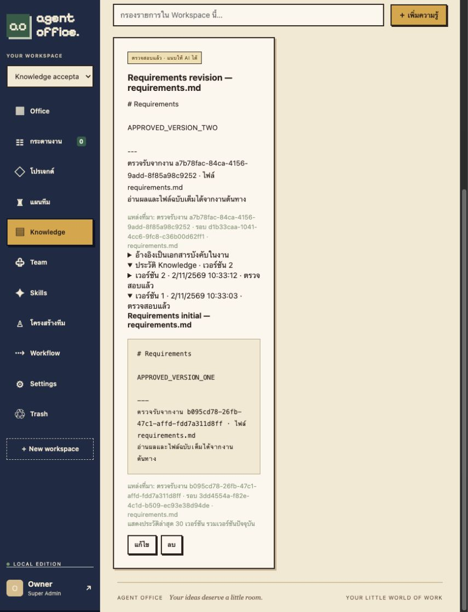

รายละเอียดและผลทดสอบ: [Automatic Knowledge](docs/automatic-knowledge-report.md)

งานถัดไปใช้เฉพาะความรู้ที่ตรวจสอบแล้วและยังไม่ถูกลบใน Workspace เดียวกัน ภายใต้งบข้อมูลของแต่ละงาน โหมดเลือกตามงานช่วยคัดข้อมูลที่เกี่ยวข้อง และใช้รหัส `[[knowledge:ID]]` จากหน้า Knowledge เพื่อระบุรายการที่ต้องใช้ได้ ควรเก็บข้อกำหนด กฎธุรกิจ และบทเรียนที่ยืนยันแล้ว ไม่คัดลอกผลทุกงานทั้งก้อน

หากต้องการค้นตามความหมายข้ามภาษา ให้เปิดบริการในเครื่องเพิ่มเติม:

```sh
docker compose --profile semantic up --build -d
```

โมเดลดาวน์โหลดในขั้น build และรันบน CPU ภายใน Docker หลัง build แล้วทำงานแบบ offline หากบริการนี้ไม่พร้อม ระบบใช้ PostgreSQL full-text และแจ้งวิธีค้นหาที่ใช้

Super Admin ให้หรือเพิกถอนสิทธิ์ **Super Intelligence** แก่สมาชิกจาก Settings ได้ สิทธิ์นี้ค้นหาความรู้ที่ตรวจสอบแล้วข้าม Workspace พร้อมแสดงแหล่งที่มาและบันทึกประวัติ ไม่ได้มอบรหัสฐานข้อมูลหรืออนุญาต SQL อิสระให้โมเดล

## ผู้ใช้หลายคนและ Worker ส่วนตัว

Super Admin เพิ่มบัญชีผู้ใช้ใน **Settings → บัญชีผู้ใช้** จากนั้นเจ้าของ Workspace เชิญสมาชิกและกำหนด Owner / Member / Viewer ได้ สมาชิกใช้บัญชีเว็บและบัญชี AI ของตนเอง ไม่แชร์ subscription ของเจ้าของโดยอัตโนมัติ

สำหรับผู้ที่ต้องรันงานด้วยบัญชี AI แยก:

1. Login ด้วยบัญชีของผู้ใช้นั้น เปิด **Settings → Worker ส่วนตัว**
2. ตั้งชื่อและดาวน์โหลดไฟล์ติดตั้ง เก็บไฟล์เป็นความลับ เพราะมี credential ส่วนตัว
3. ให้ผู้ดูแล Docker host ที่ไว้ใจติดตั้งไฟล์บน host เดียวกับระบบหลัก:

   ```sh
   docker compose -f office-worker-<id>.compose.json up -d
   ```

4. กลับมาเชื่อมบัญชี AI จากเว็บของผู้ใช้นั้น
5. ใช้ **เพิกถอนสิทธิ์** เพื่อยกเลิกการเชื่อมต่อของ Worker

Worker แยก PostgreSQL role/RLS, Redis ACL, credential volumes และ UID ของโมเดล ขอบเขตนี้ยังถือว่าผู้ดูแล Docker และตัว coordinator เป็นผู้ที่ไว้ใจ ไม่ใช่ระบบสำหรับให้ผู้ใช้ที่ไม่ไว้ใจควบคุม container เอง

## ความสามารถและข้อจำกัดของ AI

| ผู้ให้บริการ | โหมดในระบบนี้ |
| --- | --- |
| Codex | ส่งผลลัพธ์ตาม JSON schema แล้วระบบตรวจ path/ขนาดก่อนบันทึกไฟล์ UTF-8 ไม่รัน shell หรือทดสอบโปรแกรมที่สร้าง |
| Claude | เครื่องมืออ่าน/เขียน/แก้ไฟล์ภายในขอบเขตที่กำหนด ไม่มี shell หรือ MCP ภายนอก |

Codex รองรับสูงสุด **20 ไฟล์ต่อรอบ, 256 KiB ต่อไฟล์, รวม 1 MiB** ไฟล์ข้อความอ้างอิงใช้บริบทที่จำกัด ไฟล์ binary หรือไฟล์ใหญ่จะไม่ถูกแนบเป็นข้อความ โค้ดที่โมเดลสร้างยังต้องนำไปตรวจและทดสอบก่อนใช้งาน

งานมีเวลาทำงานสูงสุด 15 นาทีและจำกัดการเริ่มทำจริง 3 ครั้ง เมื่อพบ quota หรือ lease ขาด ระบบไม่ลองทำซ้ำเอง ต้องตรวจสาเหตุก่อนสั่งใหม่ ไม่มีการเปิด privileged container หรือข้าม sandbox ให้อัตโนมัติ

## สำรองและย้ายเครื่อง

วิธีใช้งานปกติสำหรับ **Super Admin**: ไปที่ **Settings → สำรองข้อมูล** ยืนยันว่าไฟล์รวมข้อมูลทุก Workspace แล้วกด **สำรองข้อมูลตอนนี้** ดูสถานะและกด **ดาวน์โหลดไฟล์สำรอง** เมื่อพร้อมได้ทันที ไม่ต้องใช้คำสั่ง มีประวัติ ยกเลิกระหว่างทำ และลบไฟล์เก่าโดยยืนยันก่อนลบ

ระบบพักการเริ่มงาน AI ใหม่ชั่วคราวและรอให้งานเดิมจบ ใช้ snapshot เดียวกันสำหรับฐานข้อมูลและรายการไฟล์ เก็บ ACL ของไฟล์ผลงาน พร้อม SHA-256 ไม่รวม session, รหัสเชื่อมบัญชี AI, credential volumes, binding ของ Worker เดิม หรือ Redis cache ไฟล์มีข้อมูลบัญชีผู้ใช้และทุก Workspace จึงต้องเก็บเป็นความลับ

ไฟล์จากหน้าเว็บเป็น `.tar` รวม `office.dump`, `artifacts.tar.gz`, `manifest.json`, `SHA256SUMS` และ `post-restore.sql` เก็บได้สูงสุด 20 ชุด ชุดละไม่เกิน 2 GB เก็บใน volume `backup-data` แยกจากผลงาน เว็บอ่านได้อย่างเดียว บริการสำรองไม่มี Docker socket และไม่มี volume บัญชี AI หากบริการขัดข้อง หน้าเว็บมีปุ่มกู้สถานะพักงานเมื่อบริการไม่ทำงานแล้ว

Settings แยกเป็นแท็บ **เชื่อมต่อ AI / บัญชีของฉัน / สมาชิก Workspace / สำรองข้อมูล / ผู้ใช้ระบบ** ตามสิทธิ์ เพื่อลดความยาวหน้าจอ

[ผลทดสอบสำรองและกู้คืนผ่านเว็บ](docs/web-backup-report.md)

สำหรับผู้ดูแลที่ต้องการใช้วิธีเดิมเพิ่มเติม:

```sh
./backup.sh
```

ผลลัพธ์จากสคริปต์เดิมอยู่ใน `backups/office-<เวลา>/` ประกอบด้วย PostgreSQL dump ไฟล์ผลงานที่ลงทะเบียนพร้อม ACL และ checksum สคริปต์พักการรับงานใหม่และรอให้งานที่กำลังทำจบก่อนสำรอง

Backup เป็นข้อมูลส่วนตัว ไม่รวม `.env` หรือ credential volumes ของ AI ให้คัดลอก backup ไปที่เก็บปลอดภัยอีกแห่งด้วยตนเอง

สำหรับไฟล์เว็บ ให้แตก `.tar` ในโฟลเดอร์ส่วนตัวก่อนใช้เครื่องมือกู้คืนด้านล่าง (การสำรองและดาวน์โหลดผ่านหน้าเว็บไม่ต้องใช้คำสั่ง)

ตัวอย่างทดสอบกู้คืนเข้า project แยก โดยใช้ไฟล์ `.env` ที่เตรียมไว้บนเครื่องปลายทาง:

```sh
docker compose build app worker backup
OFFICE_PORT=8089 docker compose -p office-restore up -d postgres redis
OFFICE_PORT=8089 RESTORE_PROJECT=office-restore CONFIRM_RESTORE=office-restore \
  ./restore.sh backups/office-<เวลา>
```

เปิด http://localhost:8089 ตรวจฐานข้อมูลและดาวน์โหลดผลงานก่อนสลับมาใช้งานจริง สคริปต์ไม่ยอมกู้ทับ project หลัก `agent-office` และจะเพิกถอน binding ของ Worker ส่วนตัวเดิม ต้องสร้าง Worker และเชื่อมบัญชี AI ใหม่หลังย้าย

หากเปลี่ยนชื่อ Compose project ต้องกำหนด `OFFICE_DOCKER_NETWORK` และ `OFFICE_RUNS_VOLUME` ใน environment ของบริการ `app` ให้ตรงกับ network/volume จริง ก่อนออกไฟล์ Worker ส่วนตัว ดูรายละเอียดใน [สถาปัตยกรรม](docs/architecture.md)

## เลือกตัวละครและใช้ฟอร์มแบบแท็บ

เปิด **Team → เพิ่ม Agent / แก้ไข → ตัวละคร** เลือกรูปลักษณ์พื้นฐาน 3 แบบและเครื่องประดับ 4 แบบ รวม 12 ตัวเลือก แล้วกดบันทึก รูปลักษณ์เดียวกันจะแสดงใน Office, Team และ Org Chart และคงเดิมเมื่อโหลดใหม่

ฟอร์ม Agent แบ่งเป็น **ข้อมูลทั่วไป / ตัวละคร / คำสั่งและตำแหน่ง**; Skill แบ่ง **ข้อมูลทั่วไป / วิธีทำงาน / การส่งมอบ**; Workflow แบ่ง **ข้อมูลทั่วไป / ขั้นตอน** แล้วเลือกแก้ทีละขั้นผ่านแท็บย่อย ข้อมูลที่กรอกคงอยู่เมื่อสลับแท็บ ใช้ลูกศรซ้าย/ขวา, Home/End สลับแท็บด้วยคีย์บอร์ดได้ รายละเอียดงานแยก **โจทย์และ Skill / ผลงานและตรวจรับ / ประวัติ**

ปุ่มหลักเปลี่ยนเป็นสีเขียวเข้มเมื่อ hover พร้อมตัวอักษรสีอ่อน และมีเส้น focus สำหรับคีย์บอร์ด

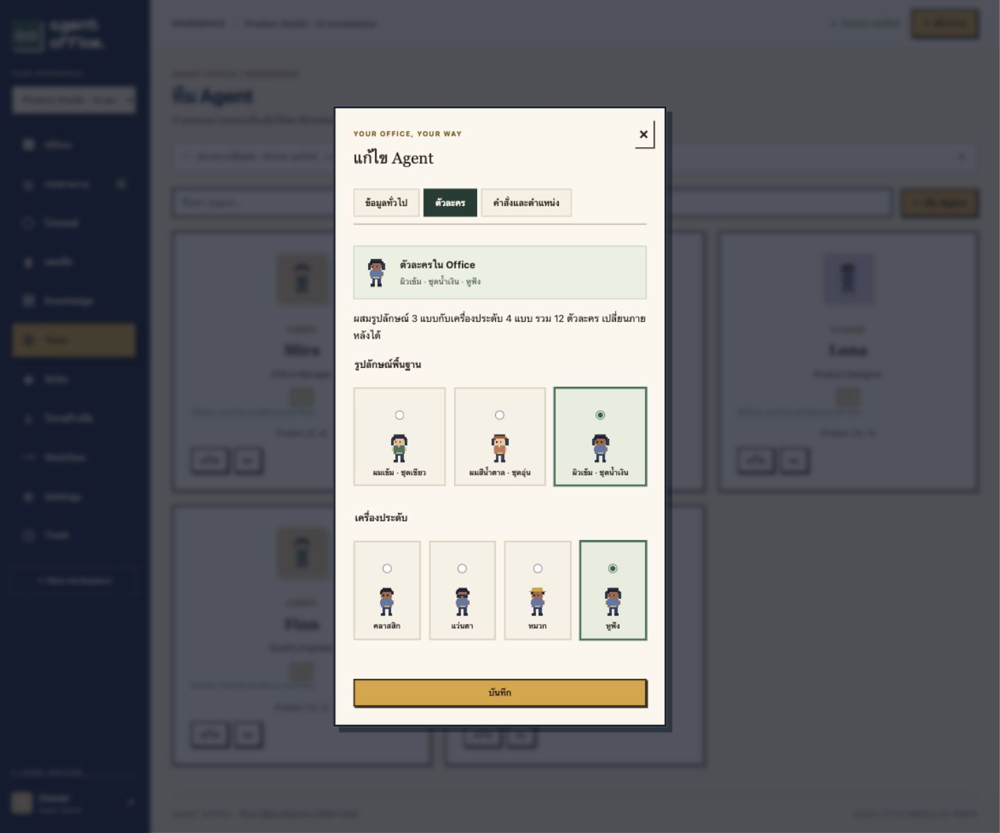

ดู [ฟอร์ม Workflow แบบย่อ](#กรอกขั้นตอน-workflow-แบบย่อ) พร้อมภาพหน้าจอด้านล่าง

## Skills, โครงสร้างทีม และ Workflow

1. เปิด **Skills → สร้าง Skill** ระบุวิธีทำงาน ข้อมูลรับเข้า ผลลัพธ์ และเกณฑ์ตรวจรับ การแก้ไขบันทึกเป็นเวอร์ชันใหม่ ส่วนประวัติเดิมแก้ทับไม่ได้
2. เพิ่ม Agent ใน **Team** แล้วเปิด **โครงสร้างทีม** คลิกสมาชิก ระบุฝ่าย หัวหน้า หน้าที่ และขอบเขตตัดสินใจ เจ้าของ Workspace หรือ Super Admin เป็นผู้จัดโครงสร้างและมอบหมาย Skill
3. เลือก **ติดตามล่าสุด** เพื่อให้งานใหม่ใช้ Skill ล่าสุด หรือ **ตรึงเวอร์ชัน** เพื่อใช้เวอร์ชันที่เลือก ระบบปฏิเสธสายรายงานวนลูปและการเชื่อมข้อมูลข้าม Workspace
4. เปิด **Workflow → สร้าง Workflow** เพิ่ม 1–8 ขั้น เลือก Agent, Skill ที่จำเป็น, ข้อมูลรับเข้า, ผลงาน, เกณฑ์ตรวจรับ, ชื่อไฟล์บังคับ และผู้ตรวจรับ เลือกงานก่อนหน้าที่ต้องรอได้หลายขั้น จึงแยกงานคู่ขนานและรวมผลกลับมาได้
5. กด **ใช้สร้างแผน** ระบุเป้าหมาย แล้วตรวจแผนใน **แผนทีม** การสร้างแม่แบบหรือร่างไม่เรียก AI ต้องอนุมัติแผนก่อน ระบบจึงสร้างงานให้ Worker
6. ตรวจผลงานและไฟล์ในรายละเอียดงาน งานถัดไปเริ่มเมื่อทุกงานที่ต้องรอผ่านตรวจรับ หากส่งกลับแก้ไขต้องกดเริ่มอีกครั้ง หากไม่มีไฟล์บังคับ งานจะล้มเหลวและไม่ปล่อยงานถัดไป

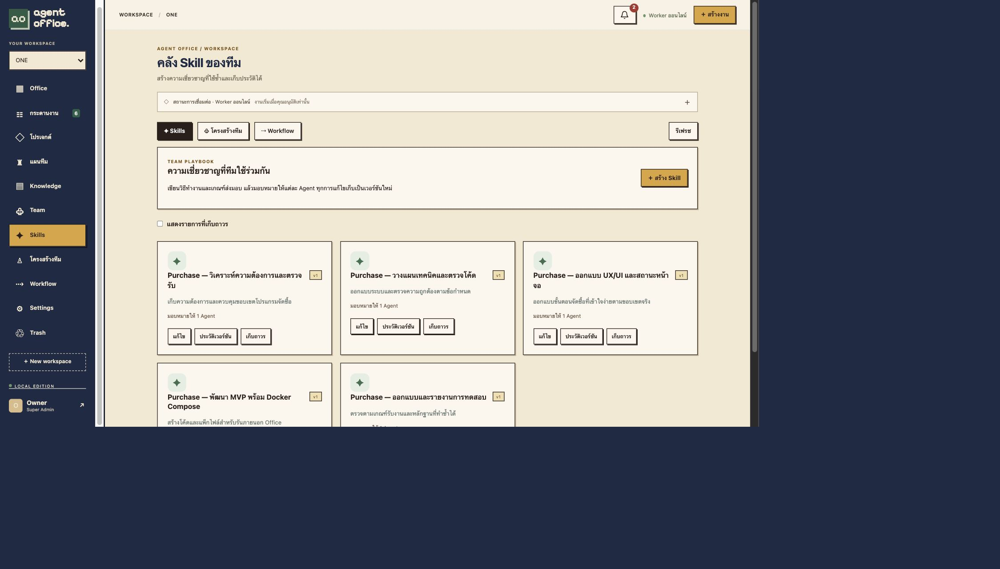

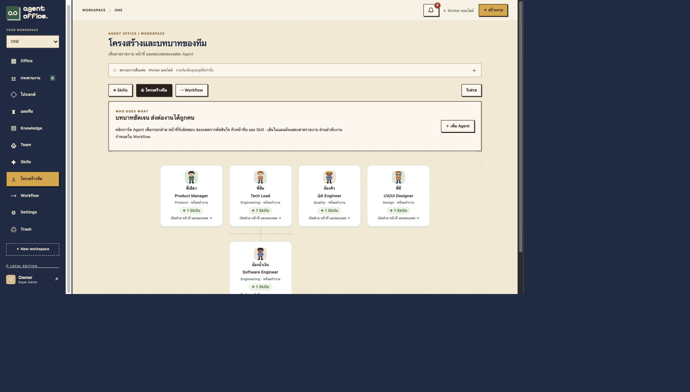

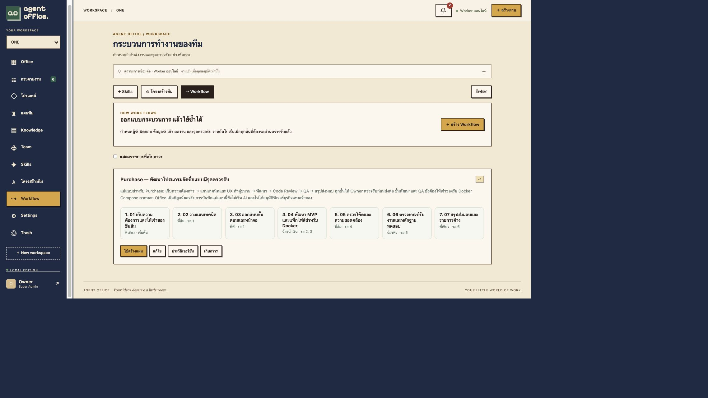

**การเก็บเวอร์ชัน:** งานทั่วไปเก็บสำเนาบทบาทและ Skill เมื่อกดเริ่มครั้งแรก งานจากแผนเก็บสำเนาเมื่ออนุมัติแผน การส่งกลับแก้ไขใช้สำเนาเดิม การแก้ Skill/Agent/แม่แบบภายหลังไม่เปลี่ยนคำสั่งของงานนั้น Skill ที่เก็บถาวรจะใช้เริ่มงานใหม่ไม่ได้จนกู้คืนหรือยกเลิกการมอบหมาย ส่วนงานที่มีสำเนาแล้วทำต่อได้

**สิทธิ์ตรวจรับ:** Workflow เลือกผู้ตรวจรับเป็นสมาชิกที่เขียนงานได้ หากไม่เลือกจะใช้ผู้อนุมัติแผน เจ้าของ Workspace และ Super Admin ตรวจรับแทนหรือเปลี่ยนผู้ตรวจรับได้และมี audit งานทั่วไปที่ไม่กำหนดผู้ตรวจรับใช้สิทธิ์เขียนตามปกติ การเป็นหัวหน้าใน Org Chart หรือมี Skill ไม่เพิ่มสิทธิ์ฐานข้อมูล เครื่องมือ หรือสิทธิ์ตรวจรับ

แม่แบบและ Skill เก็บถาวร/กู้คืนได้จากหน้าเมนูของตัวเอง ประวัติเวอร์ชันเก็บใน PostgreSQL และรวมอยู่ใน backup การทำงานยังอยู่ภายใต้โควตาสมาชิกและข้อจำกัดเครื่องมือเดิม ไม่ได้เพิ่ม API เสียเงิน

## โครงสร้างโค้ด

```text
server/
  migrations/           # ฐานข้อมูลและสิทธิ์
  src/
    main.rs             # จุดเริ่มต้น
    lib.rs              # ประกอบแอปและ routes
    domain/             # กฎแผนงาน
    application/        # use cases
    infrastructure/     # persistence และ semantic retrieval
    presentation/http/  # HTTP handlers แยกตาม feature
    organization/       # Skill revisions, roles, workflow templates, execution snapshots
    worker.rs           # วงจรงานและการเรียก CLI
    codex_files.rs      # ตรวจและบันทึก structured files
web/src/
  application/          # controller และ state
  features/             # office, tasks, knowledge, team, settings ฯลฯ
  shared/               # types, API client, fields
semantic/               # บริการ embedding ภายในเครื่อง
compose.yaml            # บริการใช้งานจริง
compose.test.yaml       # ระบบทดสอบแยก
```

Rust ใช้ structs, `impl` และ composition เพื่อห่อกฎและบริการ React ใช้ function components ร่วมกับ service/engine classes เช่น `OfficeApi` และ `LayoutEngine` ไม่บังคับใช้ inheritance กับทุกส่วน

## การทดสอบ

```sh
./test.sh
```

รัน build และทดสอบใน Compose project แยก ใช้ฐานข้อมูล `office_test`, Worker จำลองสองตัว และ volumes ชั่วคราว ไม่ใช้ credential volumes ของระบบจริง ผลตรวจล่าสุด: **52 HTTP integration tests, 14 Rust unit tests และ 3 character rendering tests ผ่าน**

Docker build รัน TypeScript build และ `npm test` สำหรับตัวละครให้อัตโนมัติ

Fixture tests ไม่เรียก AI จริง ส่วน live acceptance เคยทดสอบแยกด้วยบัญชีที่เชื่อมและอนุญาตแล้ว ครอบคลุมการสร้างไฟล์ ส่งแก้ ดาวน์โหลด ตรวจรับ และส่งต่อไฟล์ Codex → Claude รอบล่าสุดยังทดสอบ Skill จริงและ Workflow ส่งต่อไฟล์ Codex → Claude สำเร็จ ดู [รายงาน Skill/Workflow](docs/skills-workflow-test-report.md), [รายงานทดสอบ](docs/phase2-test-report.md) และ [ผลตรวจ UI กระดาน](docs/task-board-check.md)

สคริปต์ `tests/probe_live.py` และ `tests/probe_live_team.py` ต้อง opt in ชัดเจนและใช้โควตาบัญชีจริง ไม่รวมอยู่ในชุดทดสอบปกติ

## เอกสารเพิ่มเติม

- [สถาปัตยกรรม สิทธิ์ และขอบเขตความปลอดภัย](docs/architecture.md)
- [รายงานการทดสอบระบบ](docs/phase2-test-report.md)
- [ผลตรวจการจัดระเบียบ UI](docs/ui-refinement-check.md)
- [ผลตรวจหน้ากระดานงาน](docs/task-board-check.md)
- [ที่มาของภาพและฟอนต์](docs/design/README.md)

ภาพในคู่มือนี้เป็นภาพจากระบบที่ใช้งาน/ทดสอบแล้ว งานใน Workspace ชื่อ Acceptance เป็นงานตรวจระบบ ไม่ใช่ข้อมูลที่จะถูกสร้างให้เมื่อติดตั้งใหม่ ภาพ Settings ไม่แสดงรหัสผ่าน token หรือรหัสยืนยัน

### Run usage and the first context optimization

Open a task → **การใช้ Token**. Each run records provider-reported input/output,
cache counters (when available), provider elapsed time, and UTF-8 prompt bytes.
Missing counters stay unavailable; fixture workers never invent token usage.
Historical runs have no retroactive statistics. Codex cached input is included in
its input count; Claude uncached input and cache read/write are separate. Do not
add Codex cache reads to its input again, compare providers as if their counters
had identical meanings, or convert these counters into a Pro quota percentage.
Prompt bytes cover the application's submitted text, not hidden provider prompts,
subsequent tool reads, or the whole provider context.

The initial optimization serializes frozen role/Skill JSON compactly, preserving
all values including whitespace inside instruction strings. This removes formatting
only; selective knowledge retrieval and generated handoff summaries are future
work. `POST /api/workspaces/{wid}/tasks` accepts `context_format: "pretty"` for an
explicit baseline or `"compact"` (default). The choice is fixed at creation.

For an opt-in live pilot, run `tests/probe_usage.py` with `BASE_URL`, owner login
variables, and `OFFICE_TEST_TARGET=live_owner` in a trusted environment. It makes
four subscription CLI calls, one baseline and one compact run per provider, checks
downloaded `answer.json` by exact JSON equality, and archives its temporary
workspace. Never print or commit login variables. The report is written to
`/private/tmp/office-usage-pilot.json`. This small pilot is descriptive, not evidence
of a general percentage saving. Compare input/output, cache and quality separately;
repeat with representative multi-step work before broad conclusions.

Measured live results and limitations: [Context usage pilot](docs/context-usage-report.md).

### Focused Knowledge and accepted handoffs (opt-in)

New task → **ข้อมูลประกอบงาน → เลือก Knowledge ตามงาน (ทดลอง)**, or enable the
focused option when approving a draft team plan. The default stays full bounded
context. Focused mode chooses whole verified records by lexical relevance and
preserves every role/Skill/safety instruction and acceptance contract. Critical
records can be pinned with `[[knowledge:UUID]]` (copy from the Knowledge card).
Missing/unauthorized or oversized required references fail before calling a model.

Producing tasks can write `handoff.json` with `summary`, `decisions` array,
`open_questions` array and `artifacts` paths. Accepted dependency briefs are used
only after validating source run and registered artifact references; invalid
briefs fall back to the normal result. Review summaries for missing facts.

Task → **การใช้ Token** shows retrieval sources and counters. Team plan →
**การใช้ Token ทั้งแผน** aggregates every recorded attempt/revision/planner run
with provider-specific cache semantics and missing-data coverage. To use full
context after insufficient evidence, send the task back, switch mode on its Token
tab while it is not scheduled, and explicitly start again.

[Live workflow results and limitations](docs/focused-context-report.md): this
controlled noisy-library pilot observed **66.86% less reported input**, with six
exact artifact checks passing, but **28.53% longer summed provider time**. This is
one paired workflow, not a general saving guarantee or Pro quota measurement.
No paid embeddings/API service was added. Lexical retrieval has limited synonym
and Thai segmentation support; pin essential sources and retain human review.

## ดูทรัพยากรและตั้งการแจ้งเตือน

เข้าสู่ระบบด้วย Super Admin แล้วเปิด **Settings → ทรัพยากร** เพื่อดูค่าปัจจุบันและทรัพยากรที่ใช้ได้อีก อัปเดตทุก 5 วินาที เลือกเปิดเกณฑ์แต่ละรายการ ระบุเปอร์เซ็นต์ที่ใช้ไป ระยะเวลาที่ต้องเกินต่อเนื่อง และระยะเผื่อกลับปกติ แล้วกด **บันทึกเกณฑ์แจ้งเตือน**

กระดิ่งขวาบนแสดงรายการยังไม่อ่านและสถานะเตือน พร้อมข้อความเมื่อเกิดเหตุหรือกลับปกติ กดอ่านแล้วไม่ได้ทำให้ปัญหาทรัพยากรหายไป เกณฑ์และประวัติอยู่ใน PostgreSQL จึงยังอยู่หลังรีสตาร์ต หากข้อมูลขาดหายระบบจะไม่แสดงว่ากลับปกติโดยไม่มีหลักฐาน

ค่าที่แสดงเป็นของ **Docker Linux VM และคอนเทนเนอร์** ซึ่งอาจใช้ร่วมกับแอปอื่น ไม่ใช่ทรัพยากรทั้งเครื่อง macOS ระบบนี้ไม่เรียก AI ไม่ใช้ Docker socket และไม่ต้องสมัครบริการเพิ่ม ค่าเริ่มต้นเตือน CPU/RAM VM และ Redis ที่ 85%, พื้นที่ผลงาน/Worker RAM ที่ 90%, เกินต่อเนื่อง 15 วินาที และเผื่อกลับปกติ 5 จุดเปอร์เซ็นต์

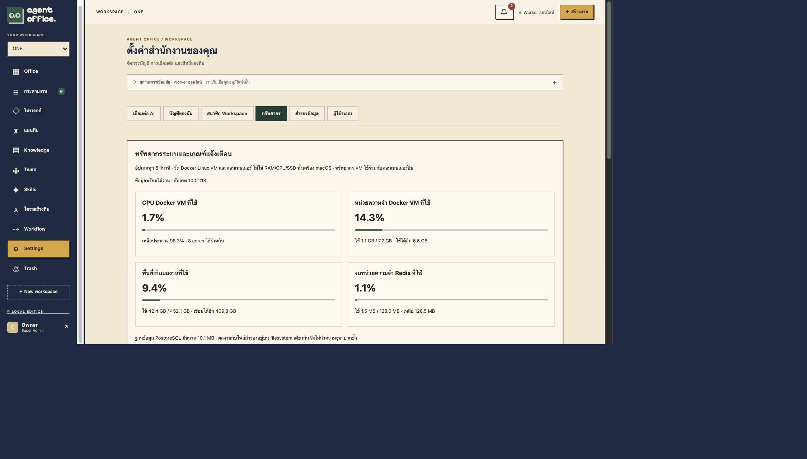

ดู [รายงานการทดสอบและข้อจำกัด](docs/resource-monitoring-report.md) และ [ตัวอย่างรายการแจ้งเตือน](docs/images/resource-notifications.jpg)

## แบ่งออฟฟิศเป็นหลายห้อง

เปิด **Office → จัดห้อง → ห้องและฝ่าย → วาดห้อง** ลากบนพื้นเพื่อกำหนดขอบ ปล่อยเมาส์แล้วคลิกผนังเพื่อใส่ประตู ระบบตั้งชื่อให้เอง ไม่ต้องกรอกขนาดหรือพิกัด กด **บันทึกออฟฟิศ** เมื่อจัดเสร็จ สลับแท็บเฟอร์นิเจอร์เพื่อจัดของใช้ได้ ยกเลิกเพื่อกลับไปใช้ผังที่บันทึกไว้

- แผนที่เดิม 20 × 12 ช่อง รองรับห้องสี่เหลี่ยมขั้นต่ำ 3 × 3 ช่อง เว้นทางเดินระหว่างห้องอย่างน้อยหนึ่งช่อง ระบบจับขอบให้เข้าตารางอัตโนมัติ
- แต่ละห้องมีหนึ่งประตู ต้องเปิดเข้าทางเดินภายในแผนที่ ห้ามวางเฟอร์นิเจอร์คร่อมผนังหรือปิดช่องประตูทั้งด้านในและนอก
- กำหนดฝ่ายของ Agent ใน **โครงสร้างทีม** ให้ตรงกับฝ่ายประจำห้อง ระบบจับคู่ชื่อโดยไม่สนตัวพิมพ์ใหญ่เล็กและช่องว่างหัวท้าย แต่ละฝ่ายมีห้องประจำหนึ่งห้อง เว้นฝ่ายว่างสำหรับห้องประชุมหรือส่วนกลาง
- ตัวละครประจำฝ่ายใช้ห้องนั้นเป็นพื้นที่ทำงานและเดินเล่น Agent ที่ไม่มีห้องประจำใช้พื้นที่ส่วนกลาง เส้นทางระหว่างห้องต้องผ่านประตู
- แก้ไขและลบห้องได้ การลบห้องไม่ลบ Agent หรือเฟอร์นิเจอร์ ห้องเป็นการจัดพื้นที่ ไม่ใช่ขอบเขตสิทธิ์ข้อมูล และไม่เปลี่ยน Workflow
- สมาชิกที่แก้ไข Workspace ได้จัดห้องได้ Viewer ดูได้เท่านั้น ระบบตรวจเวอร์ชันก่อนบันทึกเพื่อป้องกันการเขียนทับผังของผู้อื่น

ข้อมูลห้องเก็บร่วมกับ layout ใน PostgreSQL และรวมใน backup อัตโนมัติ Workspace เก่ายังคงเปิดได้โดยไม่มีห้องเพิ่มเอง

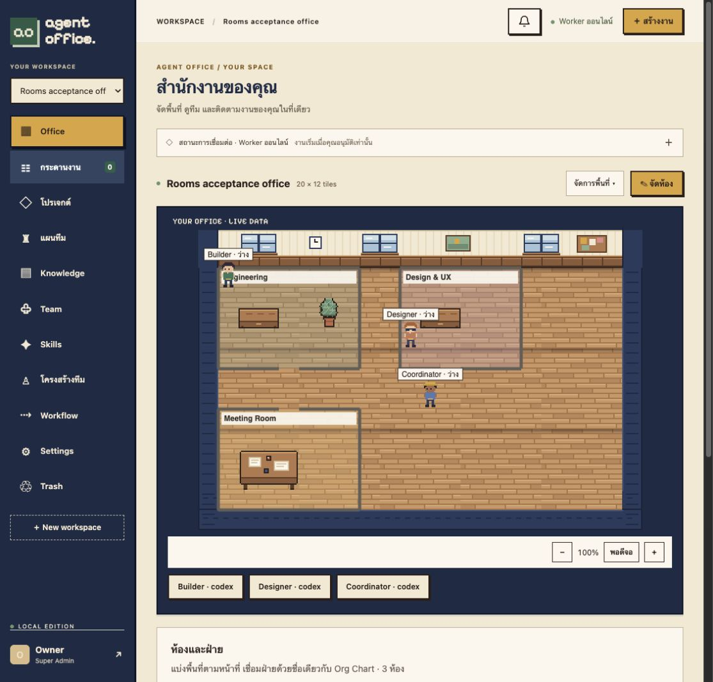

[ผลการทดสอบระบบแบ่งห้อง](docs/office-rooms-report.md)

ล้างประวัติแจ้งเตือนได้จาก **กระดิ่งขวาบน → ล้างประวัติ → ยืนยันล้างประวัติ** ล้างเฉพาะรายการที่สิ้นสุดแล้วจากบัญชีของคุณ ไม่กระทบประวัติของผู้ดูแลคนอื่น คำเตือนที่ยังเกิดอยู่จะคงแสดงจนกว่าปัญหาจะสิ้นสุด ปุ่มจะปิดเมื่อไม่มีประวัติที่ล้างได้

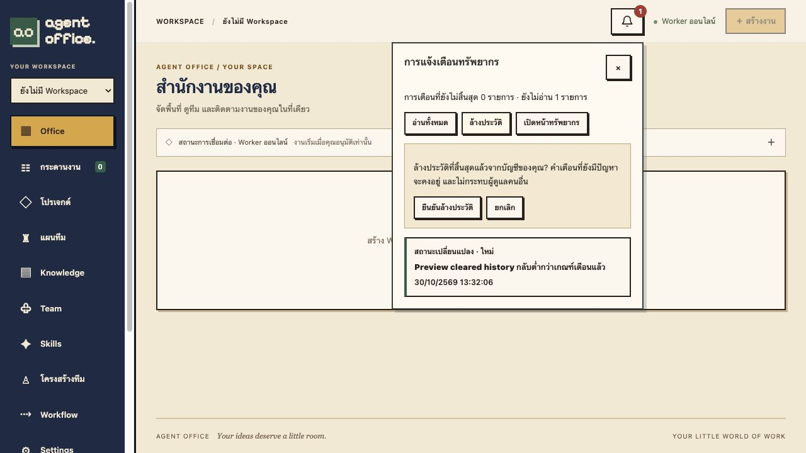

การทดสอบปุ่มล้าง: ผ่าน 4 HTTP tests ของ monitoring, 29 Rust tests และ 7 frontend domain/rendering tests พร้อมตรวจแยกประวัติผู้ดูแลสองบัญชี ([หลักฐาน](docs/measurements/clear-notifications-proof.json)) และทดสอบกดยกเลิก/ยืนยันจากหน้าจอจริง

สุ่มวันเกิด Agent ได้ที่ **Team → เพิ่ม/แก้ไข Agent → วันเกิดและบุคลิก → 🎲 สุ่มวันเกิด** กดสุ่มใหม่หรือแก้วันที่เองได้ แล้วกดบันทึกเพื่อคำนวณบุคลิกจาก master data เดิม วันที่ไม่เปลี่ยนเองเมื่อเปิดระบบใหม่ ระบบสุ่มเฉพาะวันที่ในปฏิทิน ไม่เรียก AI

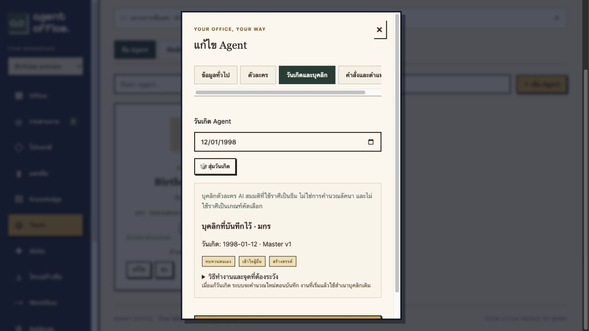

## เลือกห้องให้ Agent โดยไม่ใช้พิกัด

ฟอร์ม Agent ไม่มีช่อง X, Y แล้ว และฐานข้อมูล agents ไม่มีคอลัมน์ x/y Agent เดิมย้ายเป็น **จัดให้อัตโนมัติตามฝ่าย** โดยเก็บชื่อ บทบาท วันเกิด บุคลิก และข้อมูลอื่นไว้

ที่ **Team → เพิ่ม/แก้ไข Agent → คำสั่งและห้อง** เลือกได้สามแบบ:

- **จัดให้อัตโนมัติตามฝ่าย** ใช้ห้องที่ชื่อฝ่ายตรงกับ Org Chart หากไม่มีใช้พื้นที่ส่วนกลาง
- **พื้นที่ส่วนกลาง** เลือกให้ใช้ทางเดิน/พื้นที่นอกห้อง
- **ชื่อห้อง** เลือกห้องเองได้แม้เป็นคนละฝ่าย หรือเปิด “เลือกห้องจากภาพแผนที่” แล้วคลิกห้อง

กดบันทึกเพื่อเก็บการเลือก ระบบเลือกจุดว่างให้เอง สามารถลากตัวละครบนหน้า Office ไปยังห้องอื่นเพื่อย้ายห้องได้ การลากไปทางเดินเลือกพื้นที่ส่วนกลาง ไม่มีการเก็บจุดที่ปล่อยเมาส์เป็นพิกัดประจำ Agent ถ้าลบห้องที่เลือก Agent จะกลับเป็นจัดให้อัตโนมัติ โดยไม่ถูกลบ

ห้องและเฟอร์นิเจอร์ยังใช้พิกัดภายในเครื่องมือจัดผัง พิกัดชั่วคราวสำหรับวาดและเดินตัวละครอยู่เฉพาะการแสดงผล ไม่ใช่ข้อมูลตำแหน่ง Agent ในฐานข้อมูล

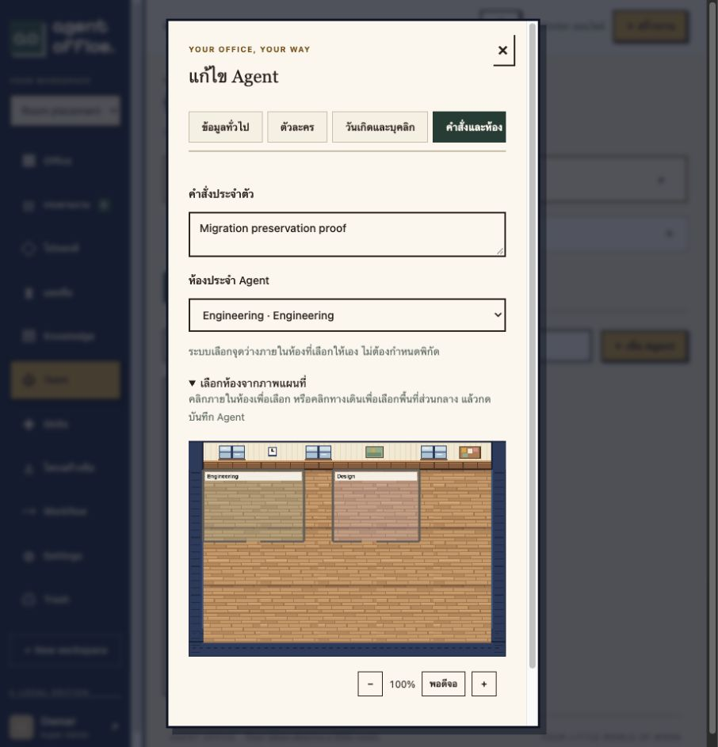

[ผลตรวจ migration และการใช้งาน](docs/agent-room-placement-report.md)

## เครื่องมือวาดห้องบนแผนที่

- **วาดห้อง:** ลากกำหนดกรอบห้องบนพื้น แล้วคลิกผนังเพื่อใส่ประตู ก่อนใส่ประตูจะยังบันทึกออฟฟิศไม่ได้
- **เลือก / ย้าย / ปรับขนาด:** คลิกห้องเพื่อเลือก ลากกลางห้องเพื่อย้าย หรือลากจุดที่มุมเพื่อปรับขนาด
- **ใส่ / ย้ายประตู:** คลิกเส้นผนังที่ต้องการ เห็นวงกบ บานประตู และแนวเปิดบนภาพทันที หนึ่งห้องมีหนึ่งประตู
- ขอบตัวอย่างสีแดงแสดงพื้นที่ที่ใช้ไม่ได้ เช่น ทับห้องเดิม เฟอร์นิเจอร์คร่อมผนัง หรือประตูถูกขวาง
- เปลี่ยนชื่อและฝ่ายได้เมื่อเลือกห้อง ไม่ต้องกรอกหน้าที่ ขนาด พิกัด หรือช่องประตู
- ใช้ **ย้อนกลับ / ทำซ้ำ**, Esc เพื่อยกเลิก และกด **บันทึกออฟฟิศ** เพื่อเก็บผังถาวร

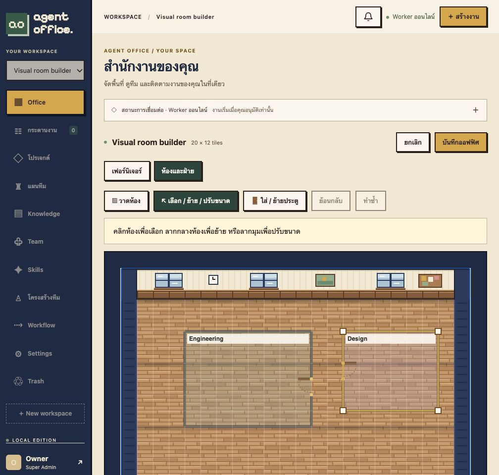

[หลักฐานการทดสอบเครื่องมือวาดห้อง](docs/visual-room-builder-report.md)

## การปรับ schema

ระบบใช้ migration ตามเวอร์ชัน ข้อมูลรูปห้องยังจำเป็นต่อแผนที่ แต่ฟิลด์หน้าที่ห้องจากฟอร์มเดิมและสำเนา prompt เต็มที่ไม่มีส่วนอ่านใช้งานถูกนำออกแล้ว ผลลัพธ์งาน ตัวชี้วัด token และข้อมูลบัญชียังคงอยู่ ดู [รายงานตรวจ schema และผลทดสอบ](docs/schema-audit.md)

แก้ไขฝ่าย หน้าที่ และขอบเขตตัดสินใจได้จาก **Team → การ์ด Agent → ฝ่าย หน้าที่ และขอบเขต** หรือกดปุ่มชื่อเดียวกันด้านบนฟอร์มแก้ไข Agent หน้าต่างที่เปิดมีช่อง **ฝ่าย / แผนก**, **รายงานต่อ**, **หน้าที่รับผิดชอบ** และ **ขอบเขตการตัดสินใจ** กด **บันทึกบทบาทและ Skill** เพื่อบันทึก เจ้าของ Workspace และ Super Admin แก้ไขข้อมูลส่วนนี้ได้

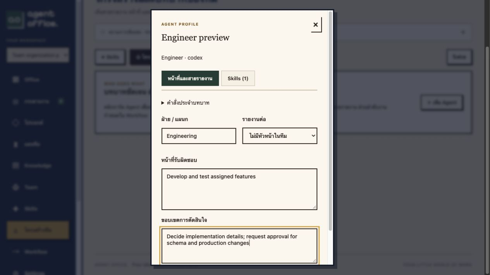

## ใช้หน้าโปรเจกต์

หน้าโปรเจกต์แสดงการ์ดสรุปชื่อ รายละเอียด และจำนวนงาน กด **สร้างโปรเจกต์** เพื่อเปิดฟอร์มใหม่ หลังสร้างให้กด **สร้างงานในโปรเจกต์นี้** ระบบจะเลือกโปรเจกต์ให้ในฟอร์มงานโดยอัตโนมัติ การสร้างงานยังไม่เริ่มเรียก AI

ปุ่ม **บันทึกการแก้ไข** แสดงเฉพาะเมื่อเปิด **แก้ไขโปรเจกต์** และมีข้อมูลเปลี่ยน ย้ายโปรเจกต์ได้ที่ **เพิ่มเติม → ย้ายไปถังขยะ → ยืนยัน** และกู้คืนได้จากแท็บ **ถังขยะ** งานเดิมยังคงอยู่

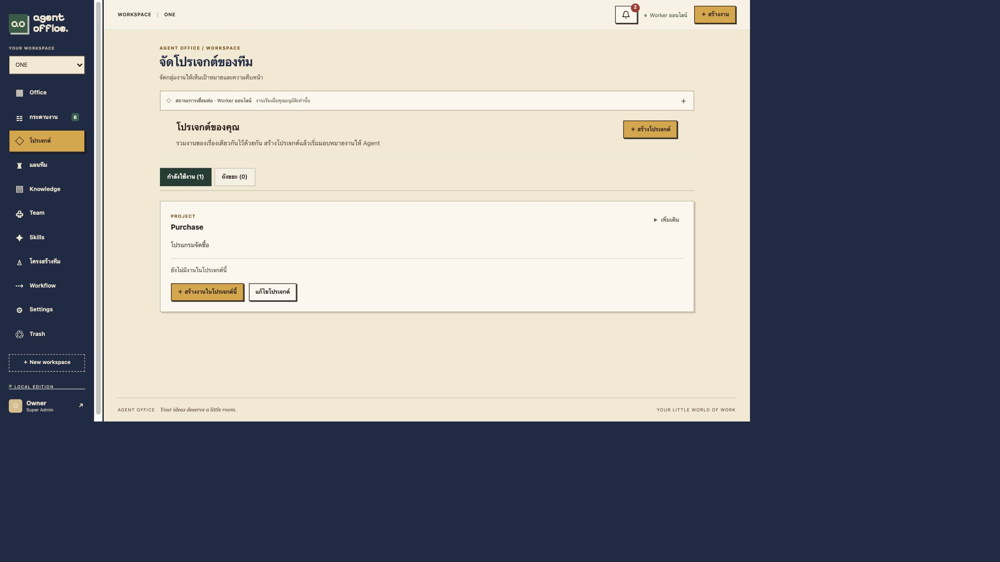

## เลือกโมเดลให้ Agent

ไปที่ **Team → เพิ่ม/แก้ไข Agent → ข้อมูลทั่วไป → โมเดล AI** เลือกผู้ให้บริการก่อน แล้วเลือกโมเดลหรือใช้ค่าเริ่มต้นเดิม กด **รีเฟรชรายชื่อโมเดล** หาก Worker เพิ่งเชื่อมต่อ โมเดล Codex มาจาก cache ของ Worker บัญชีคุณ ส่วน Claude เลือก Sonnet, Opus หรือ Haiku ตามสิทธิ์บัญชี

ระบบเก็บตัวเลือกโมเดลไว้เมื่อเริ่มงาน การแก้ Agent ภายหลังไม่เปลี่ยนตัวเลือกของงานนั้น ตรวจค่าได้ที่สถิติงานหัวข้อ **โมเดลที่ร้องขอ** ชื่อกลุ่มโมเดลอาจเปลี่ยนรุ่นตามผู้ให้บริการ การตั้งค่านี้ไม่เพิ่ม API-key fallback และไม่รวมตัวเลือก Fable ที่อาจใช้เครดิตเพิ่มเติม

[รายละเอียดและข้อจำกัดการเลือกโมเดล](docs/agent-model-selection-report.md)

## กรอกขั้นตอน Workflow แบบย่อ

ในแท็บ **ขั้นตอน** เลือก Agent แล้วระบบแนะนำชื่องานตามบทบาทให้ แก้ชื่อได้ตามต้องการ รายละเอียดงานเพิ่มเติมไม่บังคับ กด **เพิ่มขั้นตอนถัดไป** แล้วระบบตั้งให้รอขั้นก่อนหน้าผ่านตรวจรับ หากต้องการทำคู่ขนานให้เปลี่ยน **เริ่มงานเมื่อใด** เป็นเริ่มพร้อมงานแรก หรือเลือกขั้นที่ต้องรอเอง

Skill ที่ผูกกับ Agent ยังคงถูกส่งเข้าไปในบริบทงานตามเดิม ส่วนไฟล์บังคับ เกณฑ์ตรวจรับ ผู้ตรวจรับ และ Skill ที่จำเป็นอยู่ใน **รายละเอียดเพิ่มเติม** ข้อมูลเก่าคงอยู่ เมื่อเอาขั้นกลางออก งานที่เคยรอขั้นนั้นจะรับลำดับรอของขั้นที่ลบแทน เพื่อไม่ข้ามจุดตรวจรับโดยไม่ตั้งใจ ฟอร์มนี้ใช้ร่วมกับการแก้ร่างในหน้าแผนทีมด้วย

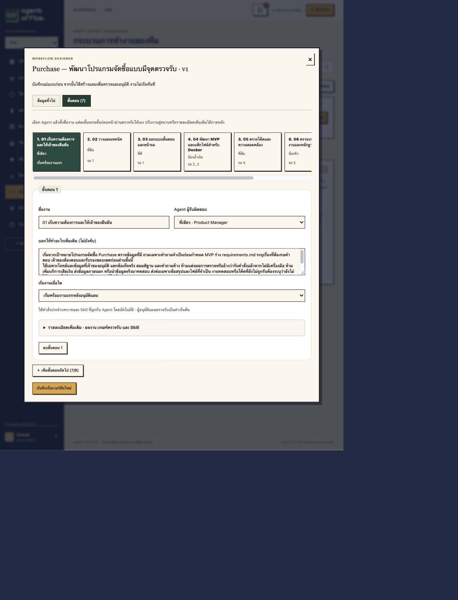

## หน้าแผนทีม

หน้าแผนทีมแยกการดูแผน แก้ไข อนุมัติ และติดตามงาน เพื่อไม่ให้ฟอร์มและปุ่มเริ่มงานปะปนกัน ด้านบนมีข้อความ **ขั้นต่อไป** บอกสิ่งที่ต้องทำตามสถานะของแผน

### กรองรายการและสร้างร่าง

- **ทั้งหมด / รอเริ่ม / เริ่มแล้ว / ยกเลิก:** กรองรายการตามสถานะ พร้อมจำนวนแผน โดยแผนที่งานครบแล้วยังอยู่ในกลุ่มเริ่มแล้ว และแสดงจำนวนงานที่เสร็จ
- **ใช้ Workflow ที่เตรียมไว้:** ไปเลือกแม่แบบที่เมนู Workflow แล้วกด **ใช้สร้างแผน**
- **สร้างร่างเอง:** เปิดหรือปิดฟอร์มสร้างแผนใหม่ ฟอร์มไม่แสดงค้างเมื่อเข้าหน้า

### แท็บภายในแต่ละแผน

| แท็บ | ใช้ทำอะไร |
|---|---|
| สรุปแผน | ดูจำนวนขั้น ความคืบหน้า เป้าหมายฉบับเต็ม แม่แบบที่ใช้ และตัววัด Token; เปิดงานเสนอแผนหรือนำข้อเสนอ AI เข้าร่างเมื่อมี |
| ขั้นตอน | ตรวจผู้รับผิดชอบ ลำดับรอ และข้อตกลงส่งมอบ; เจ้าของร่างที่มีสิทธิ์แก้ไขสามารถปรับและบันทึกได้ |
| ตรวจและเริ่ม | แสดงเฉพาะร่างที่คุณแก้ไขได้ ตรวจความพร้อมและยืนยันการใช้โควตาก่อนเริ่มทีม |
| ติดตามงาน | ดูสถานะงานในแผนและกดเปิดงานเพื่ออ่านผลงาน ตรวจรับ หรือส่งแก้ งานปรากฏหลังอนุมัติเริ่มทีม |

### บันทึกและอนุมัติเริ่มทีม

1. แก้แผนในแท็บ **ขั้นตอน** แล้วกด **บันทึกการแก้ไข** ปุ่มจะเปิดเมื่อมีการแก้ไขและทุกขั้นมีชื่อกับ Agent ที่พร้อม
2. เปิด **ตรวจและเริ่ม** เช็กลิสต์ต้องครบ: มีขั้นตอน ทุกขั้นมีชื่อและ Agent ที่พร้อม และบันทึกการแก้ไขล่าสุดแล้ว
3. ตัวเลือก **การใช้ Knowledge** เปิดดูเพิ่มเติมได้ ค่าเริ่มต้นยังใช้บริบทเต็มตามเดิม หากเลือกโหมดทดลองจะคัด Knowledge ตามงานและใช้ใบส่งต่อที่ผ่านตรวจ โดยเก็บ Skill ไว้ครบตามการตั้งค่า
4. ทำเครื่องหมาย **ฉันตรวจแผนแล้ว และอนุญาตให้ใช้โควตาสมาชิกตามงานในแผน** แล้วกด **อนุมัติและเริ่มทีม**
5. หากแก้ขั้นตอนหลังทำเครื่องหมายอนุมัติ ระบบจะล้างการยืนยัน ต้องบันทึก ตรวจ และยืนยันใหม่ก่อนเริ่ม

ปุ่มเริ่มทีมจะยังปิดเมื่อร่างไม่พร้อม มีการแก้ไขที่ยังไม่บันทึก หรือยังไม่ยืนยันการใช้โควตา ฝั่งบริการยังตรวจสิทธิ์ สถานะแผน และการเชื่อมต่อก่อนเริ่มจริง

### หยุดแผนและตรวจรับงาน

ไปที่ **สรุปแผน → จัดการแผน → หยุดแผนนี้** แล้วอ่านข้อความยืนยัน การหยุดจะไม่ให้เริ่มงานถัดไปและขอยกเลิกงานที่กำลังทำ ผลงานเดิมยังคงอยู่

สำหรับงานที่รอตรวจรับ เปิดจาก **ติดตามงาน** แล้วตรวจผลและไฟล์จริงก่อนรับงาน หากยังมีคำถามสำคัญหรือผลทดสอบไม่ครบ ให้ส่งแก้หรือระบุสิ่งที่ยังไม่ได้ทดสอบ แทนการกดผ่านเพื่อให้ขั้นถัดไปเริ่ม

การใช้ Workflow และ Skill ไม่ได้เพิ่มเครื่องมือรันโปรแกรมให้ Agent โดยอัตโนมัติ การ build/test โปรแกรมที่สร้างให้เปิด Runner ในขั้นตอนงานที่รองรับ แล้วติดตามหลักฐานจากแท็บเปิดโปรแกรม ดูขอบเขตและมาตรฐาน Runner ด้านล่าง แม่แบบ Workflow อยู่ระดับ Workspace และยังไม่ผูกงานเข้ากับ Project อัตโนมัติ

ภาพตัวอย่างก่อนอนุมัติแผน แสดงเช็กลิสต์และปุ่มเริ่มที่ยังปิดจนกว่าจะยืนยัน:

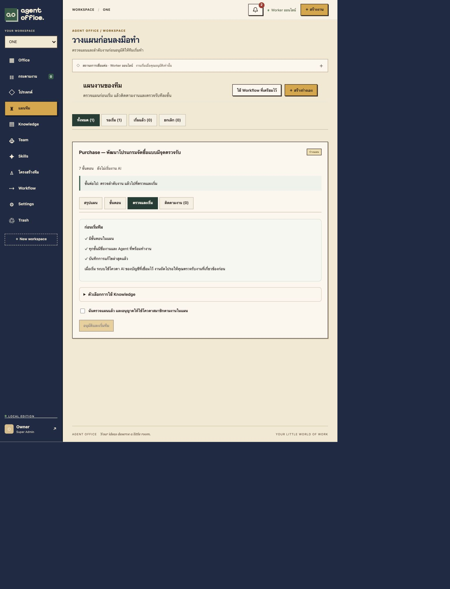

ภาพหน้าแผนทีมปัจจุบัน แสดงแผนที่เริ่มแล้วและข้อความแจ้งว่ามีงานรอตรวจรับ:

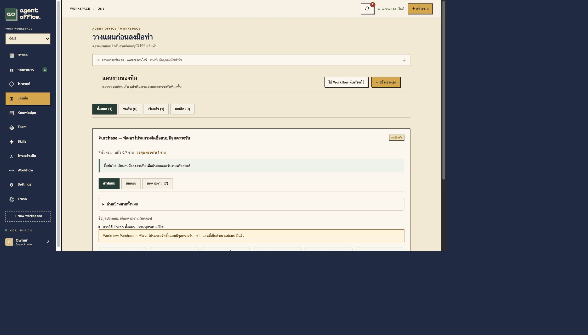

เปิดแท็บติดตามงานเพื่อดูสถานะรายขั้น แล้วกดเปิดงานที่ต้องอ่านผลงานหรือตรวจรับ:

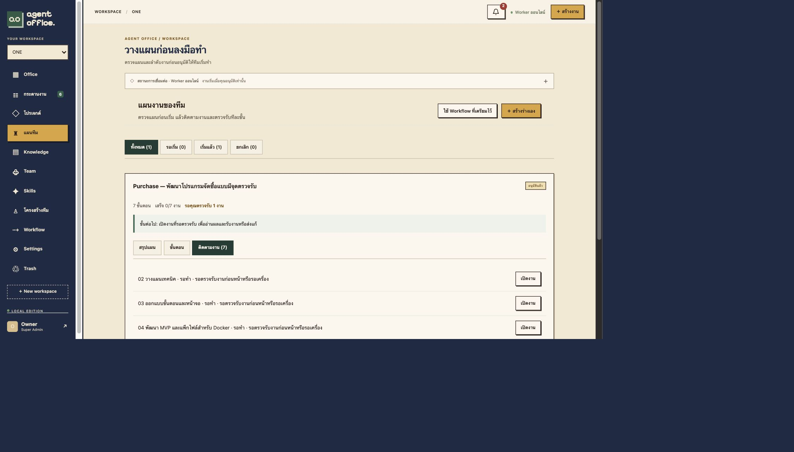

## ดูไฟล์ผลงานบนเว็บก่อนตรวจรับ

เปิดงาน → **ผลงานและตรวจรับ → ดูไฟล์** เพื่ออ่านไฟล์ในหน้าต่างพรีวิวได้ทันที ปิดด้วยปุ่ม × หรือ Esc เพื่อกลับหน้าตรวจรับเดิม ปุ่ม **ดาวน์โหลด** ยังแยกไว้สำหรับเก็บต้นฉบับ ใช้ได้ทั้งไฟล์รอบล่าสุดและไฟล์ในแท็บประวัติ โดยยังตรวจสิทธิ์ผู้ใช้และ Workspace เช่นเดียวกับการดาวน์โหลด

- Markdown รองรับหัวข้อ ย่อหน้า รายการ ตาราง และบล็อกโค้ดแบบพื้นฐาน
- ข้อความ โค้ด JSON HTML และ SVG แสดงเป็นข้อความ ไม่รันสคริปต์หรือแทรก HTML ของไฟล์เข้าหน้าเว็บ
- PNG, JPEG, GIF และ WebP แสดงเป็นภาพ
- ไฟล์ข้อความพรีวิวได้ไม่เกิน 512 KiB รูปภาพใช้เพดานไฟล์เดิม 10 MiB PDF, Word, Excel ไฟล์ไบนารี หรือไฟล์ที่เปิดไม่ได้ยังใช้ปุ่มดาวน์โหลด พรีวิวนี้ไม่ใช่ตัวรันโปรแกรมหรือเว็บแอป

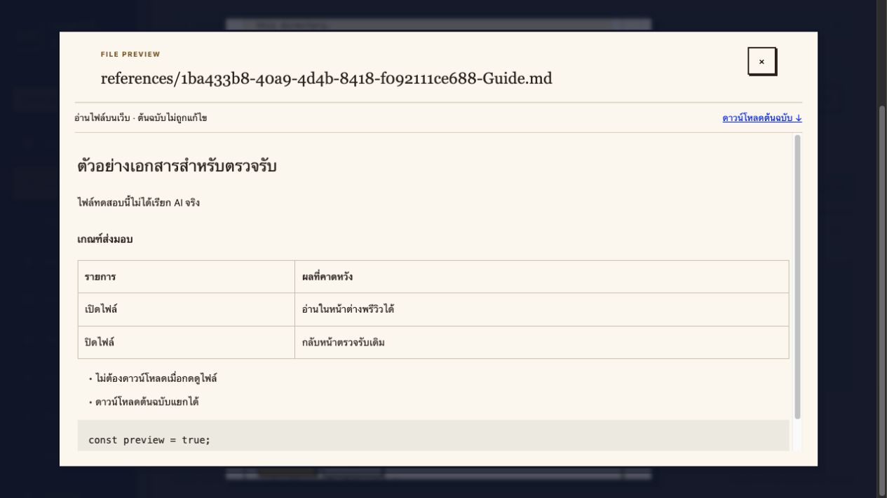

## ชั้นสิ่งของและการโต้ตอบของตัวละคร

ใน **Office → จัดห้อง → เฟอร์นิเจอร์** เลือก **วางสิ่งของ** แล้วเลือกของจากรายการ คลิกวางซ้อนกันได้ตามชั้นที่ระบบกำหนดให้ ไม่ต้องกรอกเลขชั้น:

| ชั้น | สิ่งของ | กติกา |
|---|---|---|
| 1 | พรม | อยู่ใต้เฟอร์นิเจอร์ เดินผ่านได้ แต่พรมทับพรมไม่ได้ |
| 2 | โต๊ะ เก้าอี้ โซฟา และเฟอร์นิเจอร์พื้นอื่น | ของชั้นเดียวกันห้ามทับกัน |
| 3 | คอมพิวเตอร์ | วางบนโต๊ะทำงานหรือโต๊ะประชุมได้ ไม่ซ้อนกับคอมอีกเครื่องหรือเฟอร์นิเจอร์ชนิดอื่น; คอมเดิมที่วางบนพื้นยังรองรับ |

ต้องการแก้ของที่อยู่ใต้ชิ้นอื่น ให้กด **เลือก / ย้าย → เลือกสิ่งของชั้น** แล้วเลือกชั้น 1, 2 หรือ 3 ค่า **บนสุด** เลือกชิ้นที่วาดอยู่ด้านบน การย้ายโต๊ะจะพาคอมที่วางอยู่บนโต๊ะย้ายตามด้วย หากปลายทางชนของหรือออกนอกพื้นที่ ระบบจะไม่ย้ายชุดนั้น ใช้ย้อนกลับ/ทำซ้ำได้ และกด **บันทึกออฟฟิศ** เมื่อจัดเสร็จ

ขณะมีงานสถานะกำลังทำ ตัวละครจะพยายามเดินไปยังจุดที่เข้าถึงได้ข้างคอม โต๊ะ หรือโต๊ะประชุมภายในพื้นที่ที่ตัวเองอยู่ มีข้อความกิจกรรมและภาพเคลื่อนไหวเมื่อถึงจุดใช้งาน หากไม่มีจุดที่เดินถึงได้จะใช้ตำแหน่งทำงานเดิม เมื่อว่างและไม่มีงานรอตรวจ/รอเชื่อมต่อ ตัวละครอาจเดินไปเครื่องชงกาแฟ ชั้นหนังสือ หรือต้นไม้ การแสดงกิจกรรมเป็นภาพประกอบสถานะ ไม่ใช่หลักฐานว่า Agent รันโค้ดหรือทดสอบโปรแกรมแล้ว

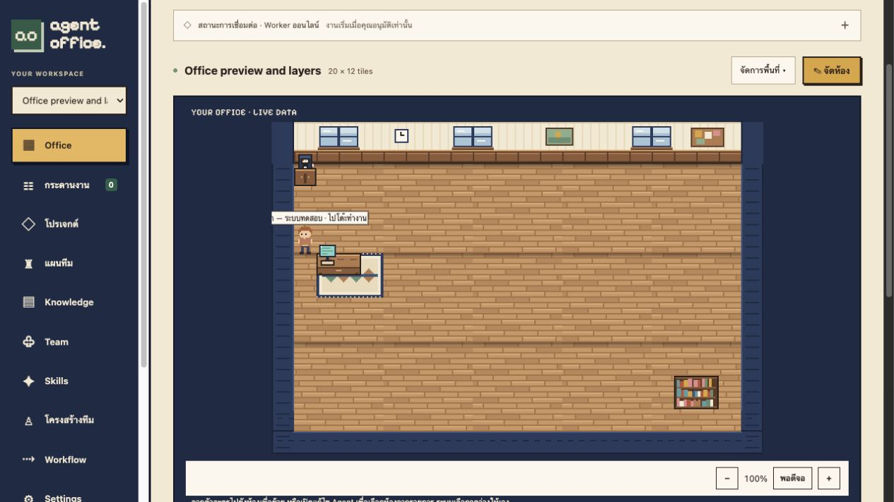

ระดับชั้นคำนวณจากชนิดสิ่งของใน layout เดิม ไม่เพิ่มพิกัด Agent หรือช่องกรอกระดับในฐานข้อมูล ดู [ผลทดสอบพรีวิวและออฟฟิศซ้อนชั้น](docs/preview-and-office-layers-report.md)


### สร้างโปรแกรมแล้วเปิดบนเครื่องด้วย Runner

เลือก **ให้ Runner Build / Test และเปิดเว็บอัตโนมัติหลัง Agent ส่งงาน** ตอนสร้างงาน หรือกำหนดในขั้นตอน Workflow ก่อนอนุมัติแผน เมื่อ Agent ส่งไฟล์ ระบบจะ Build → Test → ตรวจ HTTP ให้อัตโนมัติ โดยไม่ต้องเข้า Container ไปพิมพ์คำสั่งเอง สำหรับงานเดิม เปิดรายละเอียดงาน → แท็บ **เปิดโปรแกรม** → ยืนยันการรัน → **Build / Test / เปิดเว็บ** ในแถบล่างของ Modal

เมื่อสถานะ **พร้อมเปิดเว็บ** ให้กด **เปิดเว็บบนเครื่องนี้** ระบบแสดง URL เฉพาะ Preview เช่น `http://preview-<id>.localhost:19000` พร้อมหลักฐานของ source run ที่ทดสอบจริง มีปุ่มหยุดและประวัติ Log แยกจาก Log ของ Agent; Preview หยุดอัตโนมัติในสองชั่วโมง การผ่าน HTTP ยืนยันว่าเปิดเว็บได้ ไม่ใช่การรับรองฟังก์ชันธุรกิจทั้งหมด ผู้ใช้ยังตรวจรับผลงานสุดท้ายได้ตาม Workflow

มาตรฐานกลางอยู่ที่ **Knowledge → มาตรฐานกลางสำหรับ Agent** นำเข้าจากไฟล์ [application-runtime-v1.md](server/standards/application-runtime-v1.md) เมื่อระบบเริ่ม และแนบในบริบทงานใหม่ทุก Workspace/ทั้ง Codex และ Claude งานเก่าที่ไม่มีมาตรฐานจะได้รับผ่าน prompt สำรอง Agent ต้องส่ง source จริง, `office-run.json`, `package.json`, `package-lock.json` และชุดทดสอบ เมื่อแก้งานหรือ retry ระบบแนบผล Runner รอบก่อนให้ผู้สร้างงาน และผู้ตรวจที่เป็น Agent ต้องมีหลักฐานพร้อมใช้งานตรง source run ก่อนผ่านงานที่เปิด Runner

**ขอบเขตรุ่นแรก:** Node.js รวมถึง React ที่ build เป็น production assets และให้ Node serve ไฟล์; ยังไม่รัน Compose ที่ Agent เขียนเองหรือรองรับฐานข้อมูลของโปรแกรมลูก/ทุกภาษาโดยอัตโนมัติ Server ต้องฟัง `0.0.0.0:process.env.PORT` (Runner กำหนด 3000) ตัวอย่างไฟล์ครบอยู่ใน [runtime-node](server/fixtures/runtime-node) ไฟล์ตัวอย่างนี้ใช้ทดสอบ ไม่สร้างข้อมูลตัวอย่างลง Workspace ใช้งานจริง

Runner เป็นบริการแยกที่ควบคุม Docker บนเครื่องเดียวกัน Worker และเว็บ Office ไม่มี Docker socket โปรแกรมลูกไม่มีบัญชี AI/ฐานข้อมูล Office หรือโฟลเดอร์เครื่องผู้ใช้ ใช้ source ที่ลงทะเบียนของงานเท่านั้น (สูงสุด 100 ไฟล์/50MB) พื้นที่ทำงานชั่วคราวจำกัด 512MB, ติดตั้ง dependency จาก npm registry ด้วย lockfile v3 และปิด install hooks, build จำกัด 1GB/1 CPU และไม่มีเครือข่าย, แอปจำกัด 512MB/1 CPU ระบบใช้ Gateway เฉพาะที่เปิดบน loopback และโดเมนย่อย `.localhost` เพื่อแยก cookie กับ Office ไม่รองรับ WebSocket ในรุ่นนี้ สูงสุด 3 Preview ต่อเจ้าของงาน/6 รวม

การย้ายเครื่องให้สำรองข้อมูล Office และ source ตามระบบสำรองปกติ Preview เป็นสภาพแวดล้อมชั่วคราว ไม่รวม runtime volume ใน Backup ให้เปิดใหม่จาก source เมื่อย้ายเครื่อง Docker ต้องทำงานอยู่และมี image Node.js; การดึง image/ติดตั้ง dependencies ต้องใช้อินเทอร์เน็ตและใช้ทรัพยากรเครื่อง แต่ไม่เรียก API โมเดลเพิ่มเพื่อ Build/Test


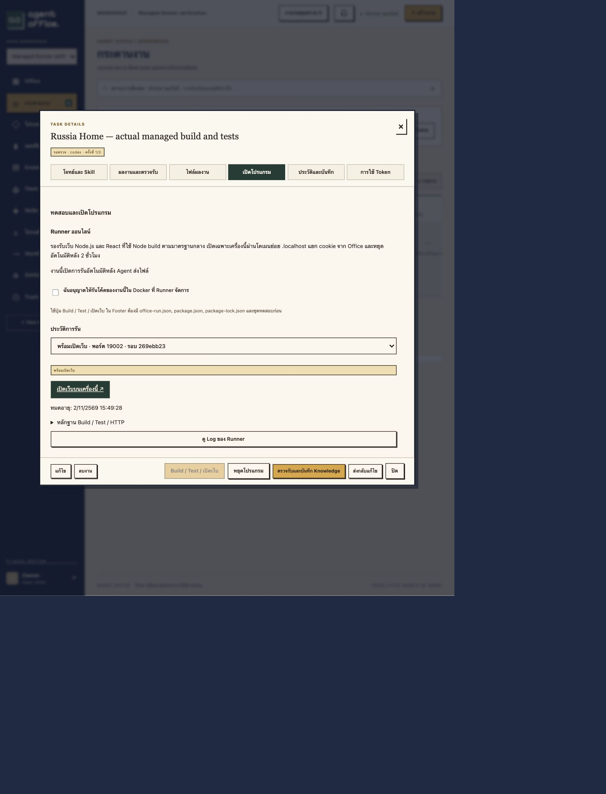

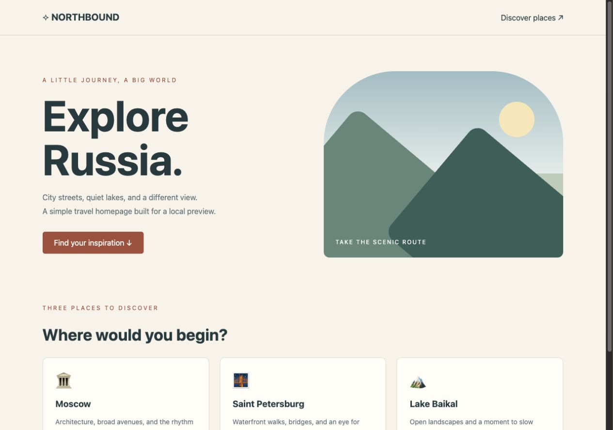

ผลทดสอบและข้อจำกัด: [Managed Runner verification](docs/runtime-runner-verification.md) ชุด API ปกติใช้ `./test.sh` และไม่เปิด Runner ส่วน `tests/probe_runtime_runner.py` เป็นการทดสอบ Docker จริงที่ต้องเลือกใช้โดยตั้งใจ โดยตรวจชื่อ project `agent-office-runtime-preview`, ฐานข้อมูล `office_test`, Worker แบบ fixture และการไม่มี volume บัญชี AI ก่อนเริ่ม ไม่ชี้ไปยังระบบใช้งานจริง
