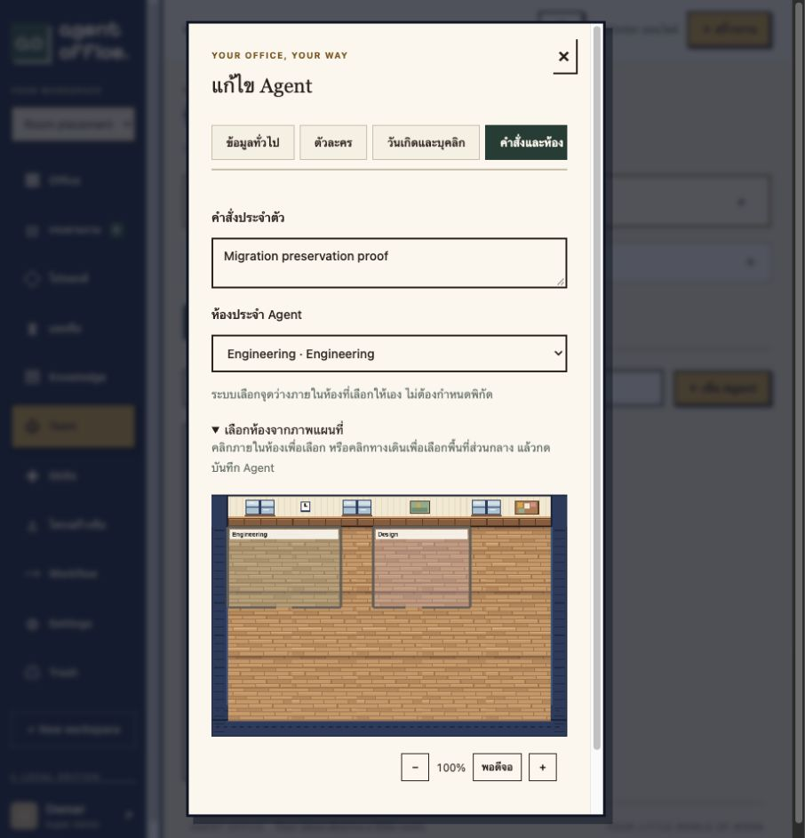

# Agent room placement verification

Verified on 2026-10-30 using Docker Compose and the actual browser.

Migration 0018 adds placement mode (auto/common/room) and an optional room identifier, then drops the x and y columns from agents. Existing agents default to auto. Agent API requests no longer require or store coordinates. Legacy omitted placement fields preserve existing room selections when editing. Workspace row locks serialize room selection against layout edits; removing a selected room resets the affected agents to auto and increments their versions.

The frontend removes coordinate controls and numeric position text. Agent forms offer automatic department placement, common space or a named room, with optional click-to-select on the map. Characters derive temporary render positions from their IDs and room selection. Dragging a character between rooms saves only the room, not the dropped point. Read-only users cannot perform these writes. Room assignments do not affect AI instructions, access permissions or workflows.

Validation:

- 86 HTTP integration tests passed, including creation without coordinates, missing/foreign room rejection, invalid mode combinations, preservation of omitted selections, optimistic conflicts, and automatic fallback when a selected room is deleted.
- 29 Rust unit tests and 8 frontend domain/rendering tests passed.
- An old image created a real pre-migration Agent with coordinates and personality in an isolated database. Upgrading that same database removed both columns while preserving every other Agent field.
- Production was backed up before migration. Before/after fingerprints verified all existing Agent fields except the removed coordinates, user accounts, provider connections and master data unchanged. information_schema confirmed neither coordinate column exists.
- Actual browser verified dropdown selection, map selection and save, per-room counts, and dragging a character from Engineering to Design. No AI inference was required and acceptance fixtures were confined to a separate preview.

Evidence: [agent-room-placement-proof.json](measurements/agent-room-placement-proof.json).

Fixed-point placement and free-form Agent coordinates are intentionally absent. The system chooses a walkable render location inside the assigned room or common area. Furniture and room geometry still have coordinates, since they define the map. Room selection is not a physical resource reservation.
