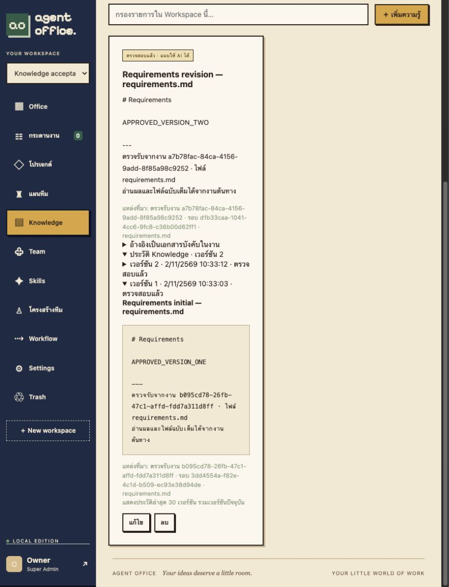

# Automatic Knowledge on task acceptance

Implemented and deployed 2026-11-02, schema migration 0023.

## Behavior

Task acceptance and automatic Knowledge saving share one PostgreSQL transaction. Revisions do not save Knowledge. The acceptance response reports created/updated/unchanged and the UI explains the outcome. The note is verified because the reviewer explicitly accepted the result. There is no additional model or embedding-generation request in this save path.

One registered, bounded UTF-8 Markdown deliverable is selected, preferring the workflow required-file order. `result.md`, inherited `inputs/`, and user-supplied `references/` are excluded. Canonical paths must stay within the source run directory. Unsupported, oversized or missing documents fall back to the first three result paragraphs (maximum 4,000 bytes). Primary Markdown content is bounded at 47,000 bytes; truncated documents carry a notice and source-task reference. This is deterministic extraction, not an AI-generated synthesis of every file.

The identity is Workspace + Project + exact relative filename, or Workspace + plan + filename for tasks without a Project. Independent tasks and result-only summaries remain task-scoped. Similar titles and user-created notes are never used to infer a match. Existing automatic notes update in place, retaining their ID so Knowledge pins remain valid. Same-run synchronization is idempotent and preserves manual corrections; a source run older than the stored source cannot roll the note back. A later accepted run may update the note after the reviewer checks its deliverable.

Migration 0023 snapshots existing notes and a database trigger records subsequent insert/edit/delete/restore versions. The authenticated history endpoint returns the latest 30 versions from the authorized Workspace. Archived automatic notes are not silently restored by future acceptance. If a replacement note exists, restoring the archived automatic identity returns a conflict without changing either note. Older accepted tasks are not imported automatically; their detail screen offers an explicit sync action.

## Verification

- Docker Compose full suite: **97 HTTP integration tests passed**.
- Final release focused suite: **6 HTTP tests passed**, including the restore conflict fix and existing manual CRUD/verification behavior. These overlap the full suite and are not additional distinct cases.
- Rust release tests: **34 passed**; frontend tests: **26 passed**; TypeScript/Vite production build passed.
- New cases cover create → update with history, same-run idempotence, manual correction preservation, old-run protection, rejection without saving, concurrent duplicate acceptance (one 200 and one 409), Project isolation, independent summaries, archived identity replacement, restore conflict, manual note non-merging, and unauthenticated/foreign-Workspace access denial.
- Browser fixture: accepted a revision through the new button, confirmed the updated toast and unchanged note identity, opened the prior version and verified both original and new text. Fixed a nested disclosure event that initially collapsed the history content.
- All task executions used isolated `office_test` fixture workers without provider-auth mounts. **No model calls or production task acceptances were performed by this verification.**

## Deployment

Waited for active production work to finish. Created a private database/artifact backup before migration. Fingerprints for workspaces, agents, tasks, knowledge, skills, agent_skills, projects, plans, workflow_versions and provider_connections matched before/after, excluding only the three new nullable Knowledge metadata columns. Existing production Knowledge count at deployment was zero; populated-note history behavior was verified in the isolated suite.

Schema 23 is active. Authenticated production health and Workspace reads pass; app/worker/backup binary hashes match and maintenance pause is off. Existing accepted tasks were not backfilled and pending tasks were not accepted on the user's behalf.

