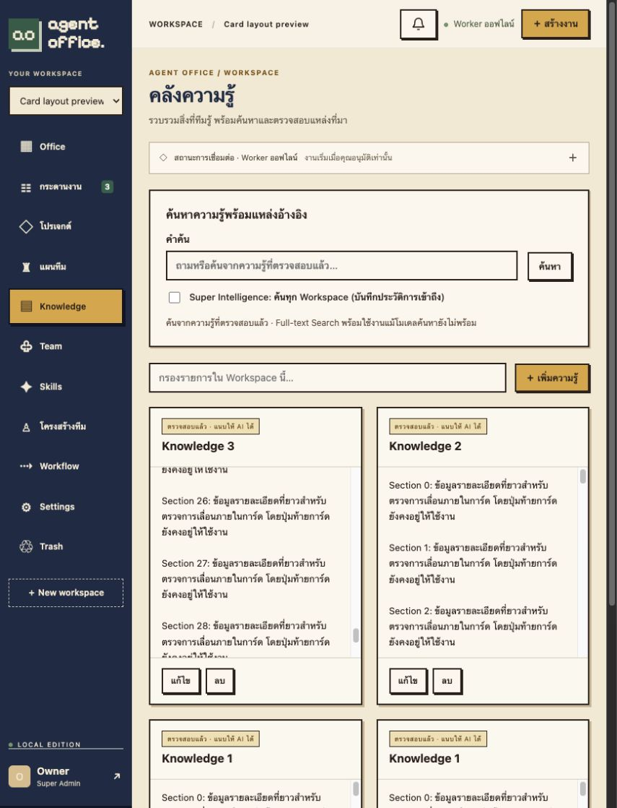
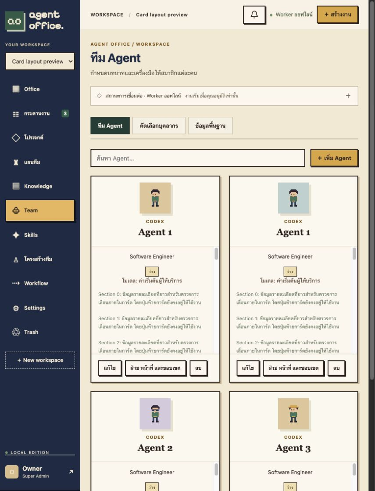

# Bounded card layout

2026-11-02: Knowledge (including search results), Team, Skills, Workflows, task board/list/attention cards, Projects, room summaries, recruitment applications and master-data cards share a three-part shell. Header identifies the item; the body owns vertical overflow; footer contains actions or summary metadata. Short cards remain compact; long content is retained and can be scrolled with pointer or keyboard. Header titles are visually limited to two lines, while their full accessible text remains intact. Existing form/editor and organization-chart layouts are not converted into scrollable cards.

| Type | Maximum height |
|---|---:|
| Knowledge / search | 420px |
| Team | 480px |
| Skill | 360px |
| Workflow | 440px |
| Task board/list | 360px |
| Project | 360px |
| Room | 210px |
| Master data | 300px |
| Recruitment application | 420px |

Verification used a disposable Docker Compose `office_test` database without a worker or provider-auth mounts. No Agent run was requested and no production records were seeded. Long-text fixtures covered Knowledge, Team, Skill, eight-step Workflow, queued tasks and Projects. Browser measurements also covered room and built-in zodiac cards and Knowledge search results. Measured cards stayed within their configured maxima and their visible footer bounds stayed inside the card. Opening the Skill edit form and Task detail modal still worked.

The first long Knowledge card stayed 420px tall with a 268px body containing 2,726px of content. Scrolling the body to 2,276px left both header and footer positions unchanged. Team cards stayed at 480px despite 1,808px of body content; task cards stayed at 360px despite 3,157px of body content. Full measurements: [bounded-cards-proof.json](measurements/bounded-cards-proof.json).

TypeScript/Vite production build and 26 frontend tests passed. Production deployment refreshes only the app container; no schema change, worker restart or content deletion is involved.

