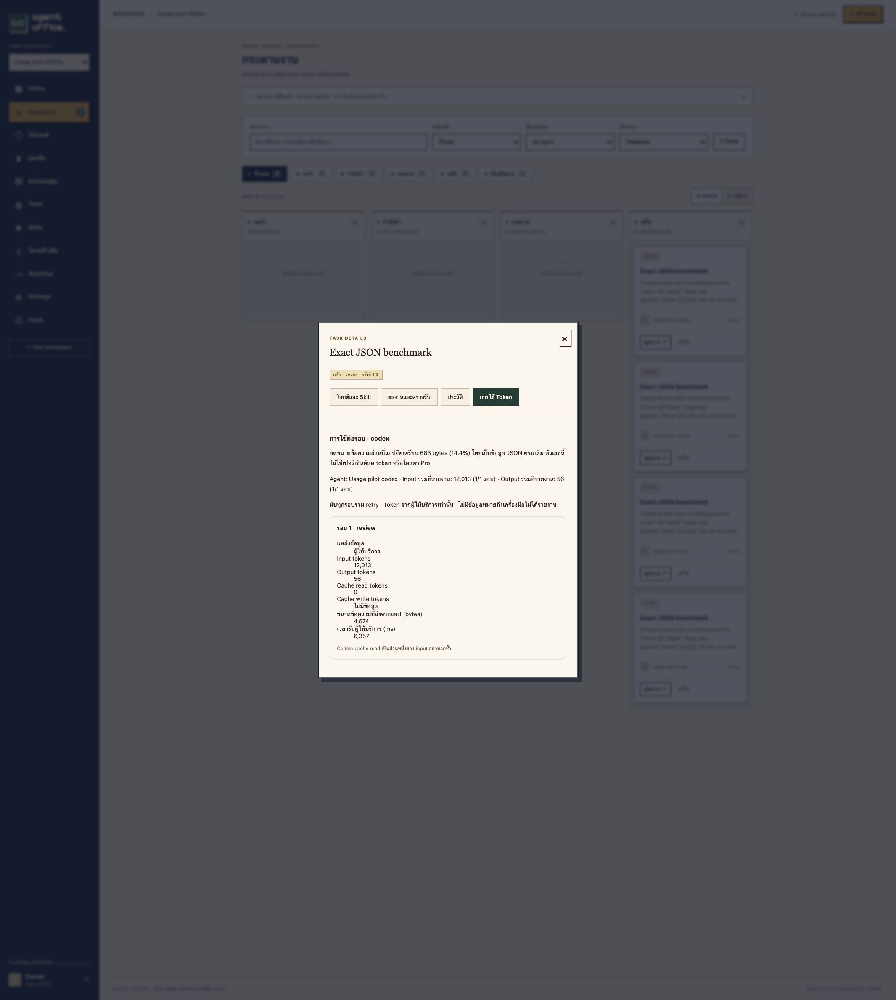

# Context usage pilot — 2026-10-30

Implemented: durable per-run counters on task details → **การใช้ Token**, including
historical attempt coverage, input/output/cache counters, elapsed time and submitted
UTF-8 prompt bytes. Missing counters remain unknown. Fixture runs are labeled.
No API keys, paid API fallback, or third-party telemetry services were added.

## Scope and method

This is the first, deliberately narrow optimization: compact JSON serialization of
the frozen Agent role and four Skills. It removes indentation and structural
whitespace while preserving every JSON value and significant spaces in strings.
It does not implement selective memory retrieval, summarized handoffs, or a general
solution to all multi-agent duplication.

Four live subscription CLI calls: one pretty baseline and one compact task per
provider. Same task description, acceptance contract and frozen Agent/Skill data
within each provider. Codex order: pretty then compact; Claude order: compact then
pretty. Default CLI model selection; no pinned model, deterministic seed, or
controlled provider load/cache state. Separate invocations can have different tool
trajectories. Therefore this is a descriptive pilot, not a causal benchmark or
statistically reliable estimate. Exact downloaded `answer.json` equality checked
sum, array, label with two significant spaces, and absence of additional fields.
All four passed, with one attempt each. Test workspace archived after execution.

## Observations

| Provider / metric | Pretty baseline | Compact | Observation |
|---|---:|---:|---|
| Codex input tokens, includes cached input | 12,220 | 12,013 | 207 fewer (1.69%) |
| Codex output tokens | 56 | 56 | unchanged |
| Codex cache read tokens, subset of input | 0 | 0 | no cache hits reported |
| Codex submitted prompt bytes | 5,357 | 4,674 | 683 fewer (12.75%) |
| Codex elapsed milliseconds | 8,836 | 6,357 | lower in this one pair |
| Claude uncached input tokens | 4 | 4 | unchanged |
| Claude cache read tokens | 11,002 | 10,033 | report separately |
| Claude cache write tokens | 2,588 | 3,092 | increased |
| Claude input + cache read + cache write | 13,594 | 13,129 | 465 fewer (3.42%) |
| Claude output tokens | 164 | 191 | increased by 27 |
| Claude submitted prompt bytes | 4,789 | 4,106 | 683 fewer (14.26%) |
| Claude elapsed milliseconds | 3,446 | 11,046 | slower in compact run |
| Exact artifact acceptance | 2 / 2 | 2 / 2 | all passed |

Claude's input sum represents the separately reported usage categories, not unique
prompt tokens or a Pro quota percentage. Codex cache reads must not be added to
its input count again. Do not compare providers as if their internal accounting or
hidden prompts were identical. Submitted byte counts cover app text, not later
tool reads or hidden CLI instructions. The UI's formatting savings denominator is
the app-generated prompt before Codex appends its file protocol, so Codex UI's
14.4% and the submitted-byte reduction of 12.75% are different, both labeled bases.

Machine-readable evidence: [context-pilot.json](measurements/context-pilot.json).

## Conclusion and next evaluation

Lossless formatting reduction is active for new tasks, and per-run measurement
works with both real providers. The pilot observed modest input reductions with
unchanged acceptance, but no consistent latency improvement. It does not establish
how much a real multi-agent workflow will save, and does not measure subscription
quota savings. Existing historical runs cannot be reconstructed retroactively.

Before implementing semantic filtering/summaries broadly, test representative
multi-step workflows with accepted file handoffs and revisions, repeat each
configuration in varied order, record model/version/cache conditions, and compare
all attempts per accepted workflow, output quality, missed requirements and time.
Keep raw evidence accessible to avoid summaries hiding important details.

## UI evidence

Database verification confirmed exactly one distinct frozen `execution_context`
across the two tasks for each provider. JSON compaction round-trip is unit tested,
including significant spaces and line breaks inside instruction values. The
fixture integration test compares baseline and compact byte counts and verifies
that fixture runs contain no fabricated provider token counters.

Validation completed: Docker Compose integration suite **66/66**, Rust unit tests
**20/20**, rendering tests **3/3**, plus **4/4 live CLI artifact checks**. Browser
verification confirmed the visible counters match stored results and no console
errors were reported. Main services remained running after test cleanup.
