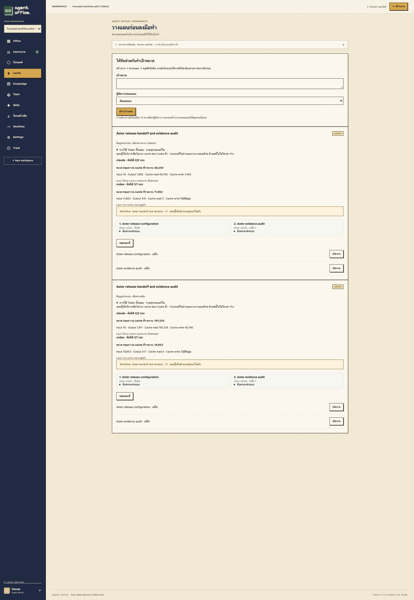

# Focused context workflow pilot — 2026-10-30

This opt-in prototype selects whole verified Knowledge documents relevant to the
current task and can use accepted `handoff.json` briefs with registered artifact
references. It retains all role/Skill instructions, task constraints, acceptance
criteria and attached evidence. Full-context behavior remains the default.

## Measured observations

Two executions of the same two-Agent workflow, each with a reviewer revision:
Codex producer → human acceptance gate → Claude reviewer → requested revision →
final acceptance. Six actual subscription CLI calls; all six downloaded JSON
artifacts passed exact equality checks. All attempts, including the initial review
that was sent back for changes, are included below.

| Metric | Existing compact context | Focused context | Observation |
|---|---:|---:|---|
| Reported input, including separately reported Claude cache categories | 211,377 | 70,056 | **66.86% lower** |
| Reported output | 2,228 | 2,120 | 4.85% lower |
| Input categories + output | 213,605 | 72,176 | **66.21% lower** |
| Summed provider execution time | 29.598 s | 38.043 s | **28.53% slower** |
| Exact artifact checks | 3 / 3 | 3 / 3 | unchanged acceptance in this sample |
| Knowledge sent per step | 20 documents | 2 documents | matching complete source records |

| Stage | Provider | Existing reported input | Focused reported input |
|---|---|---:|---:|
| Producer | Codex | 19,853 | 11,802 |
| Reviewer | Claude | 94,807 | 28,264 |
| Revision | Claude | 96,717 | 29,990 |

Claude input above sums uncached input, cache read and cache write, as separate
reported usage categories. Codex input already includes its cache reads: these
are not added again. The combined sum is usage accounting across all calls/tool
turns, not unique prompt length, API cost, or a Pro subscription quota percentage.
Summed execution time excludes human waiting and scheduler/UI overhead; it is
not end-to-end workflow wall time.

## Test data, acceptance and limitations

The controlled workspace held 20 generated documents: two complementary Aster
release/exception records and 18 unrelated facilities archives (about 50 KB total
app prompt before optimization). Both modes received the same knowledge dataset,
Agent instructions and workflow requirements. Required facts were supplied only
in the two source records, not disclosed in task instructions. Artifacts had to
preserve seven config values, a random source-only audit tag, significant spaces,
a false boolean, and then the requested revision value from the second document.
The downstream Agent used actual accepted files from the upstream run.

This deliberately tests a noisy Knowledge library and favors selective retrieval.
It is **one workflow per mode**, not a statistical benchmark or a representative
sample of all user tasks. Baseline ran first; provider load/cache state, default
model selection and tool trajectories were uncontrolled. Handoff wording differed
between model invocations. The observed reduction therefore describes this
sample, not a guaranteed improvement or a clean attribution to one component.
Tasks with little irrelevant context can save much less, or use more tokens.
Latency did not improve in this sample. The temporary workspace was archived.

Raw counters, source versions/checksums and per-stage records:
[focused-workflow-pilot.json](measurements/focused-workflow-pilot.json).

## Product behavior and guardrails

- New task: choose **ข้อมูลประกอบงาน → เลือก Knowledge ตามงาน (ทดลอง)**.
- Draft team plan: enable the focused Knowledge/handoff checkbox before approval.
- Task → **การใช้ Token** shows selected/candidate document counts, selection mode,
  source names/versions, byte reduction and actual provider counters.
- Team plan → **การใช้ Token ทั้งแผน** includes all recorded producer, reviewer,
  revision, failure and planner runs, separated by provider and coverage count.
- Knowledge → **อ้างอิงเป็นเอกสารบังคับในงาน** gives `[[knowledge:UUID]]` to paste
  into the task or workflow step. Pins have priority. Missing, unverified,
  cross-workspace or over-budget required references stop before any model call.
- Relevance is lexical matching, not semantic understanding. It scans 200 recent
  verified records plus explicitly pinned records, normally selects at most six
  whole documents, and falls back to the existing latest-20 behavior if no terms
  match. Up to 20 required records and a 60 KB rendered knowledge budget apply.
  Thai word segmentation, synonyms, and recall on ambiguous instructions remain
  limited; pin critical records rather than assuming retrieval is complete.
- No Skill, security instruction or acceptance requirement is removed.
- A brief is used only from a done dependency's current run, with registered
  `handoff.json` and referenced artifacts. Invalid/missing briefs fall back to the
  existing result. Provenance stores the source run IDs. Validity checks do not
  prove that a model-written brief preserves every important fact: review it.
- Example handoff schema:
  `{"summary":"...","decisions":["..."],"open_questions":[],"artifacts":["config.json"]}`.
  Have the producing task create this file with its normal deliverables; there is
  no separate summarization model call. File references remain scoped to the run.
- Claude can still inspect copied accepted files. Codex remains in its restricted
  declarative-file mode; it cannot autonomously request omitted Knowledge during
  a call. If evidence is insufficient, send the task back, change its context mode
  to full on the Token tab, then explicitly start again, or pin/attach evidence.
  No permissions were expanded for this optimization.
- All modes retain existing file/context limits. Full mode means the previous
  bounded context behavior, not every record in the database.

The next evaluation should use real anonymized workflows, multiple repetitions
with varied execution order, pinned model versions where possible, and adversarial
cases with relevant facts distributed across many records. Evaluate acceptance,
missed requirements, retries, latency and all reported usage categories together.

## Validation and UI evidence

Docker Compose integration tests: **73 passed**. Rust unit tests: **23 passed**.
Rendering tests: **3 passed**. Live exact artifact checks: **6 passed**. Regression
cases cover workspace isolation, unverified records, older records, required pins,
no-match fallback, invalid handoff references, missing required evidence with zero
model attempts, mode switching/conflicts, and missing telemetry in plan totals.
The required-document size guard is unit tested to prevent silent omission.

The plan usage endpoint was checked against all six raw run records, including
the rejected/revised review attempt. Browser verification confirmed the actual
plan totals, the optional create-task selector, and two selected sources out of
20 in the task detail. No browser console errors were reported. Selected source
versions/checksums matched the corresponding records in the baseline for every
stage. Main services remained running; the pilot workspace is recoverably archived.

