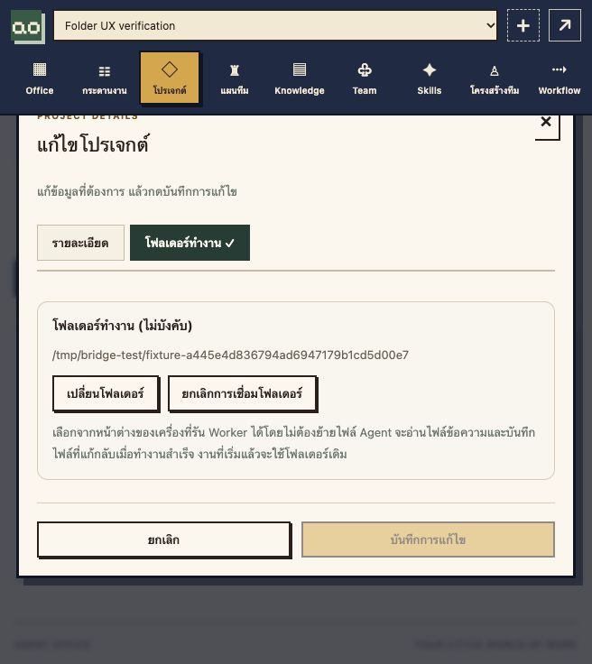

# Native project folders

Implemented 2026-10-30 for the local macOS + Docker Desktop installation.

## Use

Open Projects, create or edit a project, and switch to the **โฟลเดอร์ทำงาน** tab. **เลือกโฟลเดอร์บนเครื่อง** opens the host computer's native folder dialog. Select the existing project directory and save the project. The directory does not have to be inside Agent Office or a predefined projects directory. A mounted external drive can be selected if macOS permits access.

Create a task in that project and start it explicitly. The Worker imports a bounded text snapshot into `project/` inside the disposable run. Codex uses the existing declarative-file execution mode; Claude uses its existing restricted file tools. Successful runs synchronize changed files under `project/` back to the selected directory **before human review**. Files outside `project/` remain ordinary task artifacts. No shell execution, Docker socket, permission bypass, or paid API fallback is added.

Changing the project's selection affects newly started tasks. An already-started task retains its chosen folder. Clearing the selection returns new tasks to ordinary artifact storage. Editing a legacy project without sending the new field preserves its selection.



## Local bridge and installation

The native dialog cannot run inside a Linux container. A small Python/Tk bridge runs in the logged-in macOS session and listens only on `127.0.0.1:18089`. Docker Desktop reaches it through `host.docker.internal`. Install/update it from the repository with:

```sh
./tools/install-project-bridge.sh
docker compose up -d app worker
```

The installer copies the helper into `~/Library/Application Support/Agent Office/Project Bridge`, registers the LaunchAgent `local.agent-office.project-bridge`, and writes a private token to the helper state and `.env`. Tokens and selected-folder records must never be committed or shared. The native panel runs on the helper's main thread, not in an AppleScript subprocess. New/changed macOS privacy permissions can require selecting the directory again. Stop the helper with `launchctl bootout gui/$(id -u)/local.agent-office.project-bridge` to disable all host-folder operations; existing office data is retained.

This initial integration selects directories on the **computer running this bridge**, not a remote browser user's computer. Separate machines/personal Workers need their own local integration; this does not silently mount their files. Windows/Linux native pickers are not implemented.

## File boundaries

- The browser never supplies an arbitrary trusted host path. The native selection produces an opaque ID bound to the authenticated office user and bridge installation. Saved labels are revalidated server-side. Other users cannot reuse that ID.
- Root directory identity is checked on each operation. Directory descriptors and `O_NOFOLLOW` reject symlink traversal during reads and publication.
- Imports omit hidden files/directories, credential/key files, binary and oversized files, dependency/build directories. Limits: 200 UTF-8 text files, 2 MiB total, 256 KiB per file, bounded paths/depth. Select a narrower source directory for larger projects. Existing Codex context inclusion remains bounded to approximately 120 KB; omitted context is not automatically indexed.
- Publication accepts at most 20 changed files / 1 MiB. There is no deletion or rename synchronization. Unchanged files are not rewritten. Existing mode bits are retained.
- Every changed destination is compared with its import hash before any write begins. An observed conflicting human edit stops publication, keeps the task output as artifacts, and fails the run for review. Individual files use temporary-file replacement. This is not a transaction across multiple host files: a later disk/permission failure can leave a partially published set, and unrelated editors do not participate in a shared lock.
- Provider failure/cancellation does not publish. Existing project files are imported fresh for revisions instead of restoring stale copies over them.
- Host source directories and the bridge's private registration state are **not included in Office database/artifact backups**. After changing computers, select the local project folder again.

## Verification

- 93 HTTP integration tests passed in isolated Docker Compose, including four folder-specific cases: selected-folder validation and user isolation; persistence/legacy edits/unlink; task source import, write-back and frozen selection; conflict preservation and failed-run non-publication.
- Five local bridge filesystem tests passed: secret/binary/symlink filtering, path escapes and cross-user rejection, conflicting writes checked before mutation, executable-mode preservation, moved-directory rejection, restart persistence, replay rejection and file-count limits.
- Build passed 32 Rust tests and 13 frontend tests. Browser fixture checks created a project with a selected folder, reopened the saved selection, and verified the separate folder tab.
- The installed native helper responds to authenticated checks both on macOS and from Docker Desktop. Its actual folder dialog has **not yet been exercised**: automatic approval review rejected agent-initiated selection because it would grant persistent host-folder access. A user-operated native selection is pending; do not describe it as verified.
- No live Codex/Claude inference was called. File execution tests used the fixture Worker.
- Production was backed up before migration 0021. Fingerprints of 29 domain tables matched, excluding only the new nullable project column. Existing projects keep default storage.

Machine-readable evidence: [project-folder-proof.json](measurements/project-folder-proof.json).
