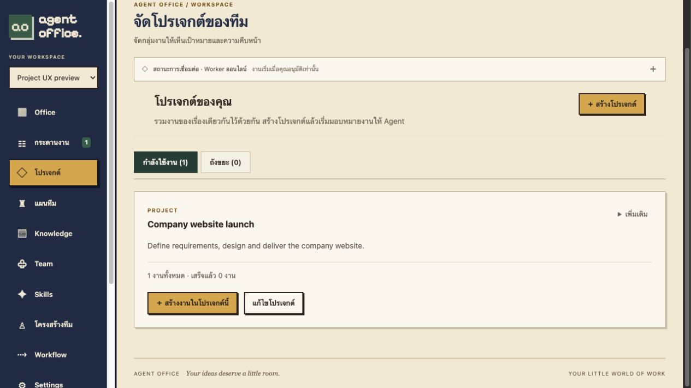

# Project UX verification

The project list previously rendered every project as an editable form with Save and Trash actions. It now renders read-only summary cards. Creation/editing use a separate dialog; unchanged edits cannot be submitted. The primary card action creates a task with that project preselected. Active projects and Trash have separate tabs; moving to Trash requires confirmation and restoration preserves associated tasks.

Project drafts retain their original optimistic version while background list polling continues. A successful create closes its dialog before refreshing the list, so a refresh failure does not invite duplicate creation. Task project selection is controlled so newly created options arriving asynchronously remain preselected.

Verified through Docker Compose and the actual browser:

- Create project, return to a read-only card and show next-step guidance.
- Create a task from the card with the correct project preselected and persisted, without starting AI.
- Edit with disabled unchanged save, cancel an edit without changing stored data, then save a real edit.
- Open the secondary menu, cancel a Trash confirmation, confirm a move, switch to Trash and restore.
- The existing task retained its project association after restoration.
- Reload persisted state, with no browser console errors observed.
- Two existing HTTP integration tests passed: project CRUD/task scope and viewer/membership controls. Frontend build and all 13 domain/rendering tests passed.

All browser fixtures were isolated from production. No schema or project API changes were needed. Proof: [project-ux-proof.json](measurements/project-ux-proof.json).

