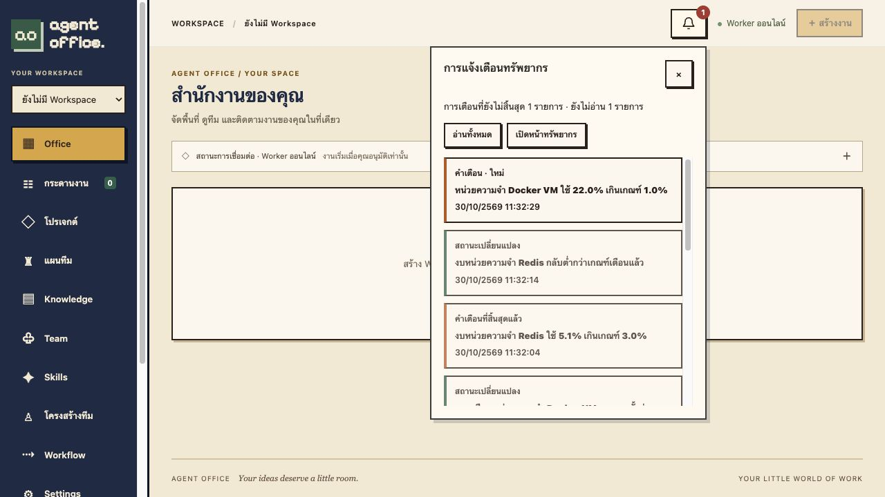

# Resource monitoring verification

Verified on 2026-10-30 through Docker Compose and the actual browser.

## Delivered

Super Admin can open Settings → ทรัพยากร to inspect Docker VM CPU/RAM, available filesystem capacity, Redis memory budget, PostgreSQL database size and app/worker/backup cgroup details. Samples update every five seconds. This measures Docker Linux VM and containers, not physical macOS resources. Shared filesystem capacity is not added twice. Without a container memory cap, available RAM means VM MemAvailable; a capped container displays remaining budget, not reserved RAM.

Seven independently enabled rules support thresholds 1–99%, sustained duration 5–300 seconds and recovery margin 1–20 percentage points. Defaults: VM CPU/RAM 85%, data disk 90%, Redis 85%, each worker RAM 90%, hold 15 seconds, recovery margin 5. Backup disk and app memory rules start disabled. Settings use optimistic version checks and persist in PostgreSQL.

The top-right bell shows unread and active warnings, with transient warning/recovery notifications. A sustained episode creates one warning; recovery creates one change event. Acknowledgements are per administrator and do not resolve an active condition. Missing metrics preserve active warnings, while stale data is visibly identified. No AI calls or Docker socket access are used.

## Evidence

- Complete Compose suite: 80 HTTP tests, 29 Rust unit tests and 3 rendering tests passed.
- Latest metric semantics/UI build: 29 Rust unit tests and 3 rendering tests passed again.
- Isolated live probe confirmed real proc/cgroup/filesystem measurements, per-admin read isolation, settings surviving app restart, stale sample indication, Redis outage while VM samples remain fresh, warning retention during missing data, and recovery after Redis returns.
- A temporary 4 MiB Redis value and deliberately low thresholds exercised real alerts without exhausting resources. Production thresholds remained at defaults.
- Actual browser verified the resource panel, persisted checkbox settings, unread badge, notification history, read-all action and settings navigation. Low-threshold screenshots use a separate disposable preview, not a production resource incident.
- Machine-readable proof: [resource-monitoring-proof.json](measurements/resource-monitoring-proof.json).

## Operational limits

Only Super Admin can view global metrics, change policies or acknowledge notifications. Notifications are local web notifications while the page is open; no email or operating-system push is configured. CPU is sampled rather than reserved capacity. PostgreSQL reports database size, not per-process RAM. No historical chart/time-series database is included. Latest 500 resolved/change records are retained; active warnings are retained regardless of age.

## Local build fallback

The runtime defaults to a pinned Debian image. If registry metadata is unavailable and a previously trusted Agent Office runtime image already exists locally, tag that existing image once as agent-office-runtime-cache:local and build with OFFICE_RUNTIME_BASE=agent-office-runtime-cache:local. This reuses only image layers, not live volumes or credentials. Fresh installations should use the default Debian base.
