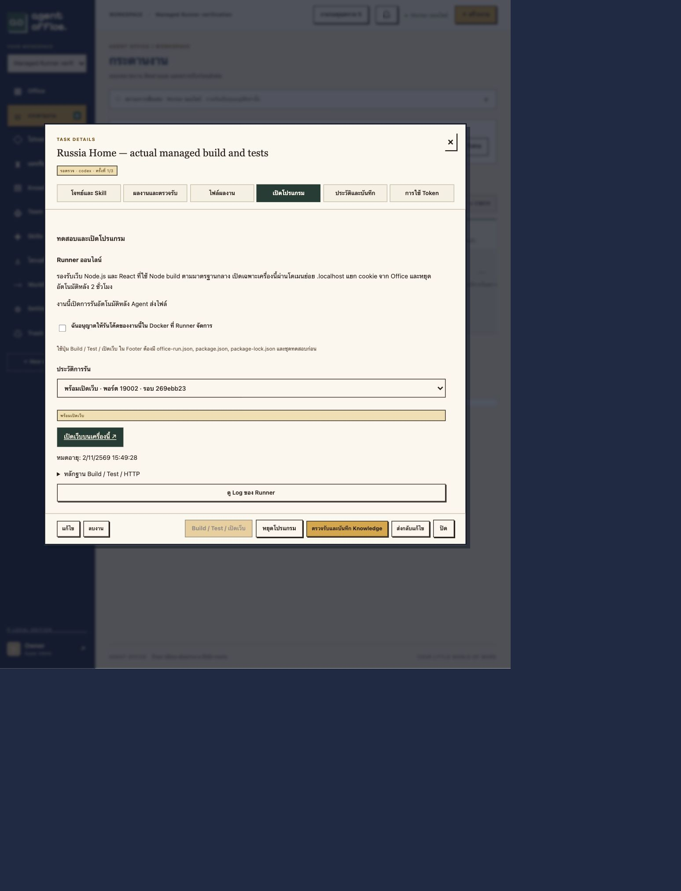
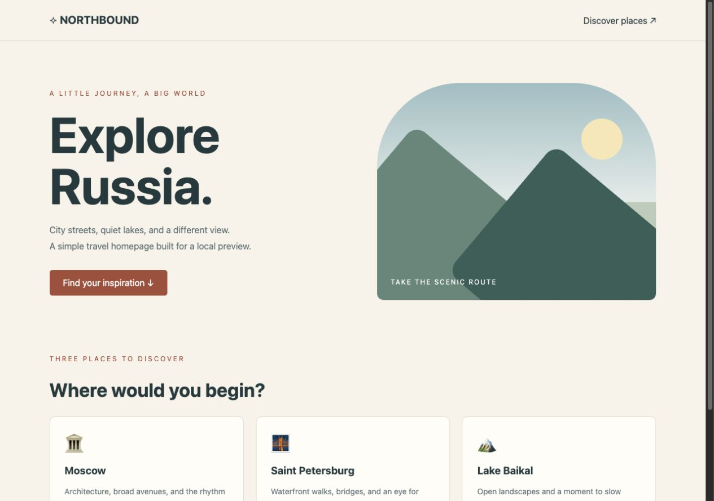
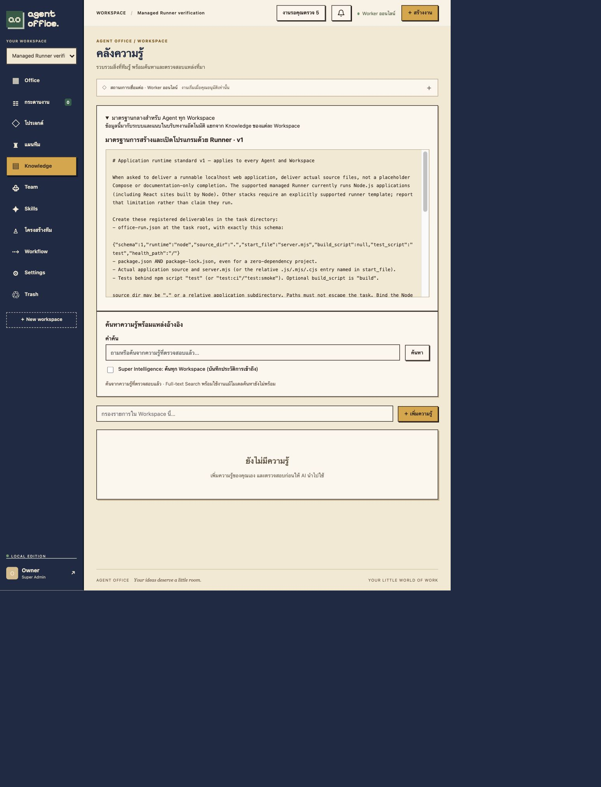

# Managed Runner and shared Agent standard

Verified on 2026-11-02. Implementation: Rust control API/Runner, React task controls, PostgreSQL job/evidence ledger. This does not install Docker inside the AI Worker. A separate trusted Runner uses the host Docker daemon to create sibling containers. No live Codex/Claude inference was used in these checks.

## Delivered behavior

- Task/Workflow opt-in automatically queues a registered source run for image build, dependency installation, optional production build, declared tests and an HTTP check. Existing tasks default to disabled and are not replayed.
- Manual launch, stop, paginated log and measured evidence are available in the task's **เปิดโปรแกรม** tab. Actions remain in the fixed modal footer.
- Unique `preview-<job>.localhost:19000–19099` URLs bind only to host loopback. Preview duration is two hours; stop, source changes, revoked membership, plan cancellation and interrupted executions trigger scoped cleanup.
- A file-backed shared standard is imported on startup, visible under Knowledge, frozen into new execution contexts for both providers and supplied as fallback to older contexts. Standard version/checksum are recorded; bump the version when changing a released contract.
- Reviewer Agents wait for runtime evidence for the exact source run. A failing runtime cannot be accepted merely because an Agent reviewer reports “pass”. A revision/retry includes the prior Runner evidence and log excerpt for the producer.

## Measured verification

| Check | Result |
|---|---|
| Docker Compose HTTP suite | 116 passed, 0 failed; 333.320 seconds |
| Rust release tests | 40 passed, 0 failed |
| Frontend tests and TypeScript/Vite build | 26 passed, 0 failed; build succeeded |
| Actual generated Node project | Docker image, bounded dependency install, optional build and three Node HTTP tests passed |
| Actual host HTTP | Russia Home returned HTTP 200 and rendered in the browser via its unique localhost URL |
| Build output persistence | A build-created file was read successfully by the final application |
| Cookie/host isolation | Office cookie removed before forwarding; application cookie retained; Office Set-Cookie rejected; Domain removed from application cookie; unexpected Host rejected |
| Runtime isolation | Non-root app, read-only root/source, dropped capabilities, memory cap, private network; no Docker socket or AI credentials in project containers |
| Negative cases | Unsupported privilege manifest, failing tests and failing HTTP health check rejected; failed jobs cleaned up without interrupting another ready preview |
| Revision feedback | Producer retry received the failed source run's test evidence |
| Workflow | Review waited for Runner; valid review saved Knowledge; failed runtime plus naive reviewer “pass” escalated and did not start the dependent task |
| Busy status | Heartbeat refreshed independently while the HTTP readiness operation was still active |
| Lifecycle | Explicit stop, plan cancellation, automatic expiry and Runner restart cleanup verified; another workspace's ready preview remained available |

The test project was **agent-office-runtime-preview**, database **office_test**, port **8107**, with fixture workers and no provider-auth mounts. The normal suite uses its separate disposable project. Neither suite seeds production workspaces. The opt-in Docker probe is [probe_runtime_runner.py](../tests/probe_runtime_runner.py); it refuses to run without explicit test opt-in and checks database/worker/mount identity before submitting work. It also exercises a Runner restart, so use it only on the named disposable project.

Two failures found during development were corrected and retested: Docker did not actually publish a port for an app on an internal-only network, so a controlled gateway now publishes loopback and readiness checks inspect actual bindings; the RAM-backed workspace needed a keeper container and explicit source initialization to preserve build output across sequential containers.

## Runtime scope

Version 1 supports Node applications and production React builds served by Node. It requires `office-run.json`, package metadata/lockfile v3, real source, a Node entry and a test script. It does not execute Agent-authored Compose/Dockerfiles or automatically provision child databases, arbitrary stacks, WebSockets or persistent application data. Passing a declared test command and HTTP check proves those measurements, not complete product/business correctness. The Russia Home screenshot is a fixture-based integration demonstration, not a claim that an AI generated or validated a production travel service.

Source input: at most 100 registered files/50MB and 10MB per file. Managed workspace: 512MB RAM-backed volume held for the preview lifetime. Installer/build: one CPU, 1GB; install uses locked npm registry dependencies with lifecycle hooks disabled, while build has no network. Application: one CPU, 512MB, private network, read-only source/root and limited temporary storage. Trusted gateway/workspace keeper: 128MB each. Capacity: three active jobs per source owner, six overall; builds execute serially. Previews are ephemeral and must be relaunched from source after moving hosts; they are not included as persistent application volumes in Office backups.

The Runner's Docker socket is a trusted host-level capability. Only the Runner service receives it; the model Worker and Office web service do not. Keep this installation on the Docker host controlled by the Office owner. Generated application source cannot grant itself host mounts, Docker access or extra Compose privileges through its manifest. Docker resource limits and networks are isolation measures, not a virtual machine boundary.

Design references: [Docker project names](https://docs.docker.com/compose/how-tos/project-name/), [Docker security](https://docs.docker.com/engine/security/), [official Docker CLI image](https://github.com/docker-library/docker/blob/master/29/cli/Dockerfile). The CLI image is pinned by digest in the repository Dockerfile.

## Screenshots








## Reproduce the isolated Docker probe

Requires an existing local `.env` from normal setup, Docker Compose and Python 3. These credentials are fixed disposable test credentials only. The override removes all Worker AI-auth mounts and uses the separate `office_test` database.

```sh
docker compose -p agent-office-runtime-preview -f compose.yaml -f compose.test.yaml -f compose.runtime-test.yaml --profile runtime-test up -d --build app worker runner
OFFICE_RUNTIME_TEST=isolated_preview python3 tests/probe_runtime_runner.py
docker compose -p agent-office-runtime-preview -f compose.yaml -f compose.test.yaml -f compose.runtime-test.yaml --profile runtime-test down --volumes
```

The probe stops previews owned by its fresh test Workspace in a `finally` block. If it is forcibly killed or Docker is unavailable, keep Runner running and stop leftover test previews through the task Runtime tab before removing this disposable project. Do not use global Docker prune commands. The standard API suite runs separately through `./test.sh` without a Docker socket or Runner service.


## Production deployment

Migration 25 was deployed after a private database/artifact backup. Fingerprints of fourteen existing domain tables (including users and provider connections) matched before/after migration. The shared standard has one row, no old task was replayed and no production Runtime job was created by the verification. Office health, existing account login, Workspace listing, shared-standard API and its Knowledge UI passed; Runner heartbeat was ready. All four service binaries matched. Only Runner has the Docker socket, and Runner has no provider-auth mounts. Disposable preview services and their generated jobs were cleaned after testing.

Machine-readable results: [runtime-runner-proof.json](measurements/runtime-runner-proof.json).
