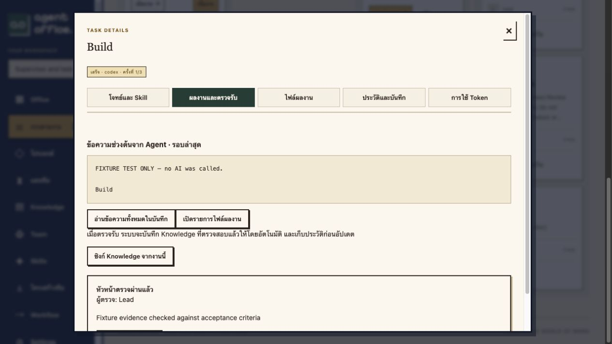
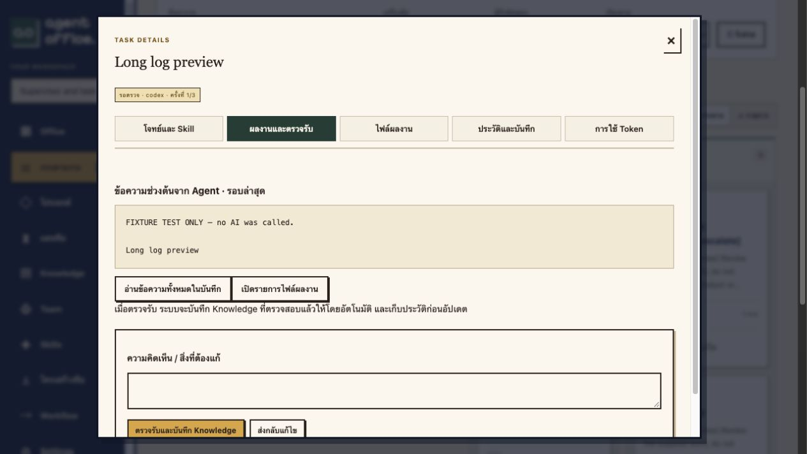
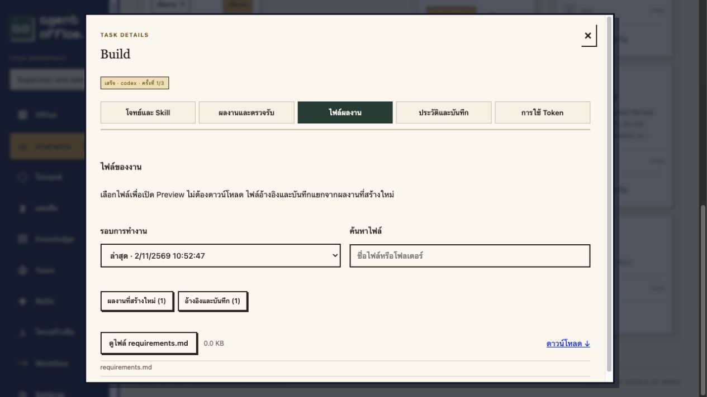

# Supervisor review and focused Task modal

Implemented and deployed 2026-11-02, migration 0024.

## Supervisor flow

Workflow steps select human review, the assigned agent's Org Chart manager, or an explicit independent agent. Existing steps default to human review; new editor drafts suggest the manager. Agent IDs must belong to the same Workspace, be enabled and differ from the producer. Manager identity is resolved when the plan is approved; final dependency leaves always require human acceptance regardless of the draft selection. The plan approval confirms subscription usage for production, review and bounded revision work. Reviewers use the plan creator's worker/account scope, with their own frozen role, skills and model choice.

The application scheduler creates an ordinary review task per source run, protected by a unique source-task/run identity and Workspace transaction lock. The worker receives copied source artifacts while the producer remains in review; accepting the producer is not a dependency of this special handoff. The review instruction and source brief are kept in frozen context rather than presenting an internal prompt as the review task's visible description. The review context has a 120 KB ceiling.

A registered, bounded `review-decision.json` must name the exact source run and return pass/revise/escalate, a reason, evidence paths and findings. Passing needs a supplied evidence path; revisions need findings. Invalid reports escalate. Passing changes the producer to done, records the decision and saves Knowledge atomically; review-job output itself does not become Knowledge. Revisions requeue the producer within its existing three-attempt cap. Missing manager/disabled reviewer/invalid Skill/failed review/cap exhaustion require owner intervention. Quota/auth waits remain visible on the linked review task. Permission and reviewer eligibility are checked again before applying a decision. Stale results cannot override an owner decision or a newer source run. Pausing maintenance stops scheduling and applying decisions.

This validates orchestration and evidence references, not the truth of every model judgment. Final human acceptance remains mandatory. The read-only delivery inventory never declares runtime verification based solely on task completion or file presence.

## Focused modal and bounded loading

The first view shows at most two paragraphs / 600 characters from the beginning of the latest agent response. It is an excerpt, not a generated summary. Files and history have separate tabs; full raw responses are not rendered in every run's disclosure panel. The modal is wider on desktop and its five tabs wrap on narrow screens.

The file browser selects a run, separates new deliverables from inherited `inputs/`, `references/` and raw `result.md`, searches relative paths, displays 12 items per page, and opens one existing authenticated Preview at a time. Full paths remain available without making every row a multi-line block.

The UI uses compact Workspace polling and task-detail requests. Compact polling omits task result bodies and frozen execution contexts; compact detail provides a 2,000-character latest excerpt, run metadata and artifact metadata. Legacy API responses remain available for existing integrations. Event history loads on opening, with 20-event cursor pages. A selected run's log loads on demand in approximately 20 KB windows; Unicode boundaries preserve text without overlap or loss. Previous windows replace the view rather than accumulating an unbounded document. Search explicitly applies only to the opened window. All new reads enforce authentication, Workspace access, task/run ownership and soft-delete state.

One 28 KB Unicode fixture produced a full detail response of **73,926 bytes** versus **5,659 bytes** in compact mode: **92.35% smaller** for that task-detail response. This is not a claim about all application bandwidth, token usage or every task. See [payload measurement](measurements/task-modal-payload-proof.json).

## Actual Purchase investigation

The existing seven tasks were marked accepted, but their deliverables describe unresolved requirements and blocked implementation. The developer supplied README, implementation notes and a placeholder Compose with `services: {}`. QA explicitly reported no working product or runtime test passing. Read-only Compose configuration returned **zero services**. The delivery inventory found **9 direct deliverables, zero source-code files and one empty Compose**; inherited copies and raw result mirrors were excluded. There is currently no Purchase application to launch.

Existing accepted records were preserved rather than silently reclassified or rerun. The Purchase Workflow template was updated to version 1: five internal steps use manager/expert review and two business/final checkpoints use human review. This changes future plans only. The goal and business process still need the owner's input before real implementation; this work does not invent requirements or claim a product was built. The current worker also does not supply a Docker runtime-test tool to its models; adding verified build/test execution is separate from declaring a result accepted.

## Verification and deployment

- Docker Compose full isolated suite: **110 HTTP integration tests passed**.
- Final focused suite: **13 HTTP tests passed** after the final review-context and compact-polling changes. These overlap the full suite.
- Rust: **37 passed**; frontend: **26 passed**; TypeScript/Vite production build passed.
- New cases cover manager pass + Knowledge + downstream release, final human gate, automatic revisions, three-attempt escalation, malformed reports, explicit escalation, missing manager, self/foreign reviewers, owner override during an active review, reviewer removal during review, quota reset/resumption, scoped delivery inventory, compact payloads, lossless Unicode windows, event cursors and authorized log/history reads.
- The first full run exposed a test-order dependency: installation-empty checks ran after a newly named test created Workspaces. Renaming the supervisor test restored the original empty-installation check order; the check itself was not weakened. An earlier duplicate imported TestCase was also removed from discovery. The final 110-case run passed from a fresh test database.
- Browser checks confirmed short default view, separate file/reference counts, on-click file Preview, unloaded logs until requested, bounded log windows, visible supervisor acceptance and working tab navigation.
- All new task executions used isolated fixture workers, `office_test`, and no provider-auth mounts. **No production AI runs or task acceptances were started by this verification.**

Before migration, production tasks and backups were idle. A private DB/artifact backup was created. Fingerprints across 13 business tables matched before/after migration after excluding only the six new default task-review fields. The intentional Workflow-template change happened afterward and retained the prior immutable version. Schema 24 is active, app/worker/backup binaries match, maintenance is unpaused and the original seven accepted tasks remain unchanged. See [production proof](measurements/supervisor-production-proof.json).
