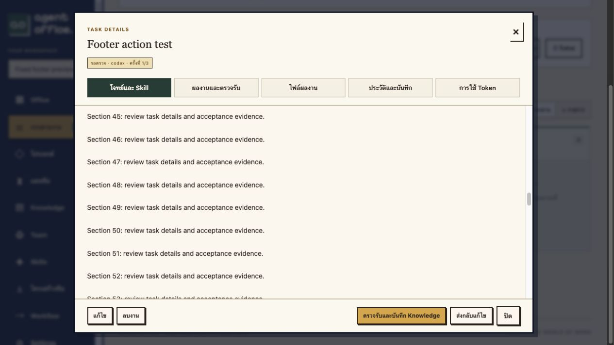

# Fixed Task modal actions

2026-11-02: Task actions now live in a non-scrolling footer, separate from the header and scrollable body. Edit/start/retry/cancel/delete and completed-task Knowledge sync follow their existing permissions and task state. Human review buttons target the body review form using the native `form` attribute, so feedback is preserved even when another tab is selected. Navigation and per-file preview controls remain beside the relevant content.

Browser verification used an isolated `office_test` database and a fixture worker without provider-auth mounts. No production task was started or accepted.

- Body scrollTop changed from 0 to 2160 while header top stayed 27px and footer top/bottom stayed 622.8125/693px.
- Submitted a revision from the footer while the brief tab was open; persisted feedback matched `FOOTER_REVISION_CHECK`.
- Started the second fixture attempt from the footer; it returned to review.
- Entered acceptance feedback, switched to the files tab and accepted through the footer; the task completed and automatic Knowledge creation succeeded.
- Production frontend build and 26 frontend tests passed. Only the production app container was refreshed; no database migration or worker restart was required.

