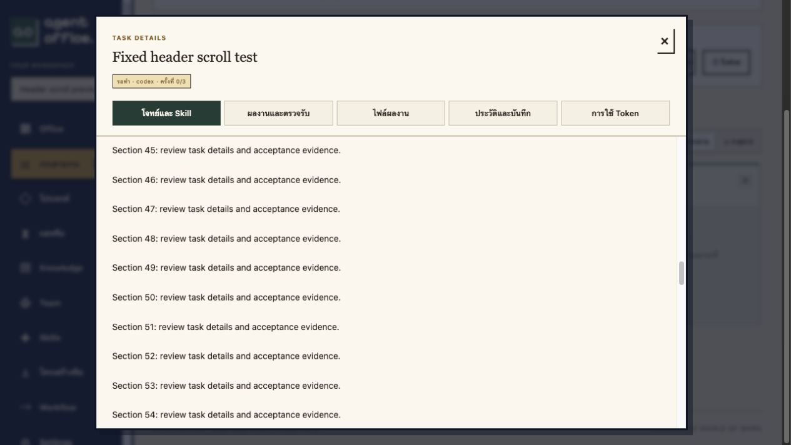

# Task modal fixed header

2026-11-02: task identity, status, navigation and the close control now live in a separate non-scrolling header. Only the body scrolls; changing task/tab returns the body to the top. The dialog has an accessible title and the close button has a descriptive label. Desktop and narrow-screen styles preserve the existing tab layout.

Verification used a disposable Docker Compose `office_test` database and a long queued task. No agent execution was requested. Browser measurements before/after scrolling:

| Measurement | Before | After |
|---|---:|---:|
| Body scrollTop | 0 | 2160 |
| Header top | 27 | 27 |
| Close control top | 45 | 45 |
| Outer modal scrollTop | 0 | 0 |

The close control successfully dismissed the modal after scrolling. TypeScript/Vite production build and 26 frontend tests passed. Only the production app container was refreshed; no schema, worker or user-data change was needed.

