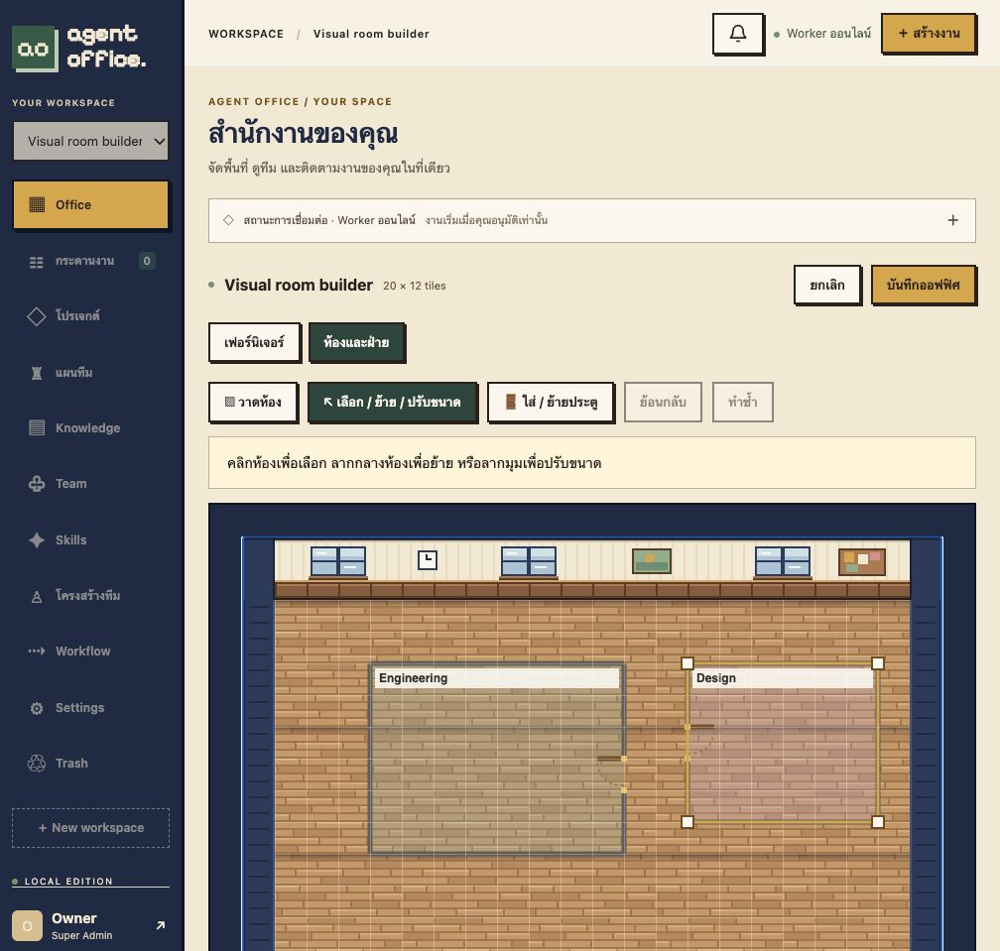

# Visual room builder verification

Verified on 2026-10-30 through Docker Compose and the actual browser.

The room geometry form has been replaced by an interactive overlay on the existing Office map. Users drag a rectangular boundary, release, then click a wall to place a door. The application generates a name, and blocks office saving until the new room has an explicitly placed valid door. Selecting an existing room exposes corner handles for resizing; dragging its interior moves it. The door tool relocates its single doorway. Only name and optional department remain as text fields. Room coordinates, dimensions, door side and offset are no longer user inputs.

Geometry remains in the existing layout JSON, so this release needs no migration and does not alter existing rooms, furniture or Agent assignments. The same server/client validation still enforces map bounds, minimum 3 × 3 rooms, corridors, unobstructed doorways and no furniture crossing walls. Invalid gestures preserve the existing layout. Undo/redo applies to room changes within the current editing session; cancelling office editing restores the saved layout.

## Evidence

- 13 frontend domain/rendering tests passed, including reverse-direction drags, moves, fixed opposite-corner resizing, wall selection and floating-point boundary snapping, plus invalid doorway/geometry validation.
- All 6 room HTTP integration tests passed against the preview image, covering persistence, authorization, optimistic conflicts, deleted-room fallback and invalid layouts.
- Actual browser created two rooms by dragging and clicking wall positions. The save button was disabled while a new room awaited its door. Moving, resizing, door relocation, undo and redo were exercised.
- A browser overlap attempt produced the corridor validation error and retained the existing two-room layout.
- Persisted room geometry matched the operations: Engineering at (3,2), 8 × 6, east doorway offset 3; Design at (13,2), 6 × 5, west doorway offset 2. These are internal test assertions, not fields users must enter.
- The saved layout survived application restart and browser reload. No browser console errors were observed. No AI inference was required. All acceptance fixtures were isolated from production.

Machine-readable evidence: [visual-room-builder-proof.json](measurements/visual-room-builder-proof.json).

This release supports rectangular rooms with one door each, not arbitrary polygonal walls or multiple floors. Geometry tools use pointer/touch gestures. Name/department edits are optional; the generated room name supports creation without typing anything. Existing room purpose text is retained internally when manipulating an old room, but its input is removed from the builder.
