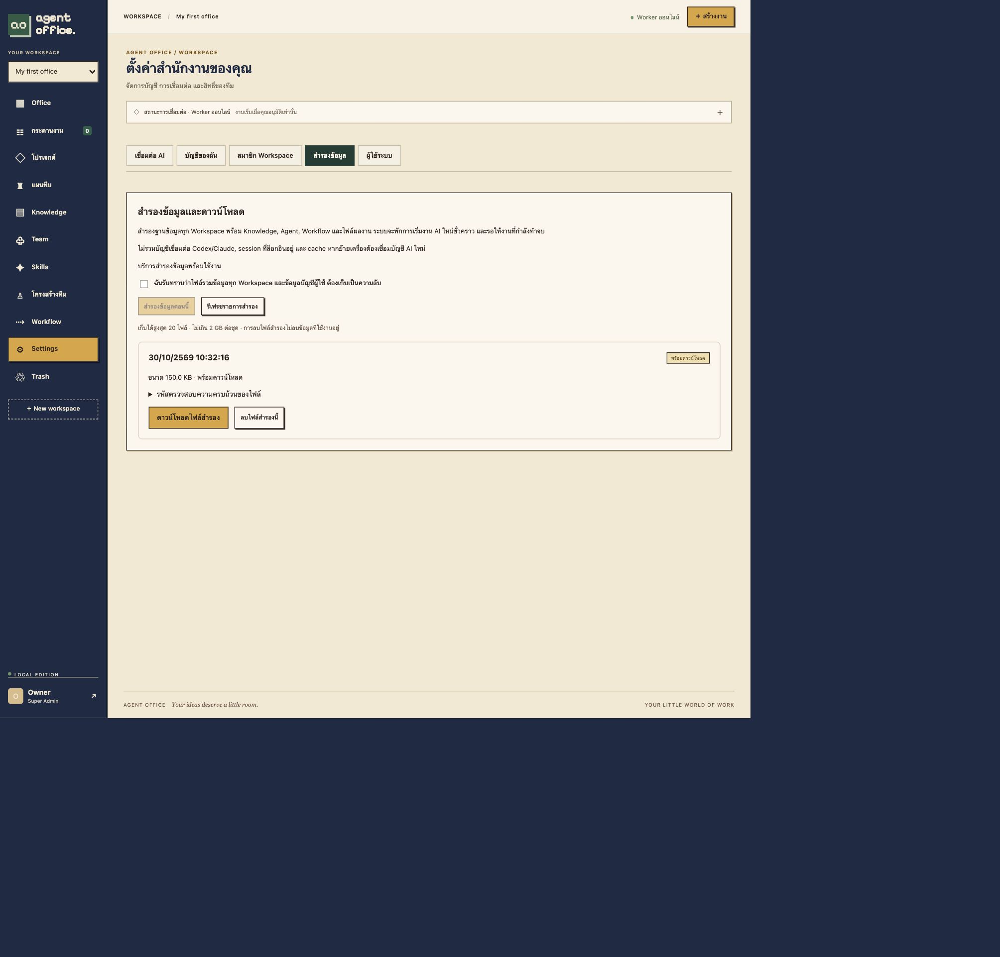

# Web backup and recovery validation — 2026-10-30

Super Admin can use Settings → สำรองข้อมูล to create, monitor, cancel, download,
and delete stored backups. The confirmation checkbox explains the global scope
and private account/workspace contents. Other users cannot list or retrieve a
backup even if they know its UUID. Settings tabs keep this separate from AI login,
account settings, workspace membership and user administration.

The trusted backup service uses a read-only artifacts mount and a separate writable
backup volume. The web app mounts backup files read-only. Neither receives a
Docker socket or additional model permissions for this feature; the backup service
has no AI credential mounts. Database connection secrets go through environment
variables, not command arguments or logs. Manual backups do not invoke AI.

## Data and consistency

The coordinator pauses new AI claims, waits for live leased work to finish, and
exports a PostgreSQL repeatable-read snapshot. Both pg_dump and the registered
artifact list use that snapshot. It archives only registered regular files and
their parent directories, rejects traversal/symlinks/missing or changed-size files,
and preserves POSIX ACLs. Unregistered files are excluded. No directory recursion
or shell interpolation is used in archive commands. Immutable completed artifacts
are expected, as in the existing task execution design.

Only complete, size-checked, checksummed bundles become downloadable. The file is
published by atomic rename; downloads require Super Admin authentication, disable
caching and stream in bounded chunks. In-progress/failed/cancelled/deleting jobs
cannot be downloaded. Creation is serialized and limited to one job at a time,
20 ready files and 2 GB per bundle. These limits do not promise backup capability
for larger installations; each subprocess also has a ten-minute timeout.

The bundle includes office.dump, artifacts.tar.gz, manifest.json, SHA256SUMS and
post-restore.sql. It excludes active sessions, provider login codes, worker binding
rows, worker heartbeat rows, backup job/service history, AI credential volumes,
.env and Redis cache. User accounts/password hashes and private workspace content
are intentionally included: downloaded files must be kept confidential.

After restoring to an isolated destination, post-restore.sql releases the saved
pause, disables automatic execution requests and AI connections, and marks running
tasks interrupted. Users/Workers must reconnect before explicit execution. The
existing restore script supports this file and stops the destination backup helper
while restoring. This change adds backup/download controls, not a destructive
restore button on the live web application.

Cancellation/failure releases only the pause owned by that backup. A pre-existing
maintenance pause is preserved. A persistent pause/job owner allows safe recovery
following a stopped helper. The admin recovery endpoint takes the coordinator
lock and refuses to run while the helper is active. File deletion is confirmed in
the UI and only reported deleted after removing the stored files.

## Validation evidence

The isolated recovery probe downloaded a real bundle from the HTTP endpoint,
verified its outer SHA-256 and every inner checksum, restored PostgreSQL into a
separate scratch database, applied post-restore.sql, and restored artifacts into a
new disposable volume. It verified:

- Knowledge marker, Agent birth date and personality, Skills, Workflow, all 39
  master records, and attachment bytes survived restoration.
- Registered result.md matched the original checksum and remained readable both
  by app UID 10001 and explicit test ACL UID 20001.
- An unregistered source file did not appear in the archive.
- Sessions, login codes, worker bindings/heartbeats and backup history were empty
  in the restored database; AI connections/execution requests were disabled.
- A successful backup preserved an existing maintenance pause.
- A missing registered artifact failed closed and released the helper's pause.
- Stopping the helper during a wait allowed admin recovery to release its pause
  without cancelling the original AI fixture task.

All model execution in the probe used explicit fixture workers: **zero real AI
calls**. The source was a disposable preview, never the user's live database.
[Machine-readable recovery evidence](measurements/web-backup-recovery.json).

## Final checks

Docker Compose suite: **76 passed**. Rust unit tests: **24 passed**. Rendering
checks: **3 passed**. The live Settings screen created a complete 153,600-byte
backup, and its download link saved the .tar into the local Downloads folder.
The downloaded bytes matched the stored outer SHA-256, and every inner checksum
also matched. No browser console errors were reported. The complete backup remains
available from the web screen; no production backup file was deleted in UI tests.

