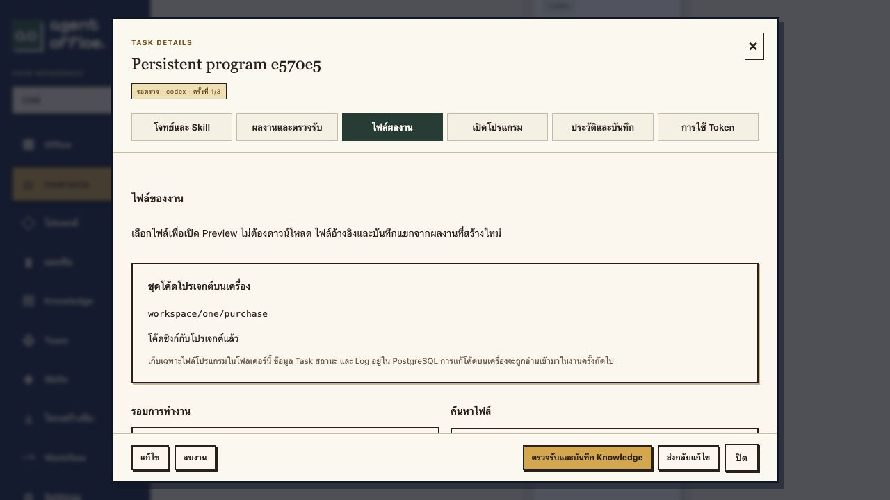

# Persistent program code, separate from Tasks

Program files are one persistent working tree per Project, for example:

```text
/Users/hall/Desktop/agent office/workspace/one/
└── purchase/
    ├── src/
    ├── package.json
    ├── package-lock.json
    └── office-run.json
```

Without a selected Project, the program tree is `workspace/<workspace>/app/`. Task descriptions, assignments, status, decisions and logs remain in PostgreSQL. Task documents/artifact evidence use the existing internal artifact store; they are not copied into host task/run folders. The former `tasks/<id>/runs/<id>/` host-export design is retired. Historical rows and standards remain in PostgreSQL, marked retired where applicable, and the old generated host folders are archived to a private Backup before deployment rather than deleted.

## How Agents work with the program

The trusted Rust code bridge prepares the current Project source under `code/` in the Agent's isolated execution directory. Models read existing code and write program files under `code/`. The bridge synchronizes those edits into the same persistent host Project during execution and flushes the final changes when execution ends. New tasks receive that Project source, including safe manual host edits, so each task continues the program instead of creating a new source snapshot as its destination.

Task reports, requirements and review documents stay outside `code/`. Only the explicit program working view is synchronized. The system checks the current host file against the baseline for the task; a conflicting host/other-Agent edit is preserved and surfaced as a conflict. A conflicted or not-yet-flushed program cannot be manually accepted as completed. Internal Agent review waits for synchronization and escalates conflicts for resolution.

Source/artifact history can still be viewed from Task details, but **โค้ดโปรเจกต์บนเครื่อง** in the Files tab is the current shared Project path, not a path for the selected historical run. The Office header shows the Workspace root.

## Isolation and names

- Models never receive a mount of all host Workspaces. The main trusted Worker receives only a protected temporary code handoff volume. The trusted Runner keeps its original task-history mount read-only; it writes the new handoff area and the managed host code folder. The Worker initializes its own existing task directory from the handoff before starting the model.
- No new mount is added to existing personal Workers without separate authorization. A Worker without an authorized code channel keeps its previous Task behavior and reports that persistent Project code is unavailable.
- Ownership markers bind a host directory to its Workspace/Project. Unknown nonempty folders and symlinks are refused. Account secrets, Git metadata, node_modules, reference trees and internal control files are excluded.
- Workspace names remain globally unique, including case, whitespace normalization, Unicode equivalents and Trash reservations. Existing directory keys remain stable on display-name changes.
- Projects with identical display names keep distinct folder keys, using an ID suffix where needed. Selecting a Project determines which source tree the task edits.

The code bridge is bounded to 100 files, 50MB of source per view and 10MB per file. It does not expand the stacks supported by the managed Runtime Runner. The Runtime standard now uses `code/office-run.json`; the controlled Node Runner also accepts legacy root manifests for existing artifacts.

Run `./setup.sh` when installing/upgrading to prepare host ownership without changing credentials. Back up `workspace/` as working source, particularly manual edits that have not become registered artifacts. Generated user programs remain excluded from the Office repository and Docker build context.

## Verification

`tests/test_workspace_code.py` checks shared Project source across tasks, importing manual host edits, live synchronization during a running Agent fixture, conflict preservation, separating Task reports, folder/symlink ownership, Workspace name collisions and cross-Workspace access. These use fixture workers with no live model inference.

The earlier snapshot-export probe/report describes the retired implementation and is retained as historical evidence, not as the current usage guide.

### Verified results (2026-11-02)

- Full API suite: 127 passed. Latest focused Project code suite: 11 passed. Rust: 43 passed; frontend: 26 passed.
- A disposable fixture Worker wrote an actual Node program under `code/`; managed Docker build, tests and HTTP checks passed. A later task reused the same Project source and read a manual host edit.
- Live updates appeared while the task was running; a host edit conflict preserved the host file and blocked acceptance with HTTP 409. Task reports did not appear in the host program folder.
- Production migration 27 preserved fingerprints of 14 domain tables. Seven historical export rows were retained and their old generated host folders archived. No existing task was replayed and no live model call was used in these checks.

[Machine-readable checks](project-code-working-tree-proof.json). `tests/probe_project_code.py` is an opt-in Docker proof for a **fresh disposable** `agent-office-code-preview` fixture stack on port 8110; it requires `OFFICE_PROJECT_CODE_TEST=isolated_preview` and checks the test database, fixture mode and absence of account mounts before writing. Do not run against production.


