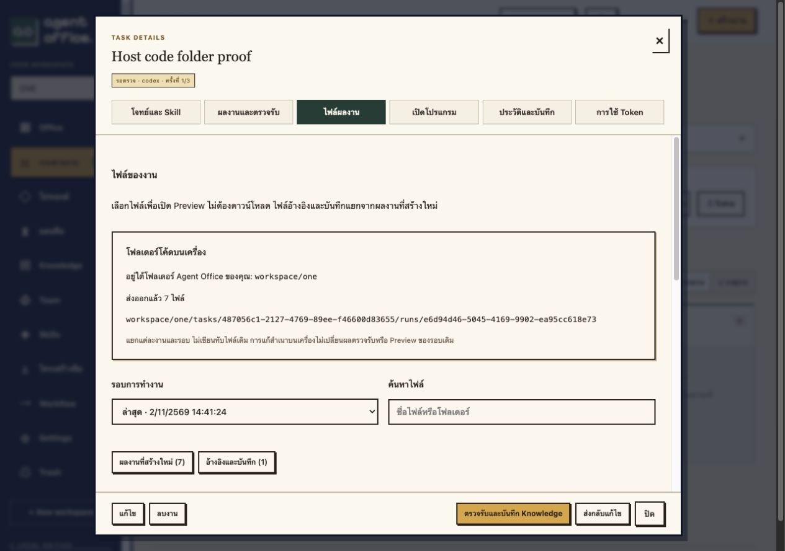

# Workspace code folders

Office exports registered deliverables to a host folder under the Agent Office installation. For this installation, Workspace `ONE` maps to `/Users/hall/Desktop/agent office/workspace/one`.

```text
agent office/
└── workspace/
    └── one/
        ├── .office-workspace.json
        └── tasks/
            └── <task-id>/
                └── runs/
                    └── <run-id>/
                        ├── .office-export.json
                        ├── server.mjs
                        ├── package.json
                        ├── package-lock.json
                        ├── office-run.json
                        └── ...
```

The folder is created automatically, including for an empty Workspace. After a successful Agent run registers its deliverables, the trusted export service copies them into a separate snapshot for that task/run, preserving relative source paths. This supports source files of any language; it does not expand which languages the managed Runtime Runner can execute. It also exports documents/assets delivered by that task. The registered-artifact limits remain 100 files/50MB per run and 10MB per file.

Open **Task → ไฟล์ผลงาน → โฟลเดอร์โค้ดบนเครื่อง** to see the folder and actual export status for the selected run. The Office header also shows the Workspace code directory. Newly produced files are exported after the run finishes, rather than streamed live while a model is writing.

## Names and existing files

- Workspace display names are unique across all users, checked in PostgreSQL, including concurrent create/rename requests. Leading/trailing spaces, character case and equivalent Unicode normalization cannot bypass this check.
- The folder key is lowercased and characters unsuitable for a folder/whitespace become hyphens. Different names resolving to the same folder key are also rejected.
- Display-name changes keep the original directory key stable. The UI shows that stable path. Names in Trash and previously allocated directory keys remain reserved to prevent another Workspace taking over existing output.
- An ownership marker ties each managed folder to its Workspace ID. A nonempty pre-existing host folder without that marker, a marker for another Workspace, or a symlink causes an export error; Office does not overwrite those files.
- Each task/run has its own folder. Office does not automatically merge multiple agents' outputs into a single flattened project, overwrite an older snapshot, delete exported code when a task/Workspace is trashed, or execute exported host files.

## Model access, edits and backup

Only the trusted Runner receives the fixed `./workspace:/workspace` bind mount. Model Workers and their AI credentials remain separate; models still write inside their own task directories. Exported files are limited to registered deliverables, with reference/input trees, account/config secrets, Git metadata, node_modules and result logs excluded. Ordinary safe source/config files are retained. Source/destination symlinks are rejected, file sizes are bounded, and a completed folder is published atomically. `.office-export.json` records names, sizes and SHA-256 hashes.

This is an outgoing snapshot, not a two-way filesystem sync. Editing a host copy does not modify the registered run, its Knowledge, its review decision or its measured Runner evidence. A later revision exports a new run. If an already published snapshot was edited, reconciliation reports the mismatch instead of overwriting that edit.

Existing database/artifact backups can regenerate missing exported snapshots after moving/restoring Office. When an output folder was published but its database acknowledgement was lost, matching ownership/hash metadata lets the exporter recover without rewriting files. **Back up the `workspace/` folder separately if you need to preserve manual host edits or files added outside Agent runs.** Exported programs are excluded from Office's Git repository and Docker build context.

Run `./setup.sh` when installing/upgrading to record the local owner UID/GID and create the host root without changing existing credentials. These IDs only control ownership of exported files. Keep `workspace/` inside the installation folder; no persistent host helper or arbitrary-folder browser is added.

An installation with legacy duplicate Workspace names must resolve them before migration 26 can create the unique index. Existing aliases resolving to the same directory key receive separate ID-suffixed keys during migration, with active Workspaces prioritized. No display name or existing business record is renamed automatically.

## Verification

`tests/test_workspace_code.py` covers concurrent duplicates, directory aliases, rename conflicts and stable paths, Trash reservation, actual code export, old host edits surviving a revision, foreign existing folders, symlink rejection and cross-workspace access. `tests/probe_workspace_code.py` also compares every exported file byte-for-byte with its registered artifact, checks case/Unicode duplicates, recovers a missing acknowledgement, regenerates a missing snapshot and refuses to overwrite a host edit. All use fixture workers; no live AI inference is required.

For the host-bind probe, use a **fresh disposable** `agent-office-code-preview` project and a fresh `/private/tmp/office-code-host-proof` directory, then:

```sh
mkdir -p /private/tmp/office-code-host-proof
docker compose -p agent-office-code-preview -f compose.yaml -f compose.test.yaml -f compose.code-test.yaml --profile test up -d --build app worker export-test
OFFICE_CODE_TEST=isolated_preview python3 tests/probe_workspace_code.py
docker compose -p agent-office-code-preview -f compose.yaml -f compose.test.yaml -f compose.code-test.yaml --profile test run --rm --no-deps tests python -m unittest -v test_workspace_code
docker compose -p agent-office-code-preview -f compose.yaml -f compose.test.yaml -f compose.code-test.yaml --profile test down --volumes
```

The probe refuses to submit work unless the explicitly named containers use `office_test`, fixture mode, no AI-auth mounts and no Docker socket. It writes only under the disposable `/private/tmp/office-code-host-proof` bind mount. The ordinary `./test.sh` suite instead uses an ephemeral named volume and never writes to production `workspace/`.




## Measured results and deployment (2026-11-02)

- Full Docker Compose API suite: **125 passed**, 0 failed, 314.966 seconds. The nine export-specific API tests also passed separately against the latest host-bind environment.
- Rust release tests: **42 passed**. Frontend tests: **26 passed**, with TypeScript/Vite build successful.
- Actual host files matched all seven registered Node fixture deliverables byte-for-byte. Missing acknowledgement recovery, missing-folder regeneration, NFC/case conflicts and preservation of manual host edits passed. No live AI inference was used.
- The first full suite exposed an existing completion/history race: a task became reviewable before its final event was committed. The Worker now commits task status, run/artifact registration and terminal event in the same transaction; its history test explicitly checks that contract. The full suite above passed after that fix.
- Migration 26 was deployed after a private database/artifact backup. Fourteen existing domain-table fingerprints matched, excluding only the new directory-key column. Accounts, provider connections and existing task data were preserved, with no task replay.
- Production `workspace/one` contains seven exported historical runs and nine deliverable files. Every exported file matched its recorded checksum and is owned by the local host user. Only the trusted Runner has the workspace mount; model Workers do not. All four service binaries matched and Office health passed.

[Machine-readable verification](measurements/workspace-code-folders-proof.json).
